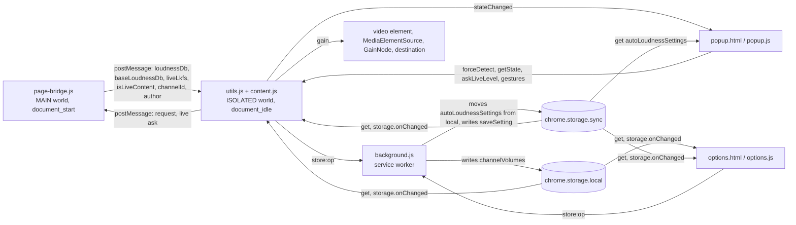

# yt-channel-volume

Chrome extension (MV3) that shows a YouTube video's Content Loudness and saves and applies a per-channel gain on a user gesture.
With Auto-apply LUFS on, a live stream on air is played at the level the player's stats for nerds name for it (`live.`), asked for again every 10 s; a level that turns the gain down plays at once, and one that turns it up raises it by no more than 1.5 dB for every 30 s. Where no level is named, a saved gain is applied. The first live gain a page plays for a stream goes no higher than 3 dB over the saved live gain (the start cap), and a level that rose 1 dB or more since the one before is played as if 3 dB louder (the rise cut).
It leaves the YouTube player's volume slider alone and controls the level with a Web Audio API GainNode.
The settings that belong to no channel live in `chrome.storage.sync`, which Chrome syncs with every Chrome the user is signed in to where the user has turned on Chrome sync, and which behaves like `chrome.storage.local` where it is off; the channels stay in `chrome.storage.local`.

## Architecture



**page-bridge.js (MAIN world content script, document_start)**

- Object.defineProperty: hooks the assignment of ytInitialPlayerResponse
- Fetch hook: intercepts /youtubei/v1/player responses whose videoDetails name the video the URL does (covers SPA navigation)
- unhandledrejection listener: prevents the default only for the `TypeError: Failed to fetch` that a request made through the fetch hook on a watch page failed with
- extractFromYtPlayer: reads from ytd-watch-flexy / movie_player (covers SPA navigation)
- isLiveContent: extracts videoDetails.isLiveContent
- Playing level: every answer to content.js (define / fetch / request / audio-change) takes the `cont.` level of movie_player.getStatsForNerds() less the response's loudnessTargetLkfs; until the player names it, the player is looked at again every 250 ms (source `playing`)
- Live level: every answer also carries the `live.` level of the same line as `liveLkfs` (an absolute level, null where the line names none), and naming it ends the looking as the `cont.` level does
- Stable volume: where the playing level is not there, with the player's DRC setting on, the level is the `isDrc` adaptive format's loudnessDb
- onPlaybackAudioChange listener on movie_player: answers again when the rendition changes (source `audio-change`)
- Live level ask: `__yt_channel_volume_live_ask__` is answered with `__yt_channel_volume_live__` alone — `{ videoId, liveLkfs }`, the `live.` level the volume line names now (null where it names none) — and no full answer, on a watch page only
- postMessage → relays loudnessDb (the rendition played) + baseLoudnessDb (the plain rendition `audioConfig` describes) + liveLkfs (the live level the player names) + isLiveContent + channelId + author to content.js

**background.js (service worker)**

- importScripts('core/common.js', 'utils.js')
- the only context that writes channelVolumes, on a `store:<op>` message (saveChannelGain / saveChannelAutoApply / deleteChannel / clearChannels / adoptHandleEntry / migrateLegacyGains)
- the only context that writes the settings, on `store:saveSetting` (`SETTINGS_WRITES`), queued with the move on `queueSettingsWrite()`
- at every start, `moveSettingsToSync()` moves settings saved in local before they synced (see "Channel-independent settings sync")

**utils.js → content.js (ISOLATED world content scripts, document_idle)**

- postMessage listener: receives loudnessDb, baseLoudnessDb and liveLkfs from page-bridge.js. An answer naming a video other than the one the URL names (`?v=`, the `/live/` path segment, or on a channel's live URL the video its canonical link names) was queued for a page this tab has left, and is dropped; where the URL names no video the answer is taken as it comes. A field of a type the bridge does not send is not taken (see "A bridge message is taken field by field")
- requestLoudnessWithRetry: asks page-bridge.js again on demand
- Live level read for the popup: `askLiveLevel` from the popup posts the live ask, and a `__yt_channel_volume_live__` answer for the video the URL names that carries a finite level replaces the level in hand (`readLiveLkfs`) and notifies the popup. Auto's level (`currentLiveLkfs`) is a separate one that only a full answer sets (and sets both): the paths that re-apply Auto between full answers — `applyPreferredGain`, `evaluateLiveSave`, cross-tab sync, a settings change — read Auto's, so a read alone never moves what Auto plays or stores. The popup's state (`liveLkfs`, `contentLufs`), the manual lock, "Apply to channel" and turning Auto on read the level in hand; turning Auto on with a live level makes it Auto's. An answer with no level leaves the one in hand
- Gain calculation (manual apply / per-channel automatic LUFS apply. Both store into the same per-type gain, held against the base rendition)
  - contentLUFS = -14 + loudnessDb (YouTube reference = -14 LUFS)
  - compensationDb = targetLUFS - contentLUFS
  - gain = 10^(compensationDb / 20), clamped `[0, 6]`, NaN/Inf → 1.0
  - With a live level (`liveLkfs`) it goes first, taken as it stands: gain = 10^((targetLUFS - liveLkfs) / 20) (`calcLiveGain`), clamped `[0, 6]`, NaN/Inf → 1.0, with no -14 reference and no normalization (see "A live stream's own level")
- Live follow: while Auto is on for the type being watched and the stream is on air or names a live level, the bridge is asked again every 10 s (`syncLiveFollow`)
- Live raise limit: a live gain below the one playing plays at once; one above it plays no more than 1.5 dB higher for every 30 s since a live level last set the gain, or since one came back after a message that named none (`liveGainToPlay`). The first live gain for a video in the page once its channel is named for it goes no higher than 3 dB over the saved live gain (the start cap); one over a gain of 0, a new Target LUFS and turning Auto on play as they stand. A level that rose 1 dB or more over the one the bridge named before it is played as if 3 dB louder (the rise cut)
- Web Audio API: `<video>` → MediaElementSource → GainNode → destination (connected lazily)
- Gain overlay: shows the gain value in .ytp-volume-area (switched on and off in the options)
- Channel detection (UC only): canonical / `#owner a[href*="/channel/"]` / meta tag → page-bridge channelId (UC form). The page is read for the document's first video alone; after an SPA navigation the channel comes from the bridge
  - `@handle` links go stale during SPA navigation and are rejected outright. Waits for the bridge when the DOM carries no UC
  - Display name: page-bridge author (videoDetails.author, authoritative source) → DOM (`#owner #channel-name a`, fallback)
- Navigation: triggerApply (async mutex) runs applyVideoVolume directly (no debounce)
  - Triggers: yt-navigate-finish, popstate, visibilitychange, MutationObserver, first load
  - Observer: watches video element changes + URL video ID changes alone (a null guard suppresses the first fire)
  - `_applyRunning` mutex prevents concurrent runs. forceDetect also goes through triggerApply
  - Clears currentChannel when the videoId changes, so stale channel information does not leak
- videoType: 'live' (stream/archive) or 'video' (video/Shorts) hold separate gains
- Cross-tab sync: chrome.storage.onChanged delivers channelVolumes changes and the gain for the current channel × videoType is applied at once (no polling, self-tab dedup by currentGain comparison), or once the gesture ends while the popup's slider previews a gain for the same state
- Storage
  - autoLoudnessSettings (`chrome.storage.sync`, read through `readSettings()`): `{ targetLufs, displayUnit, showGainOverlay, autoApplyLoudnessVideoDefault, autoApplyLoudnessLiveDefault }`
  - channelVolumes (`chrome.storage.local`, as is everything below): `{ [channelId]: { name, gainLive, gainVideo, gainLivePlain, gainVideoPlain, autoApplyLoudnessLive, autoApplyLoudnessVideo, url } }`
  - unifiedGains: the migration-done marker (top-level key)

**core/common.js (from channel-volume-core, loaded ahead of utils.js wherever utils.js loads)**

- Settings: SETTINGS_KEY, DEFAULT_TARGET_LUFS, MIN_TARGET_LUFS / MAX_TARGET_LUFS (-30, -6)
- Settings read: readSettings, isStoredSettingsObject (the settings object in sync, the copy in local while sync holds none, sync again where local comes back empty, and `{}` where neither area holds a settings object)
- Settings move and queue: moveSettingsToSync (settings an earlier version kept in local, to sync where sync holds none, then out of local), createSerialQueue (work run one after the other, past a failure)
- Settings write: writeSettingsChange (writes into sync what a change answers for the settings read, unless the read and sync hold that already), sameStoredSettings, settingCheck (a table's own check for a field, null for any other name)
- Stored map writer: createStoredMapWriter (a map in storage.local, written back where it changed, one write at a time on a queue of its own)
- Stored gain per type: storedGain, expandLegacyGain (an entry's gain per type; the old single gain is read, and copied on a write, only where no typed field is a key, and only where it is a finite number)
- Channel row: applyEntryName (a name of its own, never the id, replaces the row's; a row with none takes the id), expandLegacyAutoFlag (an earlier all-types Auto flag fills only the types without a flag), autoFlagFor (a type's Auto state), isRowKey (the key a delete may name: non-empty text), rowLabel (what a row is shown and sorted under: its name where that is non-empty text, its key otherwise)
- Worker listener: createWriteListener (the runtime message listener for the writes other contexts ask for: a refusal answered `invalid-mutation`, a storage failure by the write's own reason, a message that names no write left unanswered and logged unless its type is ignored), WriteRefused (a refusal), tableWrite (the own write a prefixed type names), requestWrite (a page's or a tab's request for a write: the worker's answer once it lands, a rejection with the reason it answered otherwise)
- Gain range: MIN_GAIN / MAX_GAIN (0, 6), clampGain, isStorableGain (a finite gain within the range, the gains a channel write takes)
- Runtime check: isContextValid
- Gain conversion and display: gainToPercent, percentToGain, gainToDb, formatGain, formatGainText (the number and the unit as one text), formatAutoGain
- Popup cards: setCardValue (a card's value, its unit in a span.unit, and its classes), setUnknown (`---` with the classes and `unknown`)
- Gain for a level: gainForLevel (10^((target - level) / 20), within the gain range, 1 where that is not finite)
- Slider keys: SLIDER_VALUE_KEYS, isSliderMoveKey, createSliderKeys (the keys that move a range input's value, which alone make a key hold on the popup's and the settings page's sliders, and the tracker of those down on one slider)
- Settings slider gesture: holdSettingsSlider (one write per key hold or drag on a settings slider; a press of the pointer during a key hold keeps the key's value for its keyup; answers whether a key or the pointer is held)
- Popup slider gesture: holdPopupSlider, PREVIEW_KEEP_ALIVE_MS (one save per key hold or drag on the popup's gain slider, previewed as it moves and sent again every second while it is held; a press of the pointer keeps a key hold; a cancelled drag saves nothing)
- i18n: msg(), applyI18n (each `data-i18n` element's message, the key itself where the catalog has none, and `<html lang>` from `pageLanguage`)
- Page reveal: revealPage (lays out what was written, then takes `body.initializing` off on the next frame)
- Page load: runPageLoad (a page's first load, failed where it rejects or has not settled within PAGE_LOAD_TIMEOUT_MS, 3 s, and the page shown once it is answered)
- HTML escape: esc()
- Settings page error line: showSettingsError (`#settingsError`, shown with a catalog message or hidden)
- Popup state retry: retryGetState (asks again for the state every interval, a set number of times, until a level is in hand)
- Popup messages: sendTabMessage (the popup's message to its tab, refused where it holds none), createSaveNotice (the notice under the Apply button that a gain is not saved, raised by the answer to the latest save sent for the owner shown where it is not ok, and taken down by one that is or by another owner)

**utils.js (shared, loaded by content / popup / options / background + tests)**

- Constants: storage keys but the settings key, YT_REFERENCE_LUFS
- Gain utilities: calcGain, calcLiveGain, gainChangeDb
- Storage utilities: updateChannelVolumes, queueSettingsWrite, SETTING_FIELDS, SETTINGS_WRITES, CHANNEL_WRITES, isChannelId, getChannelGain, setChannelGain, applyChannelIdentity, normalizeStoredGain, migrateLegacyAutoGains
- Auto state: resolveAutoApplySetting, setChannelAutoApply, hasExplicitAutoApply, isManualGainLocked

**popup.html / popup.js**

- Loudness / Suggested / Current display (read-only). The Loudness is the live level where there is one, and Suggested is worked out from it
- Fallback badge on Current while Auto is on and no LUFS was detected (the value is the saved gain itself)
- LIVE badge, shown only while a live stream is playing
- "Apply to channel" button (computes the gain from loudnessDb and saves it per type). It carries the target the button's value was computed with, and content.js refuses it with `target moved` where it holds another (one saved in the settings page after the popup drew the button)
- A save (the slider's release, a preset, "Apply to channel") answered with anything but ok, or not answered at all, shows `gainSaveFailed` in the Apply button's hint and reads the state again; the notice stands until a save lands or the popup shows another channel or type
- Per-channel × Video/Live "Auto-apply LUFS" toggle, showing only the type being watched. While its save is out, the toggles, the manual controls and Apply are disabled, and content.js refuses a gain gesture or another toggle with `auto update pending` (a manual save made then would pin the Auto state from before the toggle, after it). A toggle not saved shows `autoSaveFailed` under the label
- Manual Volume: slider (0–600%) + presets. Disabled while Auto is on and LUFS was detected; used for fallback adjustment when no LUFS was detected. Every gesture carries the `appliesTo` of the state the popup was drawn from
- UI hidden on pages other than watch
- retryGetState: polling fallback while the loudness has not arrived
- While the state shows a stream on air or a live level, `askLiveLevel` is sent every second (`LIVE_LEVEL_ASK_MS`) for as long as the popup is open, so Loudness and Suggested show the level the player names now rather than the one the follow last read

**options.html / options.js (settings screen, opened in its own tab)**

- Target LUFS slider (-30 to -6 LUFS, default -18), held to one write per gesture by `holdSettingsSlider`. A key held on it — the keys that move the value alone (`createSliderKeys`); Tab or a modifier leaves the hold as it is — changes the label alone and writes once, at the `keyup` of the last such key held or at a `blur` that comes first. A drag ends at a `blur` during it, where Chrome's `change` writes; until the next press (a `pointerdown`, or a `keydown` that is not a repeat) the `input` and `change` after a blur that ended a drag or a key hold move nothing, and the `change` puts the slider back to the target
- Auto-apply LUFS for all channels (Video / Live separately, default OFF, inherited by a type with no individual Auto flag)
- Display unit toggle (% / dB). The button already active writes nothing
- Gain overlay toggle (shown next to the player's volume bar, default OFF)
- Saved Channels table (Video / Live in two columns. Under Auto it reads `Auto (saved gain)`, with a channel link, deletable)
- Ships with the screen hidden until the load finishes and with the settings controls and the deletions (clear all, the × on a row) disabled
- The first read takes the settings (sync) and the channels (local) in one load and loses to a newer change notification through a per-type revision. A load that has not settled within 3 s (`runPageLoad`) is shown as one that failed, and what it reads after that is not drawn
- Real-time sync through storage.onChanged (renders the list the notification carried, as it is; settings from the sync area, channels from local). A settings change that arrives while a key or the pointer is held on the Target LUFS slider takes the target and leaves the slider and its label to the gesture, whose end writes its own value, or draws the target where it writes nothing (a key that moved nothing, a drag let go of on the value it began on, a press a blur ended)

## i18n

- `_locales/en/messages.json` — English, the `default_locale`: a browser language with no catalog here is answered in English
- `_locales/ja/messages.json` — Japanese
- The manifest's name/description use `__MSG_` references
- popup/options UI strings use a `data-i18n` attribute + `chrome.i18n.getMessage`, applied by `applyI18n` (core/common.js). The markup holds each element's key, which is also what a key the catalog lacks shows
- popup/options set `<html lang>` from the `pageLanguage` message, which each catalog answers with its own locale, so the page declares the language of the catalog Chrome filled it from. The markup's `lang` is `default_locale`'s

## User workflow

1. Open a video from the channel → the Content Loudness is shown
2. Turn on "Auto-apply LUFS" for the current type in the popup → videos of that type where the loudness can be detected get the gain that corresponds to Target LUFS
3. On a live stream on air Auto follows the level the player names for the stream, read again every 10 s: a level that turns the gain down plays at once, and one that turns it up raises it by no more than 1.5 dB for every 30 s. The first gain a page plays for a stream goes no higher than 3 dB over the saved live gain, and a level that rose 1 dB or more since the one before is played as if 3 dB louder. Turning Auto off and on in the popup plays the level as it stands. Where no LUFS is detected it falls back to the saved per-type gain (the gain Auto last computed for the plain rendition, or last stored from a live level, also lives there)
4. Where Auto is not applying the currently detected LUFS, "Apply to channel" and Manual Volume can save a per-type gain

## File overview

| File | Role |
|------|------|
| `manifest.json` | MV3 manifest. permissions: storage, activeTab. host: youtube.com |
| `background.js` | Service worker. Takes sole charge of writing channelVolumes and the settings (`store:<op>`), and moves settings saved before they synced from local to sync at every start, on the settings writes' queue |
| `page-bridge.js` | MAIN world. loudnessDb extraction (define/fetch/ytplayer) and the live level the player names → postMessage |
| `content.js` | ISOLATED world. Gain management, audio chain, channel detection, storage |
| `utils.js` | Shared constants and utilities (shared by content / popup / options / service worker) |
| `popup.html` | Popup UI |
| `popup.js` | Popup logic. Information display, apply gestures, manual volume |
| `options.html` | Settings screen UI |
| `options.js` | Settings logic. Target LUFS, display unit, channel management |
| `_locales/` | i18n (ja, en) |
| `icons/` | Extension icons (16/48/128 px) — 3-bar loudness meter |
| `docs/screenshots/` | Screenshots embedded in the README and used in the store listing (ja, en). Output of `gen_screenshots.py`. The six images are written one at a time beside their name and then moved onto it, and because the replacement is split into six, whatever is about to be overwritten is copied aside first and a run that stops partway restores the names it already replaced from those copies (a name that had nothing before it is removed). A stop is not only a failed save (a progress line that cannot be printed, an interrupt), so taking the first copy through finishing the last replacement is treated as one transaction (with no image replaced there is nothing to restore and no copy is left behind). When the restore itself is refused, the run states that name and what stood there before, and keeps the copy — naming where it is — while its contents are still needed. A run that could not clear its copies does not exit 0 (exit 0 says no more than "this run left none of the copies it made", says nothing about the non-PNG files that were already there and leaves them alone — `--check` counts nothing but .png either) |
| `gen_icons.py` | Icon generation script (Python pillow), in the colours and with the mark `core.json`'s `icon` names |
| `pack.py` | Builds the zip for the Chrome Web Store. Selection follows the reference graph from the manifest; `--list` prints the selection only. Everything the package carries under `_locales/` — a catalog, or a file the manifest reaches in there — sits in a directory named by the locale list the Chrome Web Store publishes, in that list's spelling, and carrying a `messages.json` of its own; Chrome declines to load an extension whose recognised locale directory has no catalog. Every archive entry is written under one time, one mode and one host, so the same files build the same zip whatever the machine holds them under |
| `gen_screenshots.py` | Screenshot generation (writes into `docs/screenshots/`. The drawing font is fixed to M PLUS 1p from `tools/fonts/`, and the wording it draws is read from `_locales/<lang>/messages.json` rather than written out here — a catalog it cannot read, or one with no message a screenshot draws, is exit 1 naming what is missing. The settings rows are declared in `SETTING_ROWS`, which the drawing walks and `test.js` compares with the rows `options.html` lays out — count, order, the message each shows, and the control with how many of it; the declared control name picks the painter, so one the drawing has not got is exit 1 naming the row. The sheet's height comes from the row count and is checked against the 640x400 canvas before anything is drawn, because nothing clips to it. `--check` writes nothing and looks, in this order, at each component of the path to the tracked location and at whether the image is a regular file → PNG structure (signature, chunks, the IDAT zlib stream) → chunk order → the IHDR dimensions → the bytes outside IDAT → RGBA pixels (the decoder comes last). A difference is exit 1, an environment that cannot draw is exit 3. `--out <dir>` replaces the write destination. An unknown argument, `--check` and `--out` given together (in either order), a repeated `--out`, a value shaped like a flag, and a destination that cannot become a directory are refused with exit 2 (so that `--chek` is not an overwrite). An argument mistake is answered ahead of a pillow or font load failure (the import and the font resolution themselves happen at module load, and the failure is carried and turned into exit 3 after argument parsing). If a component of the path to the tracked location is not a real directory, both drawing and `--check` do nothing and exit 1. A refusal from the filesystem is not a traceback either — a destination named by `--out` is exit 2 (even where it is the same as the tracked location), the tracked location with no argument is exit 1. Each refused location is reported in its own words (cannot read it for the copy, cannot write to the destination)) |
| `tools/check-tag.sh` | What a Release run is for. A run on a tag — pushed, or dispatched on the tag by `tag-release.yaml` — has to name a release this workflow makes (`vN.N.N`, or that with `-beta` / `-rc` / `-alpha`); anything else is refused here rather than passed on as a run that packs, uploads and releases nothing. A run on a branch makes no release |
| `tools/tag-plan.sh` | The release a commit on main asks for, read by `.github/workflows/tag-release.yaml`. That workflow runs when CI passes on a push to main; where the commit moved the version in `manifest.json` (`version_name` where it has one, `version` otherwise) from its first parent, it tags the commit `v<version>`, pushes the tag and dispatches `release.yaml` on it, so merging a version bump is the release. The tag is asked of `check-tag.sh` and the manifest of `verify-version.sh` before it is pushed. A tag of that name at another commit fails the job and is not moved |
| `tools/verify-version.sh` | Holds a release tag to the manifest: `version_name` where the manifest has one (which has to be `version`, or `version` followed by `-`), `version` otherwise. Run only where a release is being made |
| `tools/fonts/` | The drawing font M PLUS 1p (Regular / Bold) and OFL.txt. Taken from `ofl/mplus1p` in google/fonts (commit `66a36c8`). Committed to the repository so that CI and each machine produce the same pixels |
| `test.js` | Unit tests (node test.js) |
| `tools/mutation/` | What holds the suites to more than being green. `sweep.mjs` turns a source into mutants by rule, runs a suite against each and reports the ones that live through it; `MUTATE_SHARD=<k>/<n>` hands it every nth of those mutants from the kth, so n sweeps in n worktrees run them between them at the same time, each with its own control and baseline. `sweep-all.sh` walks a list of sources into one report and stops the run where a sweep stopped rather than leaving an empty section. `bail.mjs` runs a suite and ends the run at the first line the suite prints that matches a pattern — for this repository's suites the `  FAIL:` line a failed check prints — with exit 1, so a mutant the suite kills costs the time to its first failure rather than the whole run; a run no line matches ends as the suite ended, and a run a signal took ends by that signal. A signal that reaches the run (Ctrl-C, the sweep's timeout) is passed to the suite's process group, and once the suite itself has ended what is left of the group is killed and the run no longer waits on its output, so something the suite started that outlives the signal and holds the output does not keep the sweep waiting. It stops the suite's whole process group, which runs none of the suite's own clean-up, and refuses to run on Windows, which has no process groups. A run it stops as failed is one the suite would have ended with a failure too, except where the suite, after printing that line, would have exited 0 or never ended: the sweep counts those as standing without it and as killed with it. `equivalents.md` names every mutant the suites let through and what was measured about each, and `sweep.mjs --verify` — which `test-navigation.js` runs — asks whether each entry still names a site the code has. `test.js` reads `content.js`, `popup.js` and `page-bridge.js` as text rather than executing them, so sweeps of those three are judged by `test-navigation.js` alone. `sweep.mjs`, `bail.mjs` and `sweep-all.sh` are shared files (see "Shared files"); `equivalents.md` is this repository's own |
| `tools/coverage/` | What CI uploads to Codecov. `v8-to-lcov.mjs` turns the coverage V8 leaves under `NODE_V8_COVERAGE` into an lcov report of the sources named on its command line; CI runs `test.js` and `test-navigation.js` under it and names the JS files `pack.py --list` ships, and a failed upload fails the Test check. A source is counted from every script compiled from it, whatever context loaded it — a `file:` URL naming its own path, any other URL ending in its name — and not from a script whose text is not as long as it. A line counts as run where any of its code ran and is reported as a branch left untaken where some of it did not; blank lines and lines holding only a comment are not reported, and a named source nothing loaded is reported with every line unrun. `v8-to-lcov.mjs` is a shared file (see "Shared files") |
| `core/common.js` | What is shared with the sibling extensions — `SETTINGS_KEY`, `DEFAULT_TARGET_LUFS`, the Target LUFS and gain ranges (the gain a write may store among them), the settings read, move and write, a serial queue, the stored map writer, `isContextValid`, gain to percent and dB and back, `formatGain`, `formatAutoGain`, `gainForLevel`, the stored gain per type, a channel row's name, label and Auto flags, the key a delete may name, the worker's listener for writes and the request for one, the slider keys, `msg`, `esc`, the popup's cards, the settings page's error line, the popup's state retry, its message to the tab and its notice that a gain is not saved — as a classic script loaded ahead of `utils.js` wherever `utils.js` loads (see "Shared files") |
| `core.json` | Names this extension to the files it shares with its siblings: `core.groups` (the groups of shared files it takes), `core.commit` (the commit of [semnil/channel-volume-core](https://github.com/semnil/channel-volume-core) its copies come from, which that repository's `sync.mjs` writes), `package` (the name `pack.py` gives the zip) and `icon` (what `gen_icons.py` draws). Nothing the extension loads refers to it, so the package never carries it |
| `tools/check-shared.sh` | Fetches the commit `core.json` locks from [semnil/channel-volume-core](https://github.com/semnil/channel-volume-core) and compares the shared files with it; the Test check runs it, and a copy that differs fails it |
| `test-navigation.js` | Navigation and state-transition tests (node test-navigation.js). `content.js`, `page-bridge.js`, `background.js`, `popup.js` and `options.js` run in a VM harness here. Its `simulateRuntimeMessage` models Chrome's message port: a listener returning anything but `true` shuts it, so a handler that answers from a `.then` without `return true` ends the run naming the message rather than leaving the suite to wander against storage it is still writing to. A caller that means to send a message the listener declines passes `expectNoAnswer` |
| `test-screenshots.py` | Tests for `gen_screenshots.py`'s arguments, output destination, and the shapes `--check` turns down (python3 test-screenshots.py. Also run from `node test.js`. Where symlinks cannot be created and where `resource` is absent, the affected cases are reported as skipped) |

## Shared files

`core/common.js`, `pack.py`, `gen_icons.py`, `tools/mutation/sweep.mjs`, `tools/mutation/bail.mjs`, `tools/mutation/sweep-all.sh`, `tools/coverage/v8-to-lcov.mjs`, `tools/check-shared.sh`, the release scripts (`tools/check-tag.sh`, `tools/tag-plan.sh`, `tools/verify-version.sh`), every workflow under `.github/workflows`, `.github/tests/`, `.github/CODEOWNERS`, `.github/FUNDING.yml`, the issue templates and `.gitattributes` (which checks every one of them out with LF line endings) are copies of the files under `shared/` in [semnil/channel-volume-core](https://github.com/semnil/channel-volume-core), at the commit `core.json` locks. They are changed there, with their tests, and copied here with that repository's `sync.mjs`. The Test check fails a copy that differs from the locked commit. Dependabot runs there as well, so this repository has no `dependabot.yml`. Once a day, and when run by hand, the Sync Core workflow (`.github/workflows/sync-core.yaml`) opens or updates the pull request from `sync/channel-volume-core` that takes channel-volume-core's `main` where it has moved past the locked commit, with a GitHub App's token; its job is skipped while the repository has no `SYNC_APP_CLIENT_ID` variable (channel-volume-core's README, "Setting up the sync").

## Key design decisions

- **GainNode, not HTMLMediaElement.volume**: volume property caps at 1.0. GainNode allows 0.0–6.0 (0–600%)
- **Per-channel, per-type automatic LUFS apply**: where the `autoApplyLoudnessVideo` / `autoApplyLoudnessLive` that matches the current type is true and a loudnessDb was obtained, the video-specific gain computed from Target LUFS is applied, and the one computed for the plain rendition is saved as that type's gain in `channelVolumes` (see "A stored gain is held against the base rendition"). Where the loudness cannot be detected and where Auto is OFF, that saved gain is used. A live level goes before loudnessDb (see "A live stream's own level"). The legacy `autoApplyLoudness` is read as true for both types
- **Auto and manual do not get separate gains**: both save into the single value at `channelVolumes.{id}.gainVideo` / `gainLive`. Toggling Auto on or off does not change the gain applied to a video whose LUFS cannot be detected
- **Turning Auto on stores the gain it plays, with the flag**: `setAutoApplyLoudness` with `enabled: true`, where the type's level is known (the live level in hand, `readLiveLkfs`, which becomes Auto's `currentLiveLkfs`; otherwise `currentLoudnessDb`), plays Auto's gain at once and writes it with `autoApply: true` in one `saveChannelGain`, the value Apply to channel would store: a live level's gain unmarked (`heldAgainstPlain: false`, and `liveSaveBaseline` set once the write lands, so the follow that comes next does not store the same gain again), a video's `calcStoredGainFromLoudness()` marked where the plain rendition's level is known. A failed write puts the stored gain back (`restoreGainAfterFailedSave()`) before the popup is answered `{ ok: false }`. With no level known, and when Auto is turned off, the flag is written alone (`saveChannelAutoApply`). The gain does not wait for the `applyPreferredGain()` that follows: the change notification for the write can arrive while that apply reads the entry, and the revision check then drops that apply
- **All-channel defaults and individual settings**: `autoApplyLoudnessVideoDefault` / `autoApplyLoudnessLiveDefault` apply where the type has no individual Auto flag. A manual save ("Apply to channel" / Manual Volume) writes the Auto state at that moment as an individual flag, so the channel stops following the all-channel default from then on. Auto's own gain save writes no flag and keeps the channel following the default. Changing a default does not rewrite `channelVolumes`
- **MAIN world / ISOLATED world split**: YouTube's CSP forbids inline script, so the loudnessDb extraction runs in `page-bridge.js` (MAIN world, `document_start`)
- **The level of the rendition the player plays**: a video carries several audio renditions, each with a level of its own — per audio track (original and dubbed), and within a track the plain one, the Stable Volume (DRC) one (adaptive format `isDrc`) and the Voice Boost one — and `playerConfig.audioConfig.loudnessDb` describes one of them only. The player's stats-for-nerds volume line (`movie_player.getStatsForNerds().volume`, e.g. `100%/100% DRC (cont.-14.3dB tgt.-14.0dB)`) names in `cont.` the absolute level (LKFS) of the rendition it plays, whichever setting chose it. Every answer the bridge gives — `define`, `fetch`, the answer to content.js's ask and to `onPlaybackAudioChange` — goes through `preferPlayingLevel`, which takes that level less the response's `loudnessTargetLkfs` once the stats name formats (`codecs` is empty until the player has chosen them, and `cont.` then carries the response's own level) and name the video the URL does (`video_id_and_cpn` is `<videoId> / <cpn>`). The player draws that level rounded to 0.1 dB (`toFixed(1)` of the rendition's `trackAbsoluteLoudnessLkfs`); where the renditions the response describes (`audioConfig` and each adaptive format) whose absolute level rounds to the one named all carry one `loudnessDb`, that `loudnessDb` is the answer as the response gives it (`playingLevel`), and otherwise the named level less the target is. Until then the answer comes from the response, and the player is looked at again every 250 ms, 40 times at most, and answered again (source `playing`) the first time it names a level; an answer that carries the player's level ends the looking. A live stream names no `cont.` level; what it names is `live.`, which goes with the answer as `liveLkfs` and ends the looking as well (see "A live stream's own level"). So a response that arrives after the player has named its level, by whichever route, does not replace that level. The line is text the player draws for display, and a line that does not read this way leaves the answer to the response. From the response (any answer the stats do not settle), with the player's Stable Volume setting on, the `isDrc` format's `loudnessDb` is taken where the response has one, and `audioConfig`'s otherwise. The setting is read from `movie_player.getDrcUserPreference()`, then from the `yt-player-drc-pref` entry the player keeps in localStorage (`{ data, expiration }`, an expired entry counting for nothing), and where neither answers 0 or 1 it is taken as on, which is the player's own default. The player announces a changed rendition with `onPlaybackAudioChange` on `movie_player`; the bridge listens once per player element (attached when content.js first asks, since the player is not there at `document_start`) and answers again for the video the URL names, with source `audio-change`. content.js takes a new level for the same video like any other and re-applies Auto
- **A stored gain is held against the base rendition**: a `gainVideo` / `gainLive` stored beside `gainVideoPlain` / `gainLivePlain: true` is a gain for the plain rendition `audioConfig` describes (`baseLoudnessDb`), not for the one playing. A gain content.js stores carries the mark (`heldAgainstPlain` on `saveChannelGain`) when the plain rendition's level is known at the time; a gain without it — stored where that level was not known (a stream on air), stored before the mark existed, or folded in from the legacy keys — plays as it is, whatever rendition plays, until a save of that type with the level known marks it. Auto and "Apply to channel" store `calcGain(baseLoudnessDb)` and play `calcGain(loudnessDb)`; a gain worked out from a live level is stored without the mark, and plays as it is; a manual gain is played as chosen and stored divided by `renditionGainRatio(loudnessDb, baseLoudnessDb)`; a marked stored gain is played multiplied by it (`applyPreferredGain`, cross-tab sync). The ratio is `10^((effectiveLufs(base) - effectiveLufs(playing)) / 20)`, with `effectiveLufs` the level after YouTube's own attenuation, so a gain carried over plays both renditions at one level. Where there is no level (a stream on air, which also has no stable rendition) the stored gain plays as it is, and a channel with nothing stored stays at 1.0 whatever plays. Where the base level is not known the level playing stands in for it. The stored value is held to 0–6 (600%) (`clampGain` in `playingGainToStored`), so a gain chosen on a louder rendition whose plain rendition's would pass 6.0 is stored at 6.0, and plays below the level chosen once read back; what is played is clamped by `commitGain`
- **A live stream's own level**: on a stream on air the player's volume line names `live.<LKFS>dB`, under the same conditions as `cont.` (formats named, the video the URL names; a pre-roll ad names another video and is not taken). The bridge sends it as `liveLkfs` beside the response's level and never folds it into `loudnessDb`. It is taken as an absolute level that YouTube has not normalized, so `calcLiveGain` takes it to Target LUFS as it stands, and `effectiveLufs` is not applied. With Auto on for the type being watched it goes before loudnessDb in every place Auto applies a gain: a bridge message, `applyPreferredGain` and cross-tab sync, where this tab's live level goes before a gain another tab stored. Each bridge message replaces it, so one without it takes it away and the saved gain plays again. While Auto is on for the type, on a watch page, with the stream on air (`isLiveNow`) or a live level in hand, `syncLiveFollow` keeps one 10 s timer (`LIVE_FOLLOW_INTERVAL_MS`) that asks the bridge again; the answer goes through the message handler like any other. The condition is looked at again after every apply, on navigation, on a visibility change and on every timer, so an archive (not on air, no live level) is not followed, and a premiere on air is followed under Auto for videos. What is stored is decided by `evaluateLiveSave`, apart from the apply: the first live gain for a video and type, and after that a gain whose move from the last one this page stored for that same video and type (`gainChangeDb`, rounded to 0.1 dB, the step the player names levels in, before it is compared) is 1 dB or more, is saved to the type's slot with no mark and no Auto flag (Auto's own save, which leaves the channel following the default). What is weighed and saved is the gain the level asks for, and nothing is saved while the gain playing is under it — the start cap, the rise cut or the raise limit holding it (reason `held under the level`) — so the stored gain, which plays when the level goes and which the next page's start cap is measured from, is never one the cap or the cut held back (see "A live gain rises slowly"). The last store is kept as `liveSaveBaseline` = `{ videoId, videoType, gain }`: each type stores into a slot of its own, so a store made while the page named the stream as the other type is no measure of this type's, and the first evaluation under this type is a first store. Nothing is saved before the fold has landed, nor by a tab whose video is paused or muted, nor while a save is out; a failed save leaves the comparison where it was, so the next evaluation tries again. A live level counts as LUFS detected: with Auto on it takes the manual controls, and with Auto off "Apply to channel" saves its gain with no mark and with the Auto state as an explicit flag. The popup shows it as the Loudness and works Suggested out of it (the level in hand, which the popup's own read can carry ahead of Auto's; see "Live level read for the popup")
- **A live gain rises slowly**: `liveGainToPlay` sits between every live level Auto plays — a bridge message, `applyPreferredGain` and cross-tab sync — and the gain committed. A gain at or below the one playing (`currentGain`) plays at once. One above it plays no higher than `currentGain` raised by `LIVE_RAISE_DB` (1.5 dB) for every `LIVE_RAISE_PERIOD_MS` (30 s) since a live level last set the gain (`liveRaiseFrom` = `{ videoId, at }`), so a level that falls for a moment — a break, music between segments, the quiet before a stream starts — raises the gain a little at a time, and the level coming back finds it close to where it was. The follow's later reads take it the rest of the way. A bridge message that names no live level, which plays the saved gain, sets `at` to null, so a live level coming back is counted from its return, from the gain playing then. The first live gain for a video in this page (`liveRaiseFrom` naming no video or another) is held by the start cap instead (see "A stream's first live gain is held to the saved one"). Played as they stand: a gain after Target LUFS changes (which sets `at` to -Infinity, so the new target applies at once; a change to any other setting leaves the count as it was), a gain over a gain of 0, which no multiple could raise, and the level in hand when Auto is turned on in the popup (committed directly; the apply that follows the toggle's write sets `liveRaiseFrom`, so the reads after it are limited from there). The popup's Current is the gain playing and its Suggested the one the level asks for, so the two can differ while a raise is limited
- **A stream's first live gain is held to the saved one**: the first live gain `liveGainToPlay` plays for a video in this page — the one with `liveRaiseFrom` naming no video or another — goes no higher than `LIVE_START_CAP_DB` (3 dB) over the gain the channel's entry holds for live (`storedLiveGain`, taken from the entry with the Auto flags by `setCurrentAutoApplyFromEntry`), where it holds one above 0 and the video plays as live. From there the raise limit takes it up 1.5 dB for every 30 s (see "A live gain rises slowly"). A stream that opens quiet — music before it starts — asks for a gain the stream itself does not, and the cap and the slow raise leave less of that gain in place when the stream gets loud. `liveRaiseFrom` is read and set only while the channel in hand is named for the URL's video (`channelNamedForUrlVideo()`, which `gestureStateMoved` asks too), and the bridge naming a channel other than the one in hand drops it: after a navigation a live level can reach the tab while it still holds the channel of the page left, and a count started then would put the new channel's first live gain on the raise limit instead of its cap. Nothing is stored while the cap holds the gain; once the gain playing reaches the one the level asks for, that one is stored. A level played as a video (a premiere, or a stream the page names as a video for a moment) is not held. Nothing else is: the manual controls stay locked as while any level is applied, and the popup's Current shows the gain playing beside Suggested, the gain the level asks for
- **A rising level is taken louder than named**: `live.` is close to a gated loudness over the last 3 minutes, so a stream that turns loud is named louder a little at a time. Each bridge message keeps the live level it names for the video (`liveLevelBefore`) and how far it rose over the one named before it for the same video, to 0.1 dB (`liveLevelRise`). Where it rose `LIVE_RISE_DB` (1 dB) or more, `liveGainToPlay` works the gain out as if the level were `LIVE_RISE_AHEAD_DB` (3 dB) louder; that gain is lower, so it plays at once, and the next message's level, risen less, asks for a higher gain that the raise limit lets through 1.5 dB for every 30 s. A message with no live level, and one for another video, give no rise. Nothing is stored while the cut holds the gain under the one the level asks for, and turning Auto on plays the level in hand as it stands
- **`perceptualLoudnessDb` is read as an absolute level**: where `audioConfig` has no `loudnessDb`, `perceptualLoudnessDb` less `loudnessTargetLkfs` stands in for it; with no target there is no level
- **Three routes to loudnessDb**: (1) `Object.defineProperty` detects the variable being set, (2) a fetch hook (`/youtubei/v1/player`), (3) the YouTube player's internal DOM data (`ytd-watch-flexy.__data` / `movie_player.getPlayerResponse`)
- **Filling in isLiveNow**: `_capturedResp`'s `isLiveNow` is fixed as of page load, so the request handler asks the page's own responses whether the stream has started (this covers the waiting → stream start transition). The value is taken from the most current answer that names the video the URL does: `movie_player.getPlayerResponse()` over `ytd-watch-flexy` (which holds the response the page was built with) over the one kept from load, and its `isLive` is used as it stands, so a stream that has ended takes the badge down without waiting for the tab to leave. This runs whichever answer the level came from: after an SPA navigation the one kept from load names the video the tab has left, and the level comes from the page instead. content.js's `forceDetect` (on popup open) asks the bridge again, and where the response updates `currentIsLiveNow` the popup is notified through `stateChanged`
- **videoId filter**: the fetch hook drops prefetch responses for other videos, and a response that names no video in its `videoDetails` (on a live stream, `/youtubei/v1/player/ad_break` answers that way, and taken as an answer it turned the stream into a video until the next one)
- **A page fetch nothing handles**: Chrome reports an unhandled rejection from a page request against the `window.fetch` wrapper the request went through, and records `Uncaught (in promise) TypeError: Failed to fetch` in the extension's error list. A request made while `isWatchPage()` holds is made through `requestMadeOnWatchPage`, and the TypeError of a request Chrome could not make carries the stack of that call. The bridge's `unhandledrejection` listener prevents the default only for a `TypeError` reading `Failed to fetch` whose stack holds an `at requestMadeOnWatchPage (chrome-extension://` frame, which reaches the promise the page is handed as well as a promise chained from it or awaited, and it attaches nothing to either. The page's own promise rejected with the same error, a request made on another page (whatever page it fails on), and a request that fails with anything else, an abort among them, raise their unhandled rejection as before, and so does a failure on a page that sets `Error.stackTraceLimit` to 0, whose stacks hold no frame. A `/youtubei/v1/player` request carries the bridge's own reaction, which reads its response
- **watch pages only**: the MutationObserver, scheduleApply and the AudioContext creation happen on a watch page alone — `/watch`, `/live/<id>`, or a channel's live URL that shows a stream (see "A channel's live URL")
- **A channel's live URL**: `/@<handle>/live`, `/channel/<id>/live` and the older `/c/<name>/live`, `/user/<name>/live` and `/<name>/live` show the stream the channel has on air, or the one it has coming, without naming it in the URL. The page's canonical link names it as `/watch?v=<id>`, and that id stands for the video the URL names in both content.js and page-bridge.js (`CHANNEL_LIVE_PATH` and `canonicalVideoId()`, mirrored in the two files). The canonical link is in the document's head, ahead of the script that assigns `ytInitialPlayerResponse`, so the bridge's assignment hook can already read it. Where the channel has neither, the page is the channel's own: its canonical link names the channel, and the page is not a watch page
- **Saved per channel × type**: `gainLive` (stream/archive) and `gainVideo` (video/Shorts/premiere) are managed separately. videoType is decided from `videoDetails.isLiveContent` alone (`isLiveContent ? 'live' : 'video'`), and loudnessDb takes no part in the decision. A live stream and its archive are `isLiveContent=true` and count as live; a premiere is `isLiveContent=false` and so counts as video
- **Accounting for YouTube's loudness normalization**: where loudnessDb > 0, YouTube has already attenuated to -14 LUFS → effectiveLufs = -14. Where loudnessDb <= 0, it is used as it stands
- **Do not resolve channel state until the migration finishes**: content.js holds the startup fold as `storageReady`, and `applyPreferredGain()` waits on it before anything else. `applyAutomaticLoudnessGain()` also returns false while `storageSettled` is false, dropping to the waiting side. A map from before the migration is in the old form, "has a gain, has no Auto flag = Auto OFF", and resolving it under the current rule (no flag means the all-channel default) lets Auto take it over and overwrite a manual gain with a computed one (which happens when the popup's `forceDetect` arrives ahead of the fold)
- **Resolve under the old rule while the fold has failed**: success is held in `storageMigrated`, and while it is false `resolveAutoApplySetting(..., unmigrated)` uses the old rule that a saved gain means Auto OFF (the listing in options.js does the same). Treating a failure as a success lets Auto overwrite a manual gain with neither the marker nor a flag saved. `triggerApply()` retries the fold while `storageMigrated` is false (`foldInFlight` collapses the retries into one), and a one-off write failure recovers on the next apply
- **A bridge message stores nothing before the first apply for a URL**: `applyVideoVolume` puts the video in `appliedVideoId` once its first `applyPreferredGain()` has run. Until then neither Auto's own save nor the live save is made from a bridge message for the URL's video (`applyAutomaticLoudnessGain`, and `applyPreferredGain` / `evaluateLiveSave` with `fromMessage`): a message that lands after the URL has changed and before that apply finds the tab still holding the channel of the page it left, and a save from it would store one channel's level into another's entry. The other paths — the navigation's own apply, a settings change, the popup's opening — store as before
- **A settings change stores Auto's gain only where what Auto works out moved**: every change of `autoLoudnessSettings` applies the gain again in each tab, and Auto's own save and the live save follow only where the target or an all-channel default moved from what the tab held (`applyPreferredGain(..., { stores })`); a change of the display unit or the gain overlay stores nothing
- **Auto's own save is made by a tab that is playing**: Auto's save of its gain and the live save are made only where the page's `<video>` is neither paused nor muted (`isVideoPlaying()`); a volume of 0 and a gain of 0 still count as playing. Two tabs on one channel and one type with different levels each stored their own gain on every bridge answer and every settings change, so the stored gain was whichever landed last; a tab nobody is listening to no longer takes part. The gain is applied either way, and a `play` of the page's `<video>` runs `applyPreferredGain('play')`, so a tab whose video starts playing after its applies makes the save then
- **Do not save Auto's gain before the fold**: writing a flagless gain while unfolded produces the same shape as an old manual gain, and the next fold would pin it to Auto OFF. The computed gain is applied to playback, and the save waits until `storageMigrated` is true (a manual save writes the Auto state at that moment as an explicit flag, so it stays distinguishable before the fold and may be saved)
- **The migration marker is taken in across tabs**: `storageMigrated` is set to true by `unifiedGains` arriving through `chrome.storage.onChanged` as well as by this tab's own fold response. The canonical state is the marker on the storage side: where this tab's fold fails but another tab has completed it, resolution has to follow the current rule from then on (left on the old rule, it misreads a flagless Auto gain saved by another tab as a manual gain, and a manual save in that tab then pins Auto OFF). content.js re-resolves within the same event and options.js re-renders the list
- **Deleting the legacy keys is not part of the migration**: `clearLegacyKeys()` failing does not fail `migrateLegacyAutoGains()`. The marker and the gains are saved already, and nobody reads the keys that remain. Returning a failure here sends the caller back to the old rule. The leftovers are swept by the next call
- **Storage migration**: automatic migration from the old `{ gain }` form to `{ gainLive, gainVideo }`. `migrateLegacyAutoGains()` runs once per profile at startup and records an explicit OFF on a saved gain that has no flag, saving the old judgement (a saved gain means an implicit OFF). Where `autoLoudnessFallback:<channelId>:<type>` / `autoLoudnessFallbacks` exist, the learned value of a type with Auto on is folded into the gain and the key deleted. The marker for having run is the top-level `unifiedGains` key (Auto writes a gain without a flag too, so a second run would pin Auto's learned value to an explicit OFF; put inside the settings object, a settings write issued from a read taken before the migration erases the marker). An orphan `@handle` entry is merged into UC by a backfill that matches on the author name (a migration based on the id shape was dropped because it causes cross-channel corruption on SPA navigation)
- **One channel ID form**: `detectChannel()` returns the UC form alone. A DOM `@handle` link goes stale during SPA navigation (pointing at the previous channel) and is rejected as an identifier. `videoDetails.channelId` from page-bridge.js (UC form) is the fallback. The `meta[itemprop="channelId"]` fallback and the bridge's `channelId` are both held to `isChannelId()` (`UC` followed by `[A-Za-z0-9_-]`)
- **A bridge message is taken field by field**: any script running in the page's MAIN world can post the bridge's `__yt_channel_volume__` message, and `event.source === window` holds for it as it does for the bridge. content.js takes `loudnessDb` and `liveLkfs` only as finite numbers, `baseLoudnessDb` only as a number, `isLiveContent` only as a boolean, `author` only as text and `channelId` only in the UC form; a field of another type counts as absent. This does not tell the bridge from another page script: a message of the right types is taken from either
- **The worker refuses a write that does not describe a channel**: `CHANNEL_WRITES.saveChannelGain` / `saveChannelAutoApply` / `adoptHandleEntry` throw `WriteRefused` (core/common.js) before the map is read when `channelId` is not in the UC form, `url` is present and not text, `gain` is not a finite number within 0 to 6 (`isStorableGain`), or `authorName` is not text; a `name` that is no text, is empty or is the channel id is not taken (`applyEntryName`), and a row with no name takes the id. background.js (`createWriteListener` in core/common.js) answers it `{ ok: false, reason: 'invalid-mutation' }`, and a storage failure `'storage-update-failed'` for a channel write or `'settings-update-failed'` for a settings save. A message that names no write is left unanswered and logged as `[YTCV] unknown message type`, apart from the popup's `stateChanged`. `deleteChannel` takes any key that is non-empty text (`isRowKey`), since the map still holds legacy `@handle` keys
- **Choosing the channel display name**: the bridge's `videoDetails.author` is the authoritative source (it comes from the current video's player response and stays correct after an SPA navigation). The DOM `getChannelDisplayName()` is a fallback only (it can be stale)
- **YouTube reference = -14 LUFS**: `contentLUFS = -14 + loudnessDb`
- **Default target = -18 LUFS**: user-configurable (-30 to -6 LUFS)
- **createMediaElementSource**: called once per `<video>`. Cannot be called again — conflicts with other extensions
- **Channel ID formats**: `UC...` (canonical) is the canonical ID. `detectChannel()` rejects `@handle` and returns UC alone. Where the DOM carries no UC, it waits for the bridge's `videoDetails.channelId`, and after an SPA navigation it waits for the bridge whatever the DOM carries: `applyVideoVolume` asks `detectChannel()` only for the document's first video, since a page mid-navigation can still name the channel of the video left
- **notifyPopup dedup**: a state key comparison prevents no-op sends. The key includes `isLiveNow`, so the popup is notified on the waiting → stream start transition too, and `liveLkfs`, so a live level that moves under a gain held at its limit still reaches the popup
- **Cross-tab sync**: `chrome.storage.onChanged` delivers `channelVolumes` changes. The per-channel, per-type auto-apply flag and the per-type gain are reflected at once, and a remote deletion resets to 1.0
- **Channel-independent settings sync**: `autoLoudnessSettings` — Target LUFS, the display unit, the gain overlay and the two Auto defaults, everything that belongs to no channel — lives in `chrome.storage.sync`: where the user has turned on Chrome sync, Chrome syncs it with every Chrome the user is signed in to, so each of them reads the same settings; with sync off the area behaves like `chrome.storage.local`. The channels, the migration marker and the legacy keys stay in local: `channelVolumes` is per channel, grows with every channel saved, and would outrun sync's quotas (8 KB an item, 100 KB in all, 120 writes a minute — Auto stores per video). Every reader goes through `readSettings()`, which takes sync's object and falls back to local's while sync holds none, so a profile the worker has not moved yet reads the settings it saved. A local read that comes back empty is followed by a second read of sync: the two reads can straddle the move (sync read empty, then the move writes sync and clears local), and answering `{}` there would hand content.js the defaults and the legacy fold an Auto default of off, which drops the gain Auto learned. content.js applies what `loadSettings()` read only where `settingsRevision` (advanced by every synced settings change) has not moved since the read went out, so a change that arrived meanwhile is not undone by the older read. `moveSettingsToSync()` runs at the top of background.js at every worker start (one read once local is clear): with settings in local, it writes them to sync where sync holds none, and then removes them from local. Where another Chrome the user is signed in to already put settings in sync, with Chrome sync on, those win and the local copy is dropped, matching what `readSettings()` was already returning. Sync is written before local is cleared, so a reader always finds one of them, and a move sync refuses leaves local as it was for the next start. options.js writes no settings itself: it sends `store:saveSetting` with the one field that changed, and the worker's `SETTINGS_WRITES.saveSetting` checks the field against `SETTING_FIELDS` (an unknown field or a value it cannot hold is `invalid-mutation`) and writes `chrome.storage.sync`, merging into what `readSettings()` returns, so a save made before the move carries the rest of the local settings with it. options.js saves on `change`, never on `input`, which keeps the slider within the write quota. Chrome fires one `onChanged` per area: content.js and options.js take `autoLoudnessSettings` from the `sync` area alone — the move's removal arrives as a `local` change with no `newValue`, and taking it would put every setting back to its default — and `channelVolumes` / `unifiedGains` from `local` alone. The move reads sync before it writes it, so a settings save landing in between would be put back to local's older copy. The move and every save run one after the other on `queueSettingsWrite()` in the worker, so a save that arrives while a move is out — the first start's, or a later start's after a move that failed, with an options page left open since — waits for it, and a move that starts while a save is out waits for the save. background.js also keeps the move as `settingsMoved` and answers `migrateLegacyGains` only once it has settled, so options.js offers its controls only after the first move of the worker it talks to. A move that failed has settled too: a save then writes sync, and the next move finds sync holding settings and only drops local's copy. Of two Chromes the user is signed in to, with Chrome sync on, that both held settings before the update, the first to move uploads and the second keeps what sync carried to it; where both move before sync has carried either, the one Chrome sync takes last is what both read
- **The service worker is the sole writer of channelVolumes (and of the settings)**: content.js and options.js ask background.js through `chrome.runtime.sendMessage({ type: 'store:<op>' })` instead of doing the read-modify-write themselves. `channelVolumes` holds the whole map under one key, so several tabs reading and writing it back at the same time drop other channels' entries — last write wins (Auto saves per video, so that overlap is an everyday event). The worker serializes on `updateChannelVolumes()`'s promise chain, and the migration re-reads the map inside the queue so it does not roll back a gain saved while it was running
- **NaN/Infinity guard**: a non-finite gain result falls back to 1.0
- **Lazy audio chain**: where the gain is 1.0 (passthrough), `createMediaElementSource` is not called → this avoids the Live Caption flicker. `connectedVideo` (the audio chain) and `_lastProcessedVideo` (the detected video) are managed separately
- **triggerApply design**: the `setTimeout` debounce was dropped and an async mutex (`_applyRunning`) prevents concurrent runs. Called directly from each trigger — `yt-navigate-finish` / `popstate` / `visibilitychange` / the observer / first load. It is unaffected by background-tab throttling and by the high-frequency DOM updates of live chat
- **Gain overlay**: shows the gain value in `.ytp-volume-area`. It handles the DOM rebuild of an SPA navigation as well — the element it already made is appended to the new volume area, which moves it out of the one that was replaced (recreating it there instead leaves the old element behind in a player nobody is watching)
- **Do not swallow failures**: message handling wraps `handleMessage()` in try/catch and answers exactly once through `respondOnce()` (Chrome drops a second `sendResponse` on a one-time message itself, measured on 151 — the funnel is what makes answering once readable at the call sites, not what enforces it). `commitGain()` runs synchronously ahead of the promise chain, and `createMediaElementSource` throws while another extension owns the `<video>`, so a catch that watches the promise alone lets the reply go missing. The asynchronous side (`forceDetect`'s `sendDetectedState`) connects both success and failure to that same `respondOnce` (with no reply the popup stays stuck initializing). Failures go to the console through `reportFailure()`. A failure to save Auto's gain leaves the gain that is playing unchanged, so it is caught inside `applyPreferredGain` and kept away from the caller (`forceDetect`'s reply path). A write nobody asked for — Auto's own save, the adoption of a handle entry, the legacy fold — is named through `nameUnaskedWrite()` instead: the next video, the next navigation and the next apply make the write again, so the start of a stretch of failures goes to info, which Chrome keeps out of the extension's error list, and the error is left for a write that failed after another. **Each name keeps a stretch of its own.** One bridge message sends the adoption before Auto's save, and on a channel that already has its UC entry the adoption answers ok having written nothing, so a stretch shared between the names would be ended by that answer on every message and Auto's save would never be reported however long it kept failing. A write that lands ends the stretch of its own name, and a write the viewer asked for keeps `reportFailure()`, which the popup's own message accompanies
- **A gesture is made against a state, and applies to that state alone**: every answer content.js gives carries `appliesTo` — the channel, the videoType and the video the URL names, derived from the state rather than counted, so there is no marker to advance. The video is part of it because a navigation within one channel changes what the popup shows — the Content Loudness above all — while the channel and the type stay as they were, and `appliesTo` is part of `notifyPopup`'s deduplication key so that such a navigation reaches the popup at all. The popup echoes it with the slider, the presets, the Auto toggle and "Apply to channel", and a gesture whose state has moved on is refused with `state moved` rather than applied to the state that replaced it. So is every gesture made while the channel in hand has not been named for the video the URL names (`currentChannelVideoId`, set when a bridge message names the channel for a video and when the apply takes it from the page): after an SPA navigation the tab can hold the previous channel with the new video's URL, and a popup redrawn then would otherwise echo a state that matches it. Without it the handlers took the channel from the message and everything else — the name, the url, the type's slot, the Auto state pinned on the save, and the lock that refuses while Auto is on — from whatever the tab held when the gesture arrived, so a slider released during an SPA navigation wrote one channel's gain into another channel's entry under a third channel's name. The preview (`setGainLive`) carries it too, so a gesture that will be refused never moves the level; a preview that was accepted before the state moved is put back by `restoreGainAfterFailedSave()` when the release is refused
- **A slider preview holds the gain until its gesture ends**: an accepted `setGainLive` starts a preview for its `appliesTo`, and while `currentGestureState()` still equals it, a gain from anywhere else — a bridge message, another tab's write, a settings change, the live follow — goes through `commitGainFromElsewhere` (a live gain through `commitLiveGain`), which leaves the gain playing and sets it again on the element the page plays now, so a player rebuilt under the preview is connected at it. While the pointer or a key stays held on the slider after an unsaved preview, the popup sends that preview again every `PREVIEW_KEEP_ALIVE_MS` (1 s, `keepPreviewAlive`), so a gesture still held does not end. The gesture ends when `setGain` arrives or `PREVIEW_IDLE_MS` (2 s) pass after the last accepted preview; ended without a save, and after a save refused following a preview, `applyPreferredGain()` applies what storage holds then. Without it, an apply landing mid-drag put the stored gain back under the viewer's thumb and the release could save that one instead
- **A manual gain is a gain only once it is saved**: on a save failure, `setGain` / `applyLoudness` have `restoreGainAfterFailedSave()` read the saved value again through `applyPreferredGain()` and apply it, and return `{ ok: false }` once that completes. The slider has already previewed through `setGainLive` on `input`, so "the previous value" is the unsaved new one and an in-memory copy cannot restore it. Without the restore, the volume being played and the saved value disagree, the popup shows the value it read again after the failure and so looks saved, and the next navigation puts it back
- **Reflect the saved values before showing the screen**: popup and options hide the loading screen with `body.initializing` and remove it once the saved settings are rendered (options removes it even when the load fails — a screen that stays hidden cannot be operated either). While initializing, `transition: none !important` on `body.initializing *` (and `::before` / `::after`) stops the transitions — enumerating selectors misses the control someone forgot to write down, and without `!important` an individual selector wins on specificity. A transition starts running the moment the value is written, so the rest moves on screen and reads as "shown, then updated". `revealPage` (core/common.js) reads `document.body.offsetWidth` and drops the class on the next frame — dropping it in the same style pass makes the value from before the write the transition's starting point
- **Claim nothing about what was not read**: the first read in options takes `autoLoudnessSettings` (sync, through `readSettings()`) and `channelVolumes` (local) in one `Promise.all`, so that no state arises in which one of the two succeeded and the other did not, and the `settingsLoadFailed` line shown on failure refers to that one load. Its wording states the read and the next action (reload) alone and says nothing about the values on screen — a change notification that arrives during the read is rendered before the failure is known, so wording that states a value can be false. A change notification after the failure is settled is not taken (a write from another tab would land on a screen that is asking for a reload). A notification that arrived before it was settled is on screen already and stays there
- **Do not let anything be operated that was not read**: the settings controls (Target LUFS / the two Auto defaults / display unit / gain overlay) and the destructive operations (clear all, the × on a row) ship disabled in the markup, and a load that finished reading is what enables them. `saveSetting` also refuses a write made while `settingsLoaded` is false — the markup is the first refusal, the handler the one behind it. The × on a row is written by the render with the state at that moment, so it becomes enabled in the render that follows a successful load
- **The first read loses to a change that arrives after it**: the read is issued ahead of the change notification and returns the value as of when it was issued. `loadAll` records `settingsRevision` / `channelRevision` before the get and applies what it read only to the side that has not moved. A change notification advances that type's revision by one, and the channel side renders and holds the `newValue` the notification carried (reading again would be a second read racing the first read). The settings side applies the whole object rather than a diff — applying part of it leaves the untouched fields at the markup defaults under the revision guard
- **`renderChannels` is render-only**: it draws the list it is handed and does not read storage. Holding nothing, it draws nothing. It does not re-read after its own writes either (a row deletion, a clear all) — the service worker's write comes back as a change notification, and that notification carries the list and drives the re-render
- **A row is shown and sorted under one label**: `rowLabel()` (core/common.js) is the stored name where it is non-empty text and the channel id otherwise, and both the sort and the name cell use it. An entry with no name, or a name that is not text, is listed under its id and can be deleted with its ×
- **Showing an invalidated context**: when reloading an extension (this one or another) invalidates content.js's `chrome.runtime`, `chrome.tabs.sendMessage` from the popup rejects with `Receiving end does not exist`. The Web Audio API and the DOM overlay do not depend on `chrome.*`, so the gain display applied earlier stays on screen and misleads. The popup's catch clause shows `#reloadNeeded` (ja: 「拡張機能と接続できません。ページを再読み込みしてください (F5)」) rather than "Channel not detected", prompting the user to press F5. A popup whose read of the settings fails shows `#reloadNeeded` as well, and asks the tab nothing

## Commands

```sh
# Load as unpacked extension
# chrome://extensions → Developer mode → Load unpacked → select this folder

# Regenerate icons
python3 gen_icons.py

# Regenerate screenshots (README + store) into docs/screenshots/
python3 gen_screenshots.py

# Compare the committed screenshots with what the code draws (no writes)
python3 gen_screenshots.py --check

# Run tests
node test.js
node test-navigation.js
python3 test-screenshots.py

# Sweep one source for mutants the suite lets through (writes into the tree it
# is given, so give it a worktree rather than the checkout being worked in).
# MUTATE_LINES=<first>-<last> sweeps a region, MUTATE_COUNT=1 sizes a run
# without making one, MUTATE_CONFIRM=<shell line> re-judges the survivors alone
# against a second suite, and MUTATE_OPTIONAL=1 adds the optional-chaining rule.
# bail.mjs ends each run at the suite's first FAIL line.
node tools/mutation/sweep.mjs <worktree> content.js \
  node tools/mutation/bail.mjs '^  FAIL:' node test-navigation.js

# The same sweep in two worktrees at once, half of the mutants each
MUTATE_SHARD=0/2 node tools/mutation/sweep.mjs <worktree-a> content.js \
  node tools/mutation/bail.mjs '^  FAIL:' node test-navigation.js
MUTATE_SHARD=1/2 node tools/mutation/sweep.mjs <worktree-b> content.js \
  node tools/mutation/bail.mjs '^  FAIL:' node test-navigation.js

# Every source, one at a time, into one report (MUTATE_SHARD passes through to
# each sweep, so two of these in two worktrees split every file between them)
MUTATE_CONFIRM="node test.js" sh tools/mutation/sweep-all.sh <worktree> <report> \
  "node tools/mutation/bail.mjs '^  FAIL:' node test-navigation.js" utils.js options.js background.js

# Ask whether equivalents.md still names sites the code has (no suite is run)
node tools/mutation/sweep.mjs --verify

# The coverage report CI uploads, made locally (<dir> is any empty directory)
NODE_V8_COVERAGE=<dir> node test.js
NODE_V8_COVERAGE=<dir> node test-navigation.js
node tools/coverage/v8-to-lcov.mjs <dir> coverage.lcov $(python3 -B pack.py --list | grep '\.js$')

# Compare the shared files with the commit core.json locks (fetches it from GitHub)
bash tools/check-shared.sh

# Package for Chrome Web Store
python3 pack.py

# No build step required. Plain JS, no bundler.
```

## Conventions

- **Override of the global CLAUDE.md's 「ドキュメント」 language rule**: documentation is maintained in English and Japanese, English first: `README.md` / `README.ja.md`
- `PRIVACY_POLICY.md` keeps its name because the Chrome Web Store listing links to it by path. `PRIVACY_POLICY_JA.md` keeps its name because the README pair and the English policy point at it
- `CLAUDE.md` is English only and has no Japanese counterpart
- Commit messages follow Conventional Commits

## Development notes

- Gain value 1.0 = 100% (passthrough). Range 0.0–6.0
- `popup.js` sends `forceDetect` on open. `forceDetect` detects a video ID change and re-runs `applyVideoVolume` through `triggerApply` (honouring `_applyRunning`)
- `content.js` sends a `stateChanged` broadcast (a sender tab ID filter makes the popup ignore updates from other tabs)
- AudioContext may be `suspended` until first user interaction (Chrome autoplay policy)
- Channel detection order (UC only): `link[rel="canonical"][href*="/channel/"]` → `#owner a[href*="/channel/"]` / `ytd-video-owner-renderer a[href*="/channel/"]` → `meta[itemprop="channelId"]` → page-bridge `videoDetails.channelId`, the page's three for the document's first video only. An `@handle` link goes stale during SPA navigation and is rejected as an identifier
- Display name: the bridge's `videoDetails.author` is the authoritative source. The DOM `#owner #channel-name a` is the fallback
- SPA navigation detection: `yt-navigate-finish` + `popstate` + `visibilitychange` + MutationObserver (video element change + URL video ID change)
- Tests: `node test.js` (utils + packaging + the single-writer contract) + `node test-navigation.js` (navigation P01-P18 + bridge + guard + detectChannel + data integrity + cross-tab sync + per-channel auto LUFS + live follow + storage failure paths). The navigation side loads background.js into the same VM and wires `chrome.runtime.sendMessage` to the worker's listener, so the run goes through the real write path
- After editing `background.js`, reload the extension at chrome://extensions. Reloading the page does not re-evaluate the service worker (for a content script change, reloading the tab is enough)
- Diagnostics on popup open: content.js logs `[YTCV][popup-open]` (with `currentLiveLkfs`, the live level Auto holds, `readLiveLkfs`, the live level in hand, and `audioChain`: whether the chain is built, whether its element is the `<video>` the page holds now, the AudioContext state, the GainNode value) and the bridge logs `[YTCV][bridge-diag]` (with `drcPreference` and where it was read, each response's `drcLoudnessDb`, `playerVolume` — the player's own stats-for-nerds volume line, which names ` DRC` and the `cont.` level of what it plays, or `live.` on a stream on air — `playingLkfs`, the `cont.` level taken from that line, and `liveLkfs`, the `live.` level taken from it, each `null` where it is not taken)
- Test export: the `__TEST_YTCV__` flag exposes content.js internals on `globalThis.__YTCV__`. Disabled in production
- Storage keys: `autoLoudnessSettings` (in `chrome.storage.sync`: target LUFS, display unit, gain overlay, Video/Live auto defaults; a copy left in local by an earlier version is read until the worker moves it), `channelVolumes` (saved channel gains, per-channel auto overrides, URL), `unifiedGains` (the migration-done marker). The legacy `autoLoudnessFallback:<channelId>:<type>` / `autoLoudnessFallbacks` are folded in at startup and deleted
- Storage format: `channelVolumes.{id}` = `{ name, gainLive, gainVideo, gainLivePlain, gainVideoPlain, autoApplyLoudnessLive, autoApplyLoudnessVideo, url }` (`gain*Plain: true` marks that type's gain as held against the plain rendition, and its absence means the gain plays as it is. A type with no individual auto-apply flag inherits the all-channel default. The legacy `autoApplyLoudness` counts as the same value for both types, and the legacy `{ name, gain, url }` is read as both gains)
- slider `input` event = real-time gain change (no storage write), `change` event = storage save. Both gestures are refused while Auto is on and LUFS was detected (a live level counts as detected). A key held on the slider is one gesture, of the keys that move the value alone (`createSliderKeys`; Tab or a modifier leaves it as it is): each repeat previews, the `change` of each repeat sends nothing, and the `keyup` of the last such key held saves once. A drag previews each `input` as well, and while the pointer or a key stays held after a preview not yet saved, the preview is sent again every second; a press of the pointer during a key hold leaves the hold to the key's `keyup`. The popup's window or the slider losing focus while the pointer or a key is held ends the gesture: the `change` before that `blur` saves (a key hold saves at the `blur`), and `input` and `change` after it send nothing until the next `pointerdown` or a `keydown` that is not a key repeat; such a `change` puts the thumb back to the value at the `blur`. A drag the browser cancels (`pointercancel`) ends the same way with no save and draws nothing; the tab puts back the stored gain once the previews stop, and the popup draws it. The gesture is `holdPopupSlider` in core/common.js
- videoType decision: page-bridge.js returns `videoDetails.isLiveContent`, and `isLiveContent: null` in an answer no response named the video for, which content.js does not take. In content.js, `isLiveContent` true means 'live' and false means 'video' (loudnessDb takes no part in the decision). A premiere is `isLiveContent=false` and so counts as 'video'. On first load the default is 'video', and the gain switches to the correct type once `isLiveContent` arrives from the bridge
