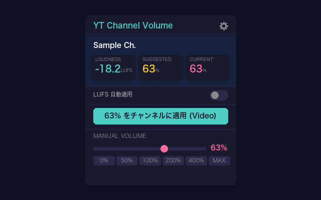
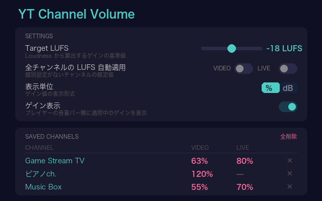
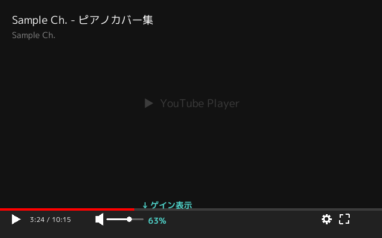

# YT Channel Volume

[](https://codecov.io/gh/semnil/yt-channel-volume)

YouTube の音量をチャンネルごとに揃える Chrome 拡張機能 (Manifest V3)。LUFS 自動適用を ON にすると、YouTube が動画ごとに測った loudness をもとに、それぞれの動画を目標の音量 (Target LUFS) に合わせ、配信中のライブではその配信の loudness の変化に合わせる。それ以外では、動画を開いた時にそのチャンネルで保存した音量を適用する。

> For the English version, see [README.md](README.md).

## 特徴

- **チャンネル単位の音量記憶**: 一度設定すれば、同じチャンネルの動画を開くたびに保存済みの音量が自動適用 (LUFS 自動適用が、検出した LUFS に合わせて調整している場合を除く)
- **Content Loudness からの最適音量算出**: YouTube が動画ごとに測定した Content Loudness を読み取り、ターゲット LUFS に基づいて最適なボリュームを算出。ワンクリックでチャンネルに保存
- **チャンネル別 LUFS 自動適用**: ポップアップには現在視聴中のVideo / Liveに対応するスイッチだけを表示し、チャンネル・種別別にON/OFF。ONの種別ではLUFSを検出できた動画をTarget LUFSに自動調整。配信中のライブでは、プレーヤーの詳細統計情報が示すその配信の loudness に合わせ、10 秒ごとに読み直す
- **全チャンネル既定値**: オプション画面でVideo / Live別にLUFS自動適用の既定値を設定可能。個別Auto設定のないチャンネル・種別が継承
- **ライブ / 動画で別音量**: 同じチャンネルでもライブ配信 (アーカイブ含む) と通常の動画で異なる音量を設定可能
- **手動ボリューム調整**: Autoが検出済みLUFSを適用している場合を除き、0〜600% の範囲でスライダーまたはプリセットボタンから設定
- **ゲイン表示**: プレイヤーの音量バーの横に現在のゲイン値を表示 (設定で ON/OFF)
- **設定をパソコン間で共有**: Chrome の同期を有効にしていれば、Target LUFS・全チャンネル既定値・表示単位・ゲイン表示は、同じアカウントで Chrome にログインしてこの拡張機能を導入しているすべてのパソコンで共有。同期が無効なら、このパソコンだけに保存。保存済みチャンネルは各パソコンに留まる
- **単一のチャンネルゲイン**: AutoでもManualでもチャンネル・種別ごとに1つのゲインを更新する。LUFSを検出している動画でLUFS自動適用をONにすると、Target LUFSに合わせたゲインを適用して保存する。OFFにすると保存済みのゲインで再生を続け、LUFSを検出していない動画ではON/OFFしても音量は変わらない。LUFS未検出時はポップアップのCurrentにFallbackを表示し、Saved Channelsでは`Auto (70%)`の形式で確認可能
- **日本語/英語**: ブラウザ言語設定で自動切替 (それ以外の言語では英語)
- **外部依存ゼロ**: npm パッケージ・CDN なし。全コード自作

## スクリーンショット

**ポップアップ** — Loudness / Suggested / Current の表示、チャンネルへの適用、手動ボリューム



**設定画面** — Target LUFS、表示単位、保存済みチャンネルの一覧



**ゲイン表示** — プレイヤーの音量バー横に適用中のゲインを表示 (設定で ON)



英語 UI の画像は同じディレクトリの `*_en.png`。

## セットアップ

### 1. 拡張をインストール

[Chrome Web Store](https://chromewebstore.google.com/detail/yt-channel-volume/hoagpdjnapnpdbmnemhcdfpdehgokaab) からインストール

> **開発版を使う場合**: `chrome://extensions` → デベロッパーモード ON → 「パッケージ化されていない拡張機能を読み込む」でこのリポジトリのフォルダを指定

### 2. 使う

1. チャンネルの動画を開く
2. ポップアップに表示された現在のVideo / Live用「LUFS 自動適用」をONにする
3. LUFS を検出できる動画では Target LUFS に合わせたゲインが自動適用される
4. 配信中のライブでは、その配信の loudness に合わせ、10 秒ごとに読み直す。音量を下げることになる loudness はすぐに適用し、上げることになる loudness は 30 秒あたり 1.5 dB までしか上げない。一時的に静かになっても音量は少ししか上がらないので、配信が大きな音に戻ったときに大きすぎる音になりにくい。loudness を読み取れない場合は、保存済みのチャンネル音量が引き続き適用される。配信のページを開いたときは、音量を保存済みのチャンネル音量より 3 dB 高いところまでに留め、そこから上げていく。また、直前より 1 dB 以上上がった loudness は、読み取った値より 3 dB 大きいものとして扱う。「LUFS 自動適用」を OFF にしてから ON にすると、その loudness をすぐに適用する

### 3. 設定

ポップアップの歯車アイコンから設定画面を開く:

- **Target LUFS**: Loudness から算出するゲインの基準値 (デフォルト: -18 LUFS)
- **全チャンネルのLUFS自動適用**: 個別設定がないチャンネルのVideo / Live別初期値 (デフォルト: OFF)
- **表示単位**: % または dB
- **ゲイン表示**: プレイヤー上にゲイン値をオーバーレイ表示 (デフォルト: OFF)
- **Saved Channels**: 保存済みチャンネルの一覧管理

保存済みチャンネル以外の上記の設定はチャンネルに依存しない。Chrome の同期を有効にしていれば、同じアカウントで Chrome にログインしてこの拡張機能を導入しているすべてのパソコンで共有し、無効ならこのパソコンだけに保存する。保存済みチャンネルは各パソコンに留まる。

## 仕組み

```
page-bridge.js (MAIN world, document_start)
  → ytInitialPlayerResponse / fetch hook / YouTube player DOM
  → loudnessDb + ライブ配信の loudness + isLiveContent + channelId を取得
  → postMessage で content.js に中継

content.js (ISOLATED world, document_idle)
  → postMessage で loudnessDb とライブ配信の loudness を受信
  → チャンネルの LUFS 自動適用が ON なら、動画やライブ配信を Target LUFS に合わせるゲインを算出・適用
  → OFF または LUFS 未検出なら保存済みチャンネルゲインを適用
  → Web Audio API GainNode で音量を制御
  → チャンネル設定の保存は service worker に依頼

background.js (service worker)
  → チャンネルごとの設定を書き込む唯一のコンテキスト
  → 複数タブが同じ保存領域を読んで書き戻す取りこぼしを防ぐ
```

- YouTube のボリュームスライダーには一切触れない
- ゲインが 1.0 (パススルー) の場合はオーディオチェーンを接続しない → Live Caption のちらつきを回避
- YouTube の CSP が inline script を禁止するため、loudnessDb 抽出は MAIN world の `page-bridge.js` で実行
- Loudness は、プレーヤーが実際に再生している音声 (音声トラック・「一定音量」・「音声ブースト」を含む。詳細統計情報が示すもの) の値を使う。再生中にプレーヤーが音声を切り替えると読み直す
- 配信中のライブの Loudness は、プレーヤーの詳細統計情報が示すその配信の値を使う。YouTube の正規化を受けていない値なので、そのまま Target LUFS に合わせる。LUFS 自動適用が ON の間は 10 秒ごとに読み直し、1 dB 以上変わったときにチャンネル音量を保存し直す。loudness が求める音量より低く抑えている間は保存しない。上げる必要がある音量は 30 秒あたり 1.5 dB までしか上げないので、しばらくの間ポップアップの Current が Suggested より低いままになることがある。ポップアップを開いている間は 1 秒ごとに読み直すので、ポップアップの Loudness と Suggested、「チャンネルに適用」と LUFS 自動適用を ON にしたときに適用する値は最新のものになる。LUFS 自動適用そのものは、次に自分で読み直すまで最後に読んだ値で再生を続ける
- このバージョン以降に保存するチャンネルの音量は動画の通常の音声を基準に持ち、再生中の音声に合わせて換算して適用する。Content Loudness も「一定音量」もない配信中のライブでは、保存した値をそのまま適用する。配信中のライブや以前のバージョンで保存した音量は、Loudness が分かる動画で保存し直すまで、どの動画にもそのまま適用する

## ビルド

```bash
# テスト実行
node test.js
node test-navigation.js
python3 test-screenshots.py

# アイコン再生成
python3 gen_icons.py

# スクリーンショット再生成 (docs/screenshots/)
python3 gen_screenshots.py

# コミット済みスクリーンショットが生成コードと一致するか確認 (書き込みなし)
python3 gen_screenshots.py --check

# Chrome Web Store 用 zip
python3 pack.py
# → yt-channel-volume-<version>.zip
```

## ファイル構成

```
yt-channel-volume/
├── manifest.json         # Manifest V3 設定
├── page-bridge.js        # MAIN world — loudnessDb とライブ配信の loudness の抽出
├── content.js            # ISOLATED world — ゲイン管理・チャンネル検出
├── background.js         # service worker — チャンネル設定の単一 writer
├── utils.js              # 共通定数・ユーティリティ (content/popup/options/service worker 共有)
├── popup.html/js         # ツールバーポップアップ
├── options.html/js       # 設定画面
├── _locales/             # i18n (ja, en)
├── icons/                # 拡張アイコン (16/48/128 px)
├── docs/*.md             # ゲインが変わる全経路と、そのうちチャンネル設定を保存する経路 (en, ja)
├── docs/screenshots/     # README・ストア掲載用スクリーンショット (ja, en)
├── tools/*.sh            # リリースワークフローが実行する、版上げのマージが求めるタグの決定・タグ検査・バージョン検査と、共有ファイルの channel-volume-core との照合
├── tools/fonts/          # スクリーンショット描画用フォント M PLUS 1p (OFL)
├── tools/mutation/       # コードを変えたときにテストが検出するかを確かめるミューテーション走査
├── test.js               # utils ユニットテスト・パッケージングと README の検査・単一 writer の契約
├── test-navigation.js    # ナビゲーション・データ整合性テスト
├── test-screenshots.py   # gen_screenshots.py の引数・出力先・--check のテスト
├── gen_icons.py          # アイコン生成 (Python pillow)
├── gen_screenshots.py    # スクリーンショット生成 (docs/screenshots/ へ出力)
├── pack.py               # zip パッケージング
├── core/common.js        # 兄弟の拡張機能と共有する小関数 (channel-volume-core から写す)
├── core.json             # 共有ファイルの写し元である semnil/channel-volume-core のコミット
├── PRIVACY_POLICY.md     # プライバシーポリシー (EN)
├── PRIVACY_POLICY_JA.md  # プライバシーポリシー (JA)
├── README.md             # README (EN)
└── README.ja.md          # README (JA)
```

## セキュリティ

- 外部へのネットワークリクエストは一切なし
- 保存済みチャンネルは `chrome.storage.local` にローカル保存。チャンネルに依存しない設定は `chrome.storage.sync` に保存し、Chrome の同期を有効にしていれば、Chrome が同じアカウントでログインしているパソコンの間で受け渡し、無効ならこのパソコンだけに保存する。拡張機能自身が送信することはない
- 通信先は YouTube のみ (コンテンツスクリプトとして動作)
- ソースコードは全ファイル公開。第三者依存なし
- 詳細は [PRIVACY_POLICY.md](PRIVACY_POLICY.md) を参照

## 既知の制限

- **createMediaElementSource**: `<video>` 要素あたり 1 回のみ呼び出し可能。Volume Master 等の他の音量拡張と競合する場合がある
- **Shorts**: `/shorts/` パスの動画は対象外
- **ライブ配信の Content Loudness**: 配信中のライブには Content Loudness データがない。代わりにプレーヤーの詳細統計情報から loudness を読むが、そこに表示されない場合は LUFS 自動適用も「チャンネルに適用」も使えない (アーカイブの Loudness から設定するか、手動ボリュームで設定)

## ライセンス

MIT
