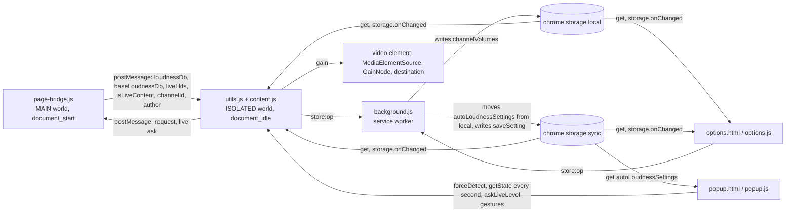

# Architecture and files

> English: [architecture.md](architecture.md)

拡張機能の各スクリプトが何をするか、スクリプトどうしがどうやり取りするか、ページの文言をどう言語ごとに出すか、視聴者が拡張機能で何をするか、リポジトリの各ファイルが何のためにあるかを書く。コードが従っている決定は [design.ja.md](design.ja.md) にあり、ゲインが変わる道筋のすべては [gain-change-and-save.ja.md](gain-change-and-save.ja.md) がたどっている。コマンドと規約は `AGENTS.md` にある。

## Architecture

**page-bridge.js (MAIN world content script, document_start)**

- Object.defineProperty: ytInitialPlayerResponse への代入をフックする
- Fetch フック: /youtubei/v1/player の応答のうち、videoDetails が URL の指す動画を名指すものを横取りする (SPA ナビゲーションをカバーする)
- unhandledrejection リスナー: watch ページで fetch フックを通して出したリクエストが `TypeError: Failed to fetch` で失敗したときに限り、既定の動作を止める
- extractFromYtPlayer: ytd-watch-flexy / movie_player から読む (SPA ナビゲーションをカバーする)
- isLiveContent: videoDetails.isLiveContent を取り出す
- 再生中のレベル: content.js へのすべての返事 (define / fetch / request / audio-change) は、movie_player.getStatsForNerds() の `cont.` のレベルから応答の loudnessTargetLkfs を引いた値を取る。プレイヤーがそれを名指すまでは、250 ms ごとにプレイヤーをもう一度見る (source は `playing`)
- ライブのレベル: すべての返事は、同じ行の `live.` のレベルも `liveLkfs` として運ぶ (絶対値のレベル。行が名指していなければ null)。これが名指されると、`cont.` のレベルのときと同じく、見直しは終わる
- Stable volume: 再生中のレベルが無く、プレイヤーの DRC の設定が ON のとき、レベルは `isDrc` の adaptive format の loudnessDb になる
- movie_player の onPlaybackAudioChange リスナー: 音声の版が変わったときにもう一度返事をする (source は `audio-change`)
- ライブのレベルの問い合わせ: `__yt_channel_volume_live_ask__` には `__yt_channel_volume_live__` だけで答える。中身は `{ videoId, liveLkfs }` で、音量の行が今名指している `live.` のレベル (名指していなければ null)。完全な返事はしない。watch ページでだけ答える
- postMessage → loudnessDb (再生中の音声の版) + baseLoudnessDb (`audioConfig` が表す素の音声の版) + liveLkfs (プレイヤーが名指すライブのレベル) + isLiveContent + channelId + author を content.js へ中継する

**background.js (service worker)**

- importScripts('core/common.js', 'utils.js')
- channelVolumes を書く唯一のコンテキスト。`store:<op>` のメッセージで書く (saveChannelGain / saveChannelAutoApply / deleteChannel / clearChannels / adoptHandleEntry / migrateLegacyGains)
- 設定を書く唯一のコンテキスト。`store:saveSetting` (`SETTINGS_WRITES`) で書き、設定を移す処理と一緒に `queueSettingsWrite()` の列に並べる
- 起動のたびに、`moveSettingsToSync()` が、sync に入る前に local へ保存された設定を移す ([design.ja.md](design.ja.md) の「Channel-independent settings sync」を参照)

**utils.js → content.js (ISOLATED world content scripts, document_idle)**

- postMessage リスナー: page-bridge.js から loudnessDb、baseLoudnessDb、liveLkfs を受け取る。URL の指す動画 (`?v=`、`/live/` のパスの区切り、チャンネルのライブの URL では canonical リンクが名指す動画) と別の動画を名指す返事は、このタブがもう離れたページのために積まれたもので、捨てる。URL が動画を名指していないときは、返事を来たまま取る。ブリッジが送らない型の項目は取らない ([design.ja.md](design.ja.md) の「A bridge message is taken field by field」を参照)
- requestLoudnessWithRetry: 必要なときに page-bridge.js へもう一度問い合わせる
- Live level read for the popup (ポップアップのためのライブのレベルの読み取り): ポップアップからの `askLiveLevel` がライブの問い合わせを送る。URL の指す動画についての `__yt_channel_volume_live__` の返事が有限のレベルを運んでいれば、それが手元のレベル (`readLiveLkfs`) を置き換え、ポップアップに知らせる。`LEVEL_FLOOR_LKFS` 以下のレベルは、手元のレベルと Auto のレベルを取り下げる ([design.ja.md](design.ja.md) の「A live stream's own level」を参照)。Auto のレベル (`currentLiveLkfs`) は別に持つもので、完全な返事だけが入れる (完全な返事は両方を入れる)。完全な返事と返事の間に Auto を適用し直す経路 — `applyPreferredGain`、`evaluateLiveSave`、タブ間の同期、設定の変更 — は Auto のレベルを読む。だから、読み取りだけでは Auto が鳴らすものも保存するものも動かない。ポップアップの状態 (`liveLkfs`、`contentLufs`)、手動操作の鍵、「チャンネルに適用」、Auto を ON にする操作は、手元のレベルを読む。ライブのレベルがあるときに Auto を ON にすると、それが Auto のレベルになる。レベルの無い返事は、手元のレベルをそのままにする
- ゲインの計算 (手動の適用 / チャンネルごとの LUFS 自動適用。どちらも種別ごとの同じゲインに保存し、素の音声の版を基準に持つ)
  - contentLUFS = -14 + loudnessDb (YouTube の基準 = -14 LUFS)
  - compensationDb = targetLUFS - contentLUFS
  - gain = 10^(compensationDb / 20)、`[0, 6]` に切りそろえる。NaN/Inf → 1.0
  - ライブのレベル (`liveLkfs`) があるときはそれが先で、そのままの値として取る: gain = 10^((targetLUFS - liveLkfs) / 20) (`calcLiveGain`)、`[0, 6]` に切りそろえる。NaN/Inf → 1.0。-14 の基準も正規化も使わない ([design.ja.md](design.ja.md) の「A live stream's own level」を参照)
- ライブの追従: 見ている種別で Auto が ON で、配信が配信中かライブのレベルを名指している間、`AUTO_FOLLOW_INTERVAL_MS` (1 秒) ごとにブリッジへもう一度問い合わせる (`syncLiveFollow`)。Auto が鳴らすライブのゲインは、どれもレベルの求めるゲイン (`calcGainFromLiveLevel`) で、上げるときも下げるときもすぐに鳴らす
- Web Audio API: `<video>` → MediaElementSource → GainNode → destination (必要になってからつなぐ)
- ゲインのオーバーレイ: .ytp-volume-area にゲインの値を出す (設定で ON / OFF を切り替える)
- チャンネルの検出 (UC のみ): canonical / `#owner a[href*="/channel/"]` / meta タグ → page-bridge の channelId (UC の形)。ページを読むのは、その文書の最初の動画のときだけ。SPA ナビゲーションの後は、チャンネルはブリッジから来る
  - `@handle` のリンクは SPA ナビゲーションの間に古くなるので、まったく受け付けない。DOM に UC が無いときはブリッジを待つ
  - 表示名: page-bridge の author (videoDetails.author。正とする出所) → DOM (`#owner #channel-name a`。代わりの出所)
- ナビゲーション: triggerApply (非同期の mutex) が applyVideoVolume を直接走らせる (debounce なし)
  - きっかけ: yt-navigate-finish、popstate、visibilitychange、MutationObserver、最初の読み込み
  - Observer: video 要素の変化と URL の動画 ID の変化だけを見る (null のガードが最初の発火を抑える)
  - `_applyRunning` の mutex が同時の実行を防ぐ。forceDetect も triggerApply を通る。mutex を持つのは、最初の適用がゲインを効かせるまで (`applyPreferredGain(..., { waitsForSave: false })`) で、Auto 自身の保存やそれが始めたライブの保存が出ている間は持たない。だから、その保存の最中のナビゲーションは自分の適用を走らせる
  - videoId が変わると currentChannel を消すので、古いチャンネルの情報が漏れない
- videoType: 'live' (配信 / アーカイブ) と 'video' (動画 / Shorts) は別々のゲインを持つ
- タブ間の同期: chrome.storage.onChanged が channelVolumes の変更を届け、今のチャンネル × videoType のゲインをすぐに適用する (ポーリングなし。自分のタブの分は currentGain との比較で除く)。ポップアップのスライダーが同じ状態のゲインをプレビューしている間は、その操作が終わってから適用する
- 保存
  - autoLoudnessSettings (`chrome.storage.sync`。`readSettings()` を通して読む): `{ targetLufs, displayUnit, showGainOverlay, autoApplyLoudnessVideoDefault, autoApplyLoudnessLiveDefault }`
  - channelVolumes (`chrome.storage.local`。以下もすべて同じ): `{ [channelId]: { name, gainLive, gainVideo, gainLivePlain, gainVideoPlain, autoApplyLoudnessLive, autoApplyLoudnessVideo, url } }`
  - unifiedGains: 移行が済んだ印 (トップレベルのキー)

**core/common.js (from channel-volume-core, loaded ahead of utils.js wherever utils.js loads)**

共有のコード。各部分が何をするかは、channel-volume-core の [docs/shared-files.ja.md](https://github.com/semnil/channel-volume-core/blob/main/docs/shared-files.ja.md#shared-code) にある。この拡張機能がそれに何を渡し、どう使うかは、それを呼ぶファイルの下に書いてある。

**utils.js (shared, loaded by content / popup / options / background + tests)**

- 定数: 設定のキーを除く保存キー、YT_REFERENCE_LUFS
- ゲインのユーティリティ: calcGain、calcLiveGain、gainChangeDb
- 保存のユーティリティ: updateChannelVolumes、queueSettingsWrite、SETTING_FIELDS、SETTINGS_WRITES、CHANNEL_WRITES、isChannelId、getChannelGain、setChannelGain、applyChannelIdentity、normalizeStoredGain、migrateLegacyAutoGains
- Auto の状態: resolveAutoApplySetting、setChannelAutoApply、hasExplicitAutoApply、isManualGainLocked

**popup.html / popup.js**

- Loudness / Suggested / Current の表示 (読み取り専用)。Loudness は、ライブのレベルがあるときはそれで、Suggested はそこから求める
- Auto が ON で LUFS が検出されなかった間、Current に Fallback のバッジを出す (値は保存ゲインそのもの)
- LIVE のバッジ。ライブ配信が再生中の間だけ出す
- 「チャンネルに適用」ボタン (loudnessDb からゲインを計算し、種別ごとに保存する)。ボタンの値を計算したときの Target を一緒に送り、content.js が別の Target を持っているとき (ポップアップがボタンを描いた後に、設定画面で保存された Target) は `target moved` で断る
- 保存 (スライダーを離す、プリセット、「チャンネルに適用」) に ok 以外の返事が来たとき、または返事がまったく来ないときは、適用ボタンのヒントに `gainSaveFailed` を出し、状態を読み直す。この知らせは `createSaveNotice` ([channel-volume-core](https://github.com/semnil/channel-volume-core/blob/main/docs/shared-files.ja.md#popup)) で、持ち主は表示中のチャンネルと種別
- チャンネル × Video/Live ごとの「LUFS 自動適用」トグル。見ている種別のものだけを出す。その保存が出ている間、トグル、手動の操作、適用ボタンは無効になり、content.js はゲインの操作や別のトグルを `auto update pending` で断る (そのときに手動で保存すると、トグルの前の Auto の状態を、トグルの後に固定してしまう)。保存できなかったトグルは、ラベルの下に `autoSaveFailed` を出す
- Manual Volume: スライダー (0–600%) + プリセット。Auto が ON で LUFS が検出されている間は無効。LUFS が検出されなかったときの代わりのゲインの調整に使う。どの操作も、ポップアップが描かれたときの状態の `appliesTo` を運ぶ
- watch 以外のページでは UI を隠す
- `pollTabState` ([channel-volume-core](https://github.com/semnil/channel-volume-core/blob/main/docs/shared-files.ja.md#popup)) は、最初に `forceDetect` を、その後は `getState` を問い合わせる。ポップアップが自分のゲインを描く前に出した問い合わせへの返事は描かない
- 状態が配信中のライブかライブのレベルを示している間、ポップアップが開いている限り、1 秒ごと (`LIVE_LEVEL_ASK_MS`) に `askLiveLevel` を送る。だから Loudness と Suggested は、追従が最後に読んだレベルではなく、プレイヤーが今名指しているレベルを示す

**options.html / options.js (settings screen, opened in its own tab)**

- Target LUFS のスライダー (-30 から -6 LUFS、既定は -18)。`holdSettingsSlider` ([channel-volume-core](https://github.com/semnil/channel-volume-core/blob/main/docs/shared-files.ja.md#sliders)) が 1 回の操作につき書き込みを 1 回に抑える。これはラベルだけを動かし、Target は保存された値として描く。ドラッグは、その最中の `blur` で終わる (Chrome の `change` が書き込む場面)
- 全チャンネルの LUFS 自動適用 (Video / Live を別々に。既定は OFF。個別の Auto のフラグが無い種別が引き継ぐ)
- 表示単位の切り替え (% / dB)。すでに選ばれているボタンは何も書かない
- ゲイン表示の切り替え (プレイヤーの音量バーの横に出す。既定は ON)
- Saved Channels の表 (Video / Live の 2 列。Auto のときは `Auto (saved gain)` と出る。チャンネルへのリンク付きで、削除できる)
- 読み込みが終わるまで画面を隠し、設定の操作と削除 (全削除、行の ×) を無効にした状態で出荷する
- 最初の読み取りは、設定 (sync) とチャンネル (local) を 1 回の読み込みで取り、それより新しい変更通知には、種類ごとのリビジョンで負ける。読み込みは `runPageLoad` ([channel-volume-core](https://github.com/semnil/channel-volume-core/blob/main/docs/shared-files.ja.md#pages)) の上で走るので、時間内に決着しなかった読み込みは失敗したものとして表示し、その後に読めたものは描かない
- storage.onChanged によるリアルタイムの同期 (通知が運んだ一覧をそのまま描く。設定は sync の領域から、チャンネルは local から)。Target LUFS のスライダーでキーかポインターが押されている間に届いた設定の変更は、Target だけを取り、スライダーとそのラベルは操作に任せる。操作の終わりは自分の値を書くか、何も書かないとき (何も動かさなかったキー、始めた値の上で離したドラッグ、blur が終わらせた押下) は Target を描く

## i18n

- `_locales/en/messages.json` — 英語。`default_locale` で、ここにカタログの無いブラウザの言語には英語で答える
- `_locales/ja/messages.json` — 日本語
- manifest の name / description は `__MSG_` の参照を使う
- popup / options の UI の文言は、`data-i18n` 属性 + `chrome.i18n.getMessage` を使い、`applyI18n` ([channel-volume-core](https://github.com/semnil/channel-volume-core/blob/main/docs/shared-files.ja.md#pages)) が当てはめる。各要素のキーはマークアップが持つ
- popup / options は `<html lang>` を `pageLanguage` のメッセージから設定する。各カタログはこのメッセージに自分のロケールで答えるので、ページは、Chrome がそのページを埋めるのに使ったカタログの言語を宣言する。マークアップの `lang` は `default_locale` のもの

## User workflow

1. そのチャンネルの動画を開く → Content Loudness が表示される
2. ポップアップで今の種別の「LUFS 自動適用」を ON にする → その種別の動画のうち loudness を検出できるものに、Target LUFS に対応するゲインがかかる
3. 配信中のライブでは、Auto は、プレイヤーがその配信について名指すレベルに追従する。レベルは 1 秒ごとに読み直し、レベルの求めるゲインを、上げるときも下げるときもすぐに鳴らす。ポップアップで Auto を OFF にしてから ON にすると、そのときのレベルで鳴らす。LUFS が検出されないときは、種別ごとの保存ゲインで鳴らす (Auto が素の音声の版について最後に計算したゲインや、ライブのレベルから最後に保存したゲインも、そこに入っている)
4. Auto が今検出している LUFS を適用していないときは、「チャンネルに適用」と Manual Volume で種別ごとのゲインを保存できる

## File overview

| ファイル | 役割 |
|------|------|
| `manifest.json` | MV3 の manifest。permissions: storage, activeTab。host: youtube.com |
| `background.js` | Service worker。channelVolumes と設定の書き込みを一手に引き受ける (`store:<op>`)。sync に入る前に保存された設定を、起動のたびに、設定の書き込みの列の上で local から sync へ移す |
| `page-bridge.js` | MAIN world。loudnessDb の取り出し (define / fetch / ytplayer) と、プレイヤーが名指すライブのレベル → postMessage |
| `content.js` | ISOLATED world。ゲインの管理、音声の経路、チャンネルの検出、保存 |
| `utils.js` | 共有の定数とユーティリティ (content / popup / options / service worker で共有) |
| `popup.html` | ポップアップの UI |
| `popup.js` | ポップアップのロジック。情報の表示、適用の操作、手動の音量 |
| `options.html` | 設定画面の UI |
| `options.js` | 設定のロジック。Target LUFS、表示単位、チャンネルの管理 |
| `_locales/` | i18n (ja, en) |
| `icons/` | 拡張機能のアイコン (16/48/128 px) — 3 本のバーのラウドネスメーター |
| `docs/screenshots/` | README に埋め込み、ストアの掲載にも使うスクリーンショット (ja, en)。`gen_screenshots.py` の出力。6 枚の画像は、1 枚ずつ、その名前の隣に書いてからその名前へ移す。置き換えが 6 回に分かれるので、上書きされようとしているものは先に脇へ写しておき、途中で止まった走行は、すでに置き換えた名前をその写しから元に戻す (前に何も無かった名前は取り除く)。止まるのは保存の失敗だけではない (進行の行を出力できない、割り込み) ので、最初の写しを取るところから最後の置き換えを終えるところまでを 1 つのトランザクションとして扱う (画像を 1 枚も置き換えていなければ、戻すものは無く、写しも残さない)。元に戻すこと自体が拒まれたときは、その名前と、そこに前にあったものを述べ、中身がまだ必要な間は写しを残して、その場所を示す。写しを片付けられなかった走行は exit 0 にならない (exit 0 が言うのは「この走行は、自分が作った写しを 1 つも残さなかった」ことまでで、前からそこにあった PNG 以外のファイルについては何も言わず、手も付けない — `--check` も .png しか数えない) |
| `gen_icons.py` | `core.json` の `icon` が名指す色と印でアイコンを描く。共有 ([channel-volume-core](https://github.com/semnil/channel-volume-core/blob/main/docs/shared-files.ja.md#package)) |
| `pack.py` | 拡張機能が読み込むものから Chrome Web Store 用の zip を作る。`--list` は選んだものを出力するだけ。共有 ([channel-volume-core](https://github.com/semnil/channel-volume-core/blob/main/docs/shared-files.ja.md#package)) |
| `gen_screenshots.py` | スクリーンショットの生成 (`docs/screenshots/` へ書く。描画のフォントは `tools/fonts/` の M PLUS 1p に固定する。描く文言は、ここに書き出さずに `_locales/<lang>/messages.json` から読む — 読めないカタログや、スクリーンショットが描くメッセージの無いカタログは、足りないものを名指して exit 1。設定の行は `SETTING_ROWS` に宣言してあり、描画はそれをたどる。`test.js` はそれを `options.html` が並べる行と比べる — 数、順序、各行が出すメッセージ、コントロールとその個数。宣言されたコントロールの名前が描き手を選ぶので、描画が持っていない名前は、その行を名指して exit 1。シートの高さは行の数から決まり、何かを描く前に 640x400 のキャンバスと照らして確かめる (そこで切り落とすものが何も無いため)。`--check` は何も書かず、次の順に見る: 追跡している場所までのパスの各要素と、画像が通常のファイルかどうか → PNG の構造 (シグネチャ、チャンク、IDAT の zlib ストリーム) → チャンクの順序 → IHDR の寸法 → IDAT の外のバイト → RGBA のピクセル (デコーダーは最後)。違いは exit 1、描けない環境は exit 3。`--out <dir>` は書き込み先を置き換える。知らない引数、`--check` と `--out` を一緒に渡したもの (どちらの順でも)、`--out` の繰り返し、フラグの形をした値、ディレクトリになれない書き込み先は、exit 2 で断る (`--chek` が上書きにならないように)。引数の間違いには、pillow やフォントの読み込みの失敗より先に答える (import とフォントの解決そのものはモジュールの読み込み時に起き、その失敗は持ち越して、引数の解析の後に exit 3 にする)。追跡している場所までのパスの要素が本物のディレクトリでないときは、描画も `--check` も何もせず exit 1。ファイルシステムからの拒否もトレースバックにはしない — `--out` で名指した書き込み先は exit 2 (それが追跡している場所と同じときも)、引数なしの追跡している場所は exit 1。拒まれた場所は、それぞれの言葉で報告する (写しのために読めない、書き込み先へ書けない)) |
| `tools/check-tag.sh` | リリースを名指していないタグでの Release の走行を断る。共有 ([channel-volume-core](https://github.com/semnil/channel-volume-core/blob/main/docs/shared-files.ja.md#release)) |
| `tools/tag-plan.sh` | main の上のコミットが求めるリリースのタグ。`tag-release.yaml` がそれを push するので、バージョンを上げる変更のマージがリリースになる。共有 ([channel-volume-core](https://github.com/semnil/channel-volume-core/blob/main/docs/shared-files.ja.md#release)) |
| `tools/verify-version.sh` | リリースのタグを manifest のバージョンに合わせさせる。共有 ([channel-volume-core](https://github.com/semnil/channel-volume-core/blob/main/docs/shared-files.ja.md#release)) |
| `tools/fonts/` | 描画のフォント M PLUS 1p (Regular / Bold) と OFL.txt。google/fonts の `ofl/mplus1p` (コミット `66a36c8`) から取った。CI と各マシンが同じピクセルを出すように、リポジトリにコミットしてある |
| `test.js` | 単体テスト (node test.js) |
| `tools/mutation/` | `sweep.mjs`、`bail.mjs`、`sweep-all.sh` は共有 ([channel-volume-core](https://github.com/semnil/channel-volume-core/blob/main/docs/shared-files.ja.md#mutation))。`equivalents.md` はこのリポジトリ自身のもの: スイートが通してしまう変異のすべてと、それぞれについて測ったことを持ち、`sweep.mjs --verify` がそれをコードに合わせさせる (`test-navigation.js` が走らせる)。これらのスイートの検査が失敗すると `  FAIL:` を出力し、これが `bail.mjs` に渡す行になる。`test.js` は `content.js`、`popup.js`、`page-bridge.js` を実行せずにテキストとして読むので、この 3 つの掃引は `test-navigation.js` だけで判定する |
| `tools/coverage/` | `v8-to-lcov.mjs` は共有 ([channel-volume-core](https://github.com/semnil/channel-volume-core/blob/main/docs/shared-files.ja.md#coverage))。CI は `test.js` と `test-navigation.js` を `NODE_V8_COVERAGE` の下で走らせ、`pack.py --list` が出荷する JS ファイルのうち `core/` の下のもの以外のレポートを Codecov へ送る。送信の失敗は、プルリクエストでは Test チェックを落とし、main への push では緑のままにする |
| `core/common.js` | 兄弟の拡張機能と共有するコード。`utils.js` を読み込むところではどこでも、`utils.js` より先に読み込む。各部分が何をするかは [channel-volume-core](https://github.com/semnil/channel-volume-core/blob/main/docs/shared-files.ja.md#shared-code) にある |
| `core.json` | この拡張機能を [semnil/channel-volume-core](https://github.com/semnil/channel-volume-core#corejson) に対して名乗る: 取り込む共有ファイルのグループ、写しの元のコミット、zip の名前、アイコン。拡張機能が読み込むものはどれもこれを参照しないので、パッケージには入らない |
| `tools/check-shared.sh` | 共有ファイルを、`core.json` が固定しているコミットと比べる。Test チェックがこれを走らせ、違いのある写しはチェックを落とす。共有 ([channel-volume-core](https://github.com/semnil/channel-volume-core/blob/main/docs/shared-files.ja.md#check-shared)) |
| `test-navigation.js` | ナビゲーションと状態遷移のテスト (node test-navigation.js)。`content.js`、`page-bridge.js`、`background.js`、`popup.js`、`options.js` は、ここで VM のハーネスの中で走る。その `simulateRuntimeMessage` は Chrome のメッセージのポートを模している: リスナーが `true` 以外を返すとポートは閉じる。だから、`return true` なしに `.then` から答えるハンドラーは、スイートがまだ書き込んでいる最中の保存に向かってさまようままにはならず、そのメッセージを名指して走行を終わらせる。リスナーが断るメッセージをわざと送る呼び出し側は `expectNoAnswer` を渡す。ハーネスは `core/common.js`、`utils.js`、`content.js` を、そのままの形で、この順に、`vm.runInThisContext` で評価する。だから、あるファイルのトップレベルの `const`、`let`、`function` の宣言は、1 つの `content_scripts` の項目のファイルどうしの間と同じように、次のファイルへ届く。ソースの `const` と `let` を `var` に書き換えて `eval` する方法では、その共有を試せない (書き換えが、問題の宣言そのものを取り去るため)。`utils.js` を関数で包むと、ハーネスは `ReferenceError` で止まる |
| `test-screenshots.py` | `gen_screenshots.py` の引数、出力先、`--check` が断る形のテスト (python3 test-screenshots.py。`node test.js` からも走る。シンボリックリンクを作れないところと `resource` が無いところでは、該当するケースを skipped と報告する) |
