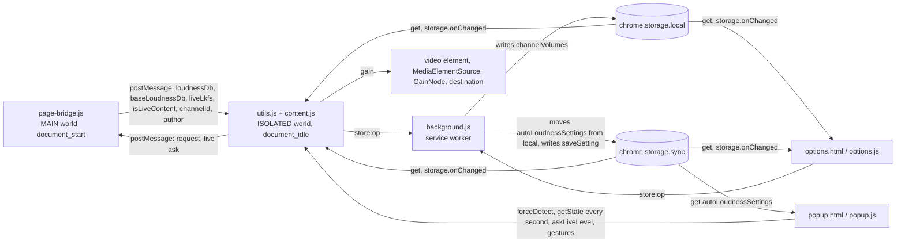

# Architecture and files

> 日本語版: [architecture.ja.md](architecture.ja.md)

What each script of the extension does and how the scripts talk to each other, how the pages are localized, what the viewer does with the extension, and what each file in the repository is for. The decisions the code is written to are in [design.md](design.md), and every path that changes the gain is followed in [gain-change-and-save.md](gain-change-and-save.md). The commands and the conventions are in `AGENTS.md`.

## Architecture

**page-bridge.js (MAIN world content script, document_start)**

- Object.defineProperty: hooks the assignment of ytInitialPlayerResponse
- Fetch hook: intercepts /youtubei/v1/player responses whose videoDetails name the video the URL does (covers SPA navigation)
- unhandledrejection listener: prevents the default only for the `TypeError: Failed to fetch` that a request made through the fetch hook on a watch page failed with
- extractFromYtPlayer: reads from ytd-watch-flexy / movie_player (covers SPA navigation)
- isLiveContent: extracts videoDetails.isLiveContent
- Playing level: every answer to content.js (define / fetch / request / audio-change) takes the `cont.` level of movie_player.getStatsForNerds() less the response's loudnessTargetLkfs; until the player names it, the player is looked at again every 250 ms (source `playing`)
- Live level: every answer also carries the `live.` level of the same line as `liveLkfs` (an absolute level, null where the line names none), and naming it ends the looking as the `cont.` level does
- Stable volume: where the playing level is not there, with the player's DRC setting on, the level is the `isDrc` adaptive format's loudnessDb
- onPlaybackAudioChange listener on movie_player: answers again when the rendition changes (source `audio-change`)
- Live level ask: `__yt_channel_volume_live_ask__` is answered with `__yt_channel_volume_live__` alone — `{ videoId, liveLkfs }`, the `live.` level the volume line names now (null where it names none) — and no full answer, on a watch page only
- postMessage → relays loudnessDb (the rendition played) + baseLoudnessDb (the plain rendition `audioConfig` describes) + liveLkfs (the live level the player names) + isLiveContent + channelId + author to content.js

**background.js (service worker)**

- importScripts('core/common.js', 'utils.js')
- the only context that writes channelVolumes, on a `store:<op>` message (saveChannelGain / saveChannelAutoApply / deleteChannel / clearChannels / adoptHandleEntry / migrateLegacyGains)
- the only context that writes the settings, on `store:saveSetting` (`SETTINGS_WRITES`), queued with the move on `queueSettingsWrite()`
- at every start, `moveSettingsToSync()` moves settings saved in local before they synced (see [design.md](design.md), "Channel-independent settings sync")

**utils.js → content.js (ISOLATED world content scripts, document_idle)**

- postMessage listener: receives loudnessDb, baseLoudnessDb and liveLkfs from page-bridge.js. An answer naming a video other than the one the URL names (`?v=`, the `/live/` path segment, or on a channel's live URL the video its canonical link names) was queued for a page this tab has left, and is dropped; where the URL names no video the answer is taken as it comes. A field of a type the bridge does not send is not taken (see [design.md](design.md), "A bridge message is taken field by field")
- requestLoudnessWithRetry: asks page-bridge.js again on demand
- Live level read for the popup: `askLiveLevel` from the popup posts the live ask, and a `__yt_channel_volume_live__` answer for the video the URL names that carries a finite level replaces the level in hand (`readLiveLkfs`) and notifies the popup; one at or below `LEVEL_FLOOR_LKFS` takes the level in hand and Auto's away (see [design.md](design.md), "A live stream's own level"). Auto's level (`currentLiveLkfs`) is a separate one that only a full answer sets (and sets both): the paths that re-apply Auto between full answers — `applyPreferredGain`, `evaluateLiveSave`, cross-tab sync, a settings change — read Auto's, so a read alone never moves what Auto plays or stores. The popup's state (`liveLkfs`, `contentLufs`), the manual lock, "Apply to channel" and turning Auto on read the level in hand; turning Auto on with a live level makes it Auto's. An answer with no level leaves the one in hand
- Gain calculation (manual apply / per-channel automatic LUFS apply. Both store into the same per-type gain, held against the base rendition)
  - contentLUFS = -14 + loudnessDb (YouTube reference = -14 LUFS)
  - compensationDb = targetLUFS - contentLUFS
  - gain = 10^(compensationDb / 20), clamped `[0, 6]`, NaN/Inf → 1.0
  - With a live level (`liveLkfs`) it goes first, taken as it stands: gain = 10^((targetLUFS - liveLkfs) / 20) (`calcLiveGain`), clamped `[0, 6]`, NaN/Inf → 1.0, with no -14 reference and no normalization (see [design.md](design.md), "A live stream's own level")
- Live follow: while Auto is on for the type being watched and the stream is on air or names a live level, the bridge is asked again every `AUTO_FOLLOW_INTERVAL_MS` (1 s) (`syncLiveFollow`), and every live gain Auto plays is the one the level asks for (`calcGainFromLiveLevel`), up or down at once
- Web Audio API: `<video>` → MediaElementSource → GainNode → destination (connected lazily)
- Gain overlay: shows the gain value in .ytp-volume-area (switched on and off in the options)
- Channel detection (UC only): canonical / `#owner a[href*="/channel/"]` / meta tag → page-bridge channelId (UC form). The page is read for the document's first video alone; after an SPA navigation the channel comes from the bridge
  - `@handle` links go stale during SPA navigation and are rejected outright. Waits for the bridge when the DOM carries no UC
  - Display name: page-bridge author (videoDetails.author, authoritative source) → DOM (`#owner #channel-name a`, fallback)
- Navigation: triggerApply (async mutex) runs applyVideoVolume directly (no debounce)
  - Triggers: yt-navigate-finish, popstate, visibilitychange, MutationObserver, first load
  - Observer: watches video element changes + URL video ID changes alone (a null guard suppresses the first fire)
  - `_applyRunning` mutex prevents concurrent runs. forceDetect also goes through triggerApply. The mutex is held until the first apply has put the gain in force (`applyPreferredGain(..., { waitsForSave: false })`), not while Auto's own save or the live save it started is out, so a navigation during that save runs its own apply
  - Clears currentChannel when the videoId changes, so stale channel information does not leak
- videoType: 'live' (stream/archive) or 'video' (video/Shorts) hold separate gains
- Cross-tab sync: chrome.storage.onChanged delivers channelVolumes changes and the gain for the current channel × videoType is applied at once (no polling, self-tab dedup by currentGain comparison), or once the gesture ends while the popup's slider previews a gain for the same state
- Storage
  - autoLoudnessSettings (`chrome.storage.sync`, read through `readSettings()`): `{ targetLufs, displayUnit, showGainOverlay, autoApplyLoudnessVideoDefault, autoApplyLoudnessLiveDefault }`
  - channelVolumes (`chrome.storage.local`, as is everything below): `{ [channelId]: { name, gainLive, gainVideo, gainLivePlain, gainVideoPlain, autoApplyLoudnessLive, autoApplyLoudnessVideo, url } }`
  - unifiedGains: the migration-done marker (top-level key)

**core/common.js (from channel-volume-core, loaded ahead of utils.js wherever utils.js loads)**

The shared code. What each part does is in channel-volume-core's [docs/shared-files.md](https://github.com/semnil/channel-volume-core/blob/main/docs/shared-files.md#shared-code); what this extension gives it, and how it uses it, is under the file that calls it.

**utils.js (shared, loaded by content / popup / options / background + tests)**

- Constants: storage keys but the settings key, YT_REFERENCE_LUFS
- Gain utilities: calcGain, calcLiveGain, gainChangeDb
- Storage utilities: updateChannelVolumes, queueSettingsWrite, SETTING_FIELDS, SETTINGS_WRITES, CHANNEL_WRITES, isChannelId, getChannelGain, setChannelGain, applyChannelIdentity, normalizeStoredGain, migrateLegacyAutoGains
- Auto state: resolveAutoApplySetting, setChannelAutoApply, hasExplicitAutoApply, isManualGainLocked

**popup.html / popup.js**

- Loudness / Suggested / Current display (read-only). The Loudness is the live level where there is one, and Suggested is worked out from it
- Fallback badge on Current while Auto is on and no LUFS was detected (the value is the saved gain itself)
- LIVE badge, shown only while a live stream is playing
- "Apply to channel" button (computes the gain from loudnessDb and saves it per type). It carries the target the button's value was computed with, and content.js refuses it with `target moved` where it holds another (one saved in the settings page after the popup drew the button)
- A save (the slider's release, a preset, "Apply to channel") answered with anything but ok, or not answered at all, shows `gainSaveFailed` in the Apply button's hint and reads the state again; the notice is `createSaveNotice` ([channel-volume-core](https://github.com/semnil/channel-volume-core/blob/main/docs/shared-files.md#popup)), whose owner is the channel and type shown
- Per-channel × Video/Live "Auto-apply LUFS" toggle, showing only the type being watched. While its save is out, the toggles, the manual controls and Apply are disabled, and content.js refuses a gain gesture or another toggle with `auto update pending` (a manual save made then would pin the Auto state from before the toggle, after it). A toggle not saved shows `autoSaveFailed` under the label
- Manual Volume: slider (0–600%) + presets. Disabled while Auto is on and LUFS was detected; used for fallback adjustment when no LUFS was detected. Every gesture carries the `appliesTo` of the state the popup was drawn from
- UI hidden on pages other than watch
- `pollTabState` ([channel-volume-core](https://github.com/semnil/channel-volume-core/blob/main/docs/shared-files.md#popup)) asks `forceDetect` first and `getState` after it; an answer to an ask made before the popup drew a gain of its own is not drawn
- While the state shows a stream on air or a live level, `askLiveLevel` is sent every second (`LIVE_LEVEL_ASK_MS`) for as long as the popup is open, so Loudness and Suggested show the level the player names now rather than the one the follow last read

**options.html / options.js (settings screen, opened in its own tab)**

- Target LUFS slider (-30 to -6 LUFS, default -18), held to one write per gesture by `holdSettingsSlider` ([channel-volume-core](https://github.com/semnil/channel-volume-core/blob/main/docs/shared-files.md#sliders)), which moves the label alone and draws the target as the stored value. A drag ends at a `blur` during it, where Chrome's `change` writes
- Auto-apply LUFS for all channels (Video / Live separately, default OFF, inherited by a type with no individual Auto flag)
- Display unit toggle (% / dB). The button already active writes nothing
- Gain overlay toggle (shown next to the player's volume bar, default ON)
- Saved Channels table (Video / Live in two columns. Under Auto it reads `Auto (saved gain)`, with a channel link, deletable)
- Ships with the screen hidden until the load finishes and with the settings controls and the deletions (clear all, the × on a row) disabled
- The first read takes the settings (sync) and the channels (local) in one load and loses to a newer change notification through a per-type revision. The load runs on `runPageLoad` ([channel-volume-core](https://github.com/semnil/channel-volume-core/blob/main/docs/shared-files.md#pages)), so one that has not settled in time is shown as one that failed, and what it reads after that is not drawn
- Real-time sync through storage.onChanged (renders the list the notification carried, as it is; settings from the sync area, channels from local). A settings change that arrives while a key or the pointer is held on the Target LUFS slider takes the target and leaves the slider and its label to the gesture, whose end writes its own value, or draws the target where it writes nothing (a key that moved nothing, a drag let go of on the value it began on, a press a blur ended)

## i18n

- `_locales/en/messages.json` — English, the `default_locale`: a browser language with no catalog here is answered in English
- `_locales/ja/messages.json` — Japanese
- The manifest's name/description use `__MSG_` references
- popup/options UI strings use a `data-i18n` attribute + `chrome.i18n.getMessage`, applied by `applyI18n` ([channel-volume-core](https://github.com/semnil/channel-volume-core/blob/main/docs/shared-files.md#pages)). The markup holds each element's key
- popup/options set `<html lang>` from the `pageLanguage` message, which each catalog answers with its own locale, so the page declares the language of the catalog Chrome filled it from. The markup's `lang` is `default_locale`'s

## User workflow

1. Open a video from the channel → the Content Loudness is shown
2. Turn on "Auto-apply LUFS" for the current type in the popup → videos of that type where the loudness can be detected get the gain that corresponds to Target LUFS
3. On a live stream on air Auto follows the level the player names for the stream, read again every 1 s: the gain the level asks for plays at once, up or down. Turning Auto off and on in the popup plays the level as it stands. Where no LUFS is detected it falls back to the saved per-type gain (the gain Auto last computed for the plain rendition, or last stored from a live level, also lives there)
4. Where Auto is not applying the currently detected LUFS, "Apply to channel" and Manual Volume can save a per-type gain

## File overview

| File | Role |
|------|------|
| `manifest.json` | MV3 manifest. permissions: storage, activeTab. host: youtube.com |
| `background.js` | Service worker. Takes sole charge of writing channelVolumes and the settings (`store:<op>`), and moves settings saved before they synced from local to sync at every start, on the settings writes' queue |
| `page-bridge.js` | MAIN world. loudnessDb extraction (define/fetch/ytplayer) and the live level the player names → postMessage |
| `content.js` | ISOLATED world. Gain management, audio chain, channel detection, storage |
| `utils.js` | Shared constants and utilities (shared by content / popup / options / service worker) |
| `popup.html` | Popup UI |
| `popup.js` | Popup logic. Information display, apply gestures, manual volume |
| `options.html` | Settings screen UI |
| `options.js` | Settings logic. Target LUFS, display unit, channel management |
| `_locales/` | i18n (ja, en) |
| `icons/` | Extension icons (16/48/128 px) — 3-bar loudness meter |
| `docs/screenshots/` | Screenshots embedded in the README and used in the store listing (ja, en). Output of `gen_screenshots.py`. The six images are written one at a time beside their name and then moved onto it, and because the replacement is split into six, whatever is about to be overwritten is copied aside first and a run that stops partway restores the names it already replaced from those copies (a name that had nothing before it is removed). A stop is not only a failed save (a progress line that cannot be printed, an interrupt), so taking the first copy through finishing the last replacement is treated as one transaction (with no image replaced there is nothing to restore and no copy is left behind). When the restore itself is refused, the run states that name and what stood there before, and keeps the copy — naming where it is — while its contents are still needed. A run that could not clear its copies does not exit 0 (exit 0 says no more than "this run left none of the copies it made", says nothing about the non-PNG files that were already there and leaves them alone — `--check` counts nothing but .png either) |
| `gen_icons.py` | Draws the icons in the colours and with the mark `core.json`'s `icon` names; shared ([channel-volume-core](https://github.com/semnil/channel-volume-core/blob/main/docs/shared-files.md#package)) |
| `pack.py` | Builds the zip for the Chrome Web Store from what the extension loads; `--list` prints the selection only. Shared ([channel-volume-core](https://github.com/semnil/channel-volume-core/blob/main/docs/shared-files.md#package)) |
| `gen_screenshots.py` | Screenshot generation (writes into `docs/screenshots/`. The drawing font is fixed to M PLUS 1p from `tools/fonts/`, and the wording it draws is read from `_locales/<lang>/messages.json` rather than written out here — a catalog it cannot read, or one with no message a screenshot draws, is exit 1 naming what is missing. The settings rows are declared in `SETTING_ROWS`, which the drawing walks and `test.js` compares with the rows `options.html` lays out — count, order, the message each shows, and the control with how many of it; the declared control name picks the painter, so one the drawing has not got is exit 1 naming the row. The sheet's height comes from the row count and is checked against the 640x400 canvas before anything is drawn, because nothing clips to it. `--check` writes nothing and looks, in this order, at each component of the path to the tracked location and at whether the image is a regular file → PNG structure (signature, chunks, the IDAT zlib stream) → chunk order → the IHDR dimensions → the bytes outside IDAT → RGBA pixels (the decoder comes last). A difference is exit 1, an environment that cannot draw is exit 3. `--out <dir>` replaces the write destination. An unknown argument, `--check` and `--out` given together (in either order), a repeated `--out`, a value shaped like a flag, and a destination that cannot become a directory are refused with exit 2 (so that `--chek` is not an overwrite). An argument mistake is answered ahead of a pillow or font load failure (the import and the font resolution themselves happen at module load, and the failure is carried and turned into exit 3 after argument parsing). If a component of the path to the tracked location is not a real directory, both drawing and `--check` do nothing and exit 1. A refusal from the filesystem is not a traceback either — a destination named by `--out` is exit 2 (even where it is the same as the tracked location), the tracked location with no argument is exit 1. Each refused location is reported in its own words (cannot read it for the copy, cannot write to the destination)) |
| `tools/check-tag.sh` | Refuses a Release run on a tag that names no release; shared ([channel-volume-core](https://github.com/semnil/channel-volume-core/blob/main/docs/shared-files.md#release)) |
| `tools/tag-plan.sh` | The release tag a commit on main asks for, which `tag-release.yaml` pushes, so merging a version bump is the release; shared ([channel-volume-core](https://github.com/semnil/channel-volume-core/blob/main/docs/shared-files.md#release)) |
| `tools/verify-version.sh` | Holds a release tag to the manifest's version; shared ([channel-volume-core](https://github.com/semnil/channel-volume-core/blob/main/docs/shared-files.md#release)) |
| `tools/fonts/` | The drawing font M PLUS 1p (Regular / Bold) and OFL.txt. Taken from `ofl/mplus1p` in google/fonts (commit `66a36c8`). Committed to the repository so that CI and each machine produce the same pixels |
| `test.js` | Unit tests (node test.js) |
| `tools/mutation/` | `sweep.mjs`, `bail.mjs` and `sweep-all.sh` are shared ([channel-volume-core](https://github.com/semnil/channel-volume-core/blob/main/docs/shared-files.md#mutation)). `equivalents.md` is this repository's own: every mutant the suites let through and what was measured about each, held to the code by `sweep.mjs --verify`, which `test-navigation.js` runs. A failed check of these suites prints `  FAIL:`, the line given to `bail.mjs`. `test.js` reads `content.js`, `popup.js` and `page-bridge.js` as text rather than executing them, so sweeps of those three are judged by `test-navigation.js` alone |
| `tools/coverage/` | `v8-to-lcov.mjs` is shared ([channel-volume-core](https://github.com/semnil/channel-volume-core/blob/main/docs/shared-files.md#coverage)). CI runs `test.js` and `test-navigation.js` under `NODE_V8_COVERAGE` and uploads to Codecov the report of the JS files `pack.py --list` ships but those under `core/`; a failed upload fails the Test check on a pull request and leaves it green on a push to main |
| `core/common.js` | The code shared with the sibling extensions, loaded ahead of `utils.js` wherever `utils.js` loads; what each part does is in [channel-volume-core](https://github.com/semnil/channel-volume-core/blob/main/docs/shared-files.md#shared-code) |
| `core.json` | Names this extension to [semnil/channel-volume-core](https://github.com/semnil/channel-volume-core#corejson): the groups of shared files it takes, the commit its copies come from, the zip's name and the icon. Nothing the extension loads refers to it, so the package never carries it |
| `tools/check-shared.sh` | Compares the shared files with the commit `core.json` locks; the Test check runs it, and a copy that differs fails it. Shared ([channel-volume-core](https://github.com/semnil/channel-volume-core/blob/main/docs/shared-files.md#check-shared)) |
| `test-navigation.js` | Navigation and state-transition tests (node test-navigation.js). `content.js`, `page-bridge.js`, `background.js`, `popup.js` and `options.js` run in a VM harness here. Its `simulateRuntimeMessage` models Chrome's message port: a listener returning anything but `true` shuts it, so a handler that answers from a `.then` without `return true` ends the run naming the message rather than leaving the suite to wander against storage it is still writing to. A caller that means to send a message the listener declines passes `expectNoAnswer`. The harness evaluates `core/common.js`, `utils.js` and `content.js` as they stand, in that order, with `vm.runInThisContext`, so the top-level `const`, `let` and `function` declarations of one reach the next as they do between the files of one `content_scripts` entry. An `eval` of the sources with `const` and `let` rewritten to `var` would not test that sharing, since the rewrite takes away the declarations in question. With `utils.js` wrapped in a function, the harness stops with a `ReferenceError` |
| `test-screenshots.py` | Tests for `gen_screenshots.py`'s arguments, output destination, and the shapes `--check` turns down (python3 test-screenshots.py. Also run from `node test.js`. Where symlinks cannot be created and where `resource` is absent, the affected cases are reported as skipped) |
