# ゲインが変わるときと、チャンネル設定が保存されるとき

> English: [gain-change-and-save.md](gain-change-and-save.md)

この文書は、このリポジトリのコードに沿って 2 つのことを説明します。1 つ目は、動画の音にかかるゲイン (音の大きさを何倍にするかの値。1.0 が 100% で、そのままの大きさ) が変わる道筋のすべてです。2 つ目は、そのうちどの道筋がチャンネルごとの設定を `chrome.storage` (拡張機能がデータを保存するブラウザの仕組み) に書き込むかです。それぞれの図のあとに、図のもとになったファイルと関数を挙げます。最後の「測って確かめたブラウザとサイトの挙動」の節には、これらの道筋が頼っていて、コードだけでは決まらない Chrome と YouTube の挙動を、測った結果で挙げます。

## 概要

### 登場するもの

| 登場するもの | 動く場所 | ここでの役目 |
|---|---|---|
| `page-bridge.js` | YouTube のページの MAIN world (ページ自身の JavaScript と同じ実行環境)。`document_start` (ページの読み込みが始まった時点) で読み込まれる | プレイヤーの応答データと、プレイヤーの「詳細統計情報」(stats for nerds) の音量の行を読み、音量レベルを `content.js` に送る |
| `utils.js` + `content.js` | ISOLATED world (ページの中にあるが、ページのスクリプトから切り離された拡張機能専用の実行環境)。`document_idle` (ページの読み込みが落ち着いた時点) で読み込まれる | タブの状態を持ち、GainNode にゲインを設定し、チャンネルの書き込みを `background.js` に頼む |
| `background.js` | Manifest V3 (MV3、Chrome 拡張機能の今の形式) の service worker (拡張機能の裏側で動くスクリプト) | `channelVolumes` と設定への書き込みをすべて受け持つ。起動のたびに、`chrome.storage.local` に残っている設定を `chrome.storage.sync` へ移す |
| `popup.js` | ツールバーのポップアップ | 視聴者の操作を、開いているタブの `content.js` に送る |
| `options.js` | 設定画面。専用のタブで開く | 設定の書き込み、チャンネルの削除、旧形式の取り込みを `background.js` に頼む |
| `chrome.storage.local`、`chrome.storage.sync` | ブラウザ | 下の保存キーを持つ。設定は sync (同じプロフィールでサインインしたどのマシンでも Chrome が同じ中身に保つ場所)、ほかは local に置く。`content.js` と `options.js` は、両方の場所の `chrome.storage.onChanged` (保存内容が変わったという知らせ) を受け取る |
| GainNode | タブの中の Web Audio API (ブラウザで音声を加工する仕組み) のつながり: `<video>`、`MediaElementSource`、`GainNode`、出力先 | 適用ゲインで音を鳴らす |

### 保存キー

| キー | 形 | 書き込む側 |
|---|---|---|
| `channelVolumes` | `{ [channelId]: { name, url, gainVideo, gainLive, gainVideoPlain, gainLivePlain, autoApplyLoudnessVideo, autoApplyLoudnessLive } }` | `background.js`。`utils.js` の `CHANNEL_WRITES` を通す |
| `autoLoudnessSettings` (sync) | `{ targetLufs, displayUnit, showGainOverlay, autoApplyLoudnessVideoDefault, autoApplyLoudnessLiveDefault }` | `background.js`。`utils.js` の `SETTINGS_WRITES` を通す。頼むのは `options.js` (`saveSetting`)。local に残っている写しは `moveSettingsToSync` が sync へ移す |
| `unifiedGains` | `true` | `background.js`。旧形式の取り込みの `channelVolumes` と同じ `set` で書く |
| `autoLoudnessFallbacks`、`autoLoudnessFallback:<channelId>:<type>` | 古い形式で Auto が覚えたゲイン | 書き込まれない。旧形式の取り込みが読んで消す |

`channelVolumes` の 1 つのチャンネルの中身:

- `gainVideo` / `gainLive`: 種別ごとの保存ゲイン (1.0 が 100%)。保存するときに上限・下限で切りそろえない。
- `gainVideoPlain` / `gainLivePlain`: その種別のゲインが「素の音声の版」(`baseLoudnessDb`) を基準にしているとき `true`。これが無いゲインは、保存された値のまま鳴らす。
- `autoApplyLoudnessVideo` / `autoApplyLoudnessLive`: 種別ごとの、そのチャンネル個別の Auto の設定 (フラグ)。これが無い種別は、全チャンネル共通の既定値に従う。
- `name` と `url` (`https://www.youtube.com/channel/<channelId>`)。
- 古い形式の項目: `gain` (2 つの種別で共通の 1 つのゲイン) と `autoApplyLoudness` (2 つの種別で共通の 1 つのフラグ) は、両方の種別の値として読む。`setChannelGain` と `setChannelAutoApply` は、書き込みがそれに触れたときに種別ごとの項目へ広げる。
- キーは UC 形式のチャンネル ID (`UC` の後に `[A-Za-z0-9_-]` が続く)。`@handle` のキーで保存されたものは、`adoptHandleEntry` が移すまでそのキーに残る。

設定を読む側は、どれも `readSettings()` を通す: まず sync、service worker がまだ移していなければ local の写し、local が空で返ったときはもう一度 sync。

### 用語

- **適用ゲイン**: `content.js` の `currentGain` と、GainNode に設定された値。`commitGain` を通るときだけ変わる。
- **保存ゲイン**: `channelVolumes` の `gainVideo` / `gainLive`。
- **videoType (種別)**: ブリッジ (`page-bridge.js`) が `isLiveContent` を true と送ったときは `'live'` (配信中のライブとそのアーカイブ)、それ以外は `'video'` (動画、ショート、プレミア公開)。`applyVideoVolume` が新しいページのためにブリッジ由来の状態を消すと `'video'` になり、ブリッジが `isLiveContent` を送るまでそのまま。
- **LUFS / LKFS**: Loudness Units relative to Full Scale / Loudness, K-weighted, relative to Full Scale。どちらも同じ音の大きさ (ラウドネス) の目盛り。
- **loudnessDb**: 再生中の音声の版のレベル。YouTube の目標ラウドネスに対する dB (デシベル) の値。**baseLoudnessDb**: 応答データの `audioConfig` が表す、素の音声の版のレベル。
- **DRC**: Dynamic Range Compression (音の大小の差を縮める処理)。プレイヤーの Stable Volume 設定は、専用の音声の版 (`isDrc` が付いた adaptive format) を鳴らす。
- **ライブのレベル** (`liveLkfs`): 配信中のライブで、プレイヤーの音量の行が示す `live.` のレベル。LKFS の絶対値。`content.js` は 2 つ持つ: Auto のレベル (`currentLiveLkfs`) はブリッジの完全な返事だけが入れ、Auto が鳴らして保存する。手元のレベル (`readLiveLkfs`) は、完全な返事とポップアップの 1 秒ごとの読み取りが入れる。ポップアップ、手動操作の鍵、「チャンネルに適用」、Auto を ON にする操作は、手元のレベルを使う。
- **ライブで鳴らすゲイン** (`liveGainToPlay()`): Auto がライブのレベルに対して鳴らすゲイン。同じ動画でブリッジが前に示したレベルより `LIVE_RISE_DB` (1 dB) 以上上がったレベル (`liveLevelRise`) は、`LIVE_RISE_AHEAD_DB` (3 dB) 大きいものとしてゲインを出す (上昇の先取り、rise cut)。ページの中でその動画に最初に鳴らすライブのゲイン (`liveRaiseFrom` が動画を示していないか、別の動画を示している) は、中身のライブのゲイン (`storedLiveGain`) が 0 より大きく、動画がライブとして鳴っているとき、それより `LIVE_START_CAP_DB` (3 dB) 大きいところまでに抑える (始まりの上限、start cap)。そのあとは、`currentGain` 以下のゲインはすぐに鳴らし、それより大きいゲインは、ライブのレベルが最後にゲインを決めてから `LIVE_RAISE_PERIOD_MS` (30 秒) あたり `LIVE_RAISE_DB` (1.5 dB) だけ `currentGain` を上げたところまでしか鳴らさない (上げる速さの制限、raise limit)。その時刻は `liveRaiseFrom` = `{ videoId, at }` が持つ。ライブのレベルを示さないブリッジのメッセージは `at` を null にするので、次のライブのゲインは鳴っているゲインより上げず、数えるのはそこから始まる。Target LUFS を変えると `at` を -Infinity にするので、次のライブのゲインはそのまま鳴らす。`currentGain` が 0 のときのゲインもそのまま鳴らす。
- **Target LUFS**: `autoLoudnessSettings` の `targetLufs`。初期値は -18。
- **Auto**: 「LUFS 自動適用」の設定。`resolveAutoApplySetting` が種別ごとに次の順で決める: チャンネル個別のフラグ、古い形式のフラグ、(旧形式の取り込みが終わる前は)「フラグの無い保存ゲインがあれば OFF」、全チャンネル共通の既定値。
- **Auto のゲイン**: `calcGain(loudnessDb, targetLufs)` = 10^((targetLufs - effectiveLufs) / 20)。`effectiveLufs` は、`loudnessDb` が 0 より大きいとき -14、それ以外は -14 + `loudnessDb`。**ライブのゲイン**: `calcLiveGain(liveLkfs, targetLufs)` = 10^((targetLufs - liveLkfs) / 20)。どちらも 0 から 6 の範囲に切りそろえ、計算結果が有限の数でなければ 1.0 にする。
- **版の比率**: `renditionGainRatio(loudnessDb, baseLoudnessDb ?? loudnessDb)`。`loudnessDb` が分からないときは 1。印の付いた保存ゲインは、この比率を掛けて鳴らす。手動のゲインは、この比率で割って保存する。
- **旧形式の取り込み**: 移行処理 `migrateLegacyAutoGains`。`storageMigrated` は成功したかどうか、`storageSettled` は試みが終わったかどうか、`storageReady` はその試みの promise (あとで結果が出る処理を表す JavaScript の値)。
- **appliesTo**: ポップアップの操作が、どの状態に向けたものか。`currentGestureState()` = チャンネル ID、videoType、URL の動画 ID を `|` でつないだもの。`appliesTo` が今の状態と合わない操作は `state moved` で断られる。
- **頼まれた書き込み**: ポップアップの操作が求めた書き込み。失敗すると `reportFailure` が記録し、`restoreGainAfterFailedSave()` が適用ゲインを戻し、ポップアップに `{ ok: false }` を返す (Auto トグルのフラグだけの書き込みが失敗したときは、ゲインを戻さずに返す)。
- **頼まれていない書き込み**: Auto 自身の保存、ライブの保存、`@handle` のキーの引き取り、旧形式の取り込み。失敗は `nameUnaskedWrite` に渡る。名前ごとに、続けて起きた失敗の 1 回目を `console.info`、2 回目を `console.error` で記録し、3 回目からは記録しない。その名前の書き込みが成功すると、失敗の続きは終わる。

### 適用ゲインが変わる場所: `commitGain`

`commitGain(value)` は `Number(value)` を取り、有限の数でなければ 1.0 にし、0 から 6 に切りそろえて `applyGainToAudio` を呼ぶ。そのあとで `currentGain` に入れ、`updateGainOverlay` と `notifyPopup` を呼ぶ。`applyGainToAudio` は、音声のつながりがまだ無いうちはゲイン 1.0 のためにつながりを作らない。それ以外では `ensureAudioChain` がページの `<video>` に向けてつながりを作り (要素が変わっていれば作り直す)、値を `gainNode.gain.value` に入れる。`ensureAudioChain` が例外を投げたとき (別のところがすでにつないだ要素を `createMediaElementSource` が断ったとき) は、`commitGain` はそこで止まる。`currentGain`、ゲイン表示、ポップアップは、鳴っていたゲインのままになる。`notifyPopup` は、状態が前回送ったものと違うときに `stateChanged` を送る。

`commitGain` を呼ぶのは、`applyPreferredGain` と `applyAutomaticLoudnessGain` (ライブのゲインは、`liveGainToPlay` でゲインを出す `commitLiveGain` を通す)、`chrome.storage.onChanged` の受け取り側、`handleMessage` の `setGainLive` / `setGain` / `applyLoudness` / `setAutoApplyLoudness` の分岐。

## チャンネル書き込みの共通の流れ

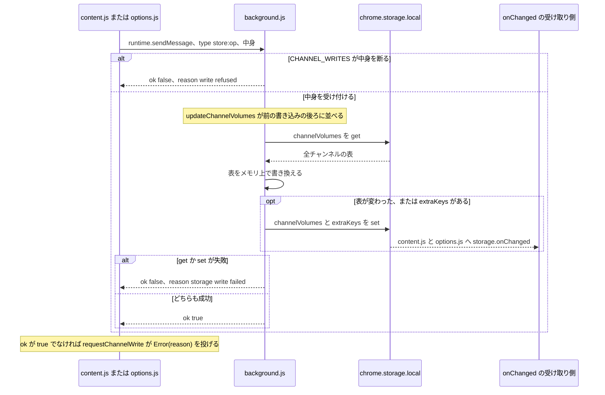

- `content.js` は `requestChannelWrite` で送る。拡張機能とのつながりが切れているとき (`isContextValid()` が false) は、送らずに成功として終わる。`saveChannelGain` と `saveChannelAutoApply` は、チャンネル ID が無いときは送らない。ほかの送り手も送る前にチャンネル ID があることを確かめるので、`migrateLegacyGains` を除き、`content.js` が送る書き込みはどれもチャンネルを名指しする。
- `CHANNEL_WRITES.saveChannelGain` / `saveChannelAutoApply` / `adoptHandleEntry` は、チャンネル ID が UC 形式でない、`name` か `url` があって文字列でない、`gain` が有限の数でない、`authorName` が文字列でない、のどれかなら、表を読む前に `ChannelWriteRefused` を投げる。`deleteChannel` はどのキーでも受け付ける。
- `updateChannelVolumes` は service worker の中の書き込みを 1 本の promise のつながり (`channelVolumesWrite`) に並べる。そのため、ある書き込みの `get` と `set` の間に別の書き込みが割り込まない。1 つが失敗しても列は止まらない。`mutate` のあとで表が変わっておらず、`extraKeys` も無ければ、何も `set` しない。
- この流れには debounce や throttle (続けて来る呼び出しをまとめたり間引いたりする仕組み) は無い。1 回の依頼が、列に並んだ 1 回の「読んで、書き換えて、書く」になる。

それぞれの操作が書き込むもの:

| 操作 | 送る側 | 書き込むもの |
|---|---|---|
| `saveChannelGain` | `content.js` | `name` / `url` (`applyChannelIdentity`)、その種別のゲイン、その種別の `gain*Plain` の印を付けるか外すか (`heldAgainstPlain`)、`autoApply` があればその種別の Auto のフラグ |
| `saveChannelAutoApply` | `content.js` | `name` / `url` と、その種別の Auto のフラグ |
| `adoptHandleEntry` | `content.js` | UC のキーに中身が無く、`@handle` のキーに `name` が `authorName` と同じ中身があるとき: その中身を新しい `url` 付きで UC のキーに置き、`@handle` のキーを消す |
| `deleteChannel` | `options.js` | そのキーを消す |
| `clearChannels` | `options.js` | すべてのキーを消す |
| `migrateLegacyGains` | `content.js`、`options.js` | 旧形式の取り込み (「起動時: 旧形式の取り込みと最初の適用」を参照)。service worker は、設定を sync へ移す処理が落ち着いてから返事をする |
| `saveSetting` | `options.js` | sync の `autoLoudnessSettings` の 1 項目 (「設定画面: 設定の変更」を参照)。チャンネルの書き込みの列ではなく、設定を移す処理と同じ列 (`queueSettingsWrite`) に並ぶ |

`applyChannelIdentity` は、名前が渡されてチャンネル ID と違うときに `name` を置き換える。そうでなければ保存済みの名前を残し、名前が無いときはチャンネル ID を入れる。`url` は渡されたときに置き換える。

図のもと: `content.js` の `requestChannelWrite`、`saveChannelGain`、`saveManualChannelGain`、`saveLiveChannelGain`、`saveChannelAutoApply`。`background.js` の `chrome.runtime.onMessage` の受け取り側。`utils.js` の `CHANNEL_WRITES`、`checkChannelIdentity`、`updateChannelVolumes`、`applyChannelIdentity`、`setChannelGain`、`setChannelAutoApply`。

## 優先するゲインを適用する: `applyPreferredGain`

この後の場面の多くは、この関数で終わる。この関数はチャンネルの保存内容を読んでゲインを決め、Auto が ON でレベルが分かっていれば Auto 自身の保存をする。

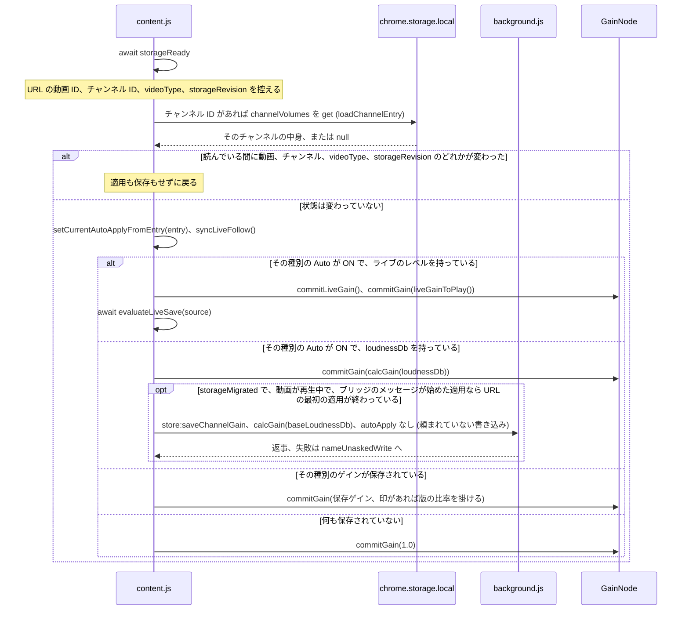

- 読み込みのもとになった状態が動いたら、その読み込みの結果は捨てる。動く例: 別の動画への移動、チャンネルや種別を変えたブリッジの返事、保存内容が変わったという知らせ (`storageRevision` は `channelVolumes` か `autoLoudnessSettings` が変わったという知らせのたびに増え、他の場所の `unifiedGains` を取り入れたときにも増える)。
- Auto 自身の保存は `autoApply` を送らないので、チャンネルは全チャンネル共通の既定値に従い続ける。`baseLoudnessDb` が分かっていれば `heldAgainstPlain: true` を送る。表が変わらない保存は、service worker が `set` しない (「チャンネル書き込みの共通の流れ」を参照)。
- 旧形式の取り込みが成功するまで (`storageMigrated` が false の間) は保存しない。`<video>` が止まっているかミュートのタブも保存しない (`isVideoPlaying()`。音量 0 やゲイン 0 は再生中に数える)。ブリッジのメッセージが始めた適用 (`fromMessage`) は、URL が変わったあとの最初の適用が URL の動画について終わるまで (`appliedVideoId`) も保存しない。ゲインの適用はする。
- `setCurrentAutoApplyFromEntry` は、中身のライブのゲイン (`storedLiveGain`) も取る。始まりの上限はこれをもとに測る。
- スライダーの試し聞きが続いている間 (「ポップアップ: スライダーを動かしている間 (`input`)」を参照) は、図のゲインを入れずに取っておき、残りは動かす。
- 項目の読み出しが reject したとき、または音声のつなぎを作れないときは、適用はそこで止まる。この関数を待たずに動かす呼び出し元 (ブリッジのメッセージ、移動の後の再試行、`autoLoudnessSettings` と `unifiedGains` が変わったという知らせ) は、その失敗を `reportFailure('apply failed')` で記録する。移動そのものの適用を `triggerApply` が記録するのと同じ。

図のもと: `content.js` の `applyPreferredGain`、`loadChannelEntry`、`setCurrentAutoApplyFromEntry`、`resolveAutoApplyForType`、`commitLiveGain`、`liveGainToPlay`、`storedGainToPlaying`、`calcStoredGainFromLoudness`、`calcGainFromLiveLevel`、`evaluateLiveSave`、`nameUnaskedWrite`。`utils.js` の `getChannelGain`、`isGainHeldAgainstPlain`、`renditionGainRatio`、`calcGain`、`calcLiveGain`。

## ポップアップ: スライダーを動かしている間 (`input`)

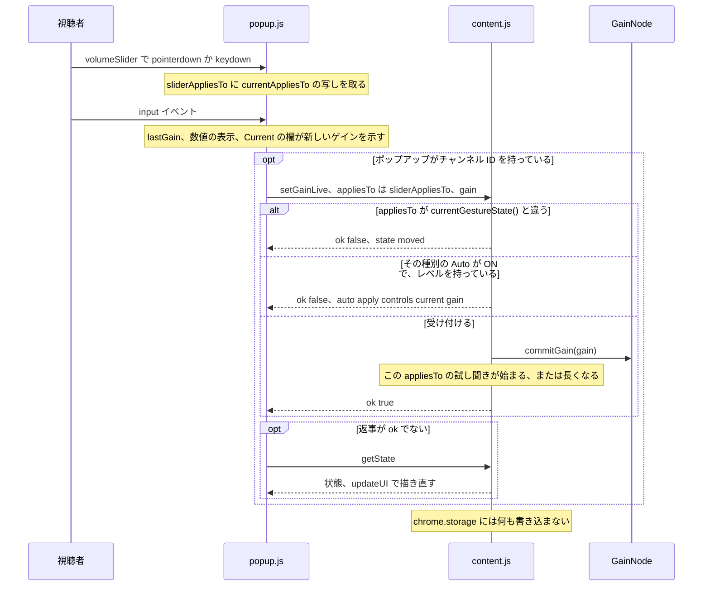

- `pointerdown` も `keydown` も無いまま来た `input` は、その `input` 自身が `currentAppliesTo` の写しを取る。1 回のドラッグの間の `input` は、すべて同じ写しを運ぶ。
- 「Manual Volume」(スライダーとプリセット) は、その種別の Auto が ON で Loudness が表示されている間はポップアップ側で操作できなくなり、`content.js` も同じ状態を断る。
- `input` イベント 1 回ごとに `setGainLive` を 1 回送る。debounce は無い。
- 試し聞きが続いていて、`currentGestureState()` がまだその `appliesTo` と同じ間は、ほかから来たゲインをかけずに取っておく: `applyPreferredGain`、`applyAutomaticLoudnessGain`、`channelVolumes` の変更の受け取り側は `commitGainFromElsewhere` を通してゲインを入れ、この関数はゲインをそのままにして、取っておいたことを記録する。`commitLiveGain` はライブのゲインを出す前に戻るので、ブリッジのメッセージでは `liveRaiseFrom` はそのまま残る。受け取り側は `liveGainToPlay` でライブのゲインを出してから取っておくので、別のタブの保存が届くと、`liveRaiseFrom` は試し聞きのゲインを基準に進む。それぞれのほかの仕事 (受け取る状態、Auto 自身の保存、ライブの保存の判定) は続ける。状態が動いた試し聞きは、何も取っておかない。
- 試し聞きは、`setGain` が来たとき (次の節を参照) か、最後に受け付けた `setGainLive` から `PREVIEW_IDLE_MS` (2000 ms) たったときに終わる。後者で終わり、取っておいたゲインがあるときは、`applyPreferredGain()` がその時点の保存内容をかけ、ポップアップに知らせる。

図のもと: `popup.js` の `beginSliderGesture`、`volumeSlider` の `input` の受け取り側、`sendManualGain`、`refreshDisplay`。`content.js` の `handleMessage` (`setGainLive`)、`currentGestureState`、`isCurrentManualGainLocked`、`commitGain`、`startPreview`、`endPreview`、`endIdlePreview`、`commitGainFromElsewhere`。

## ポップアップ: スライダーを離したとき (`change`) とプリセットボタン

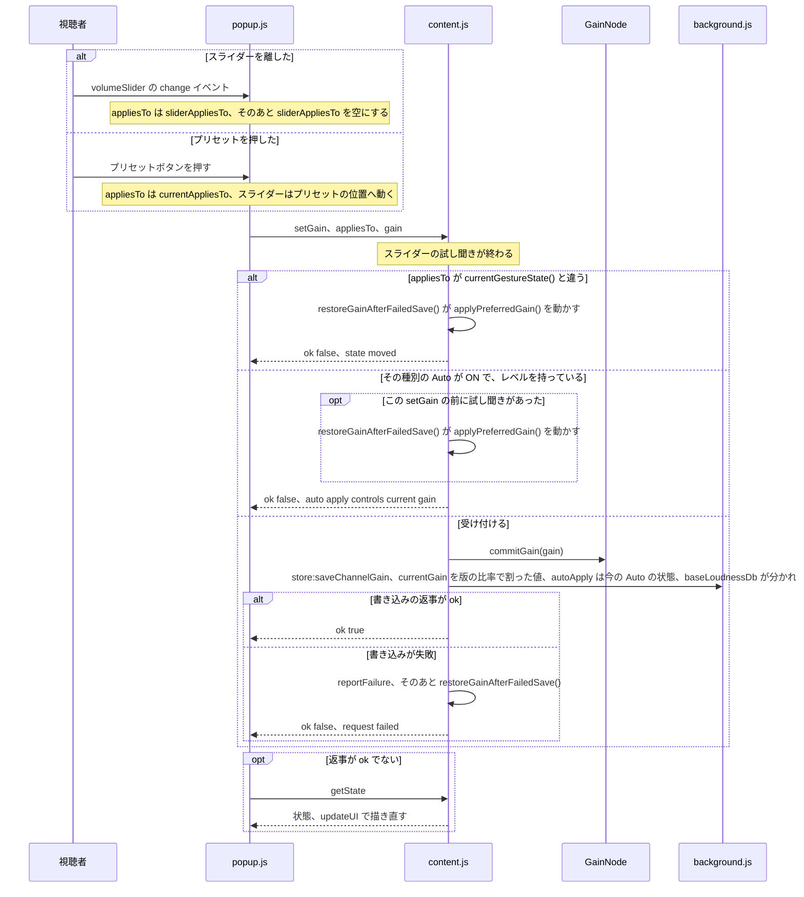

- プリセットボタンは「0%」「50%」「100%」「200%」「400%」「MAX」(`data-vol` は 600)。ポップアップがチャンネル ID を持っていなければ、何も送らない。
- スライダーをポインターで押さえている間にポップアップのウィンドウがフォーカスを失う (`blur`) と、ドラッグはそこで終わる。その `blur` より前に来た `change` は、離したときと同じく保存する。`blur` のあとは、次にスライダーで `pointerdown` か、キーの繰り返しでない `keydown` があるまで、`input` も `change` も何も送らない。
- 保存する値は、適用ゲイン (`commitGain` が切りそろえたあとの値) を版の比率で割ったもので、素の音声の版を基準にした値になる。どちらのレベルも分からないときは、比率は 1 で `heldAgainstPlain` は false。
- `autoApply` はその時点のその種別の Auto の状態で、チャンネル個別のフラグとして書かれる。Auto が ON でレベルがあるときは操作が断られるので、Auto が ON のまま保存されるのはレベルを持っていないとき (Auto が代わりに保存ゲインを使うとき) で、その保存はチャンネルの Auto を ON に固定する。
- `restoreGainAfterFailedSave()` は、続いている試し聞きを終わらせて `applyPreferredGain()` を動かすので、ゲインはその関数が保存内容から決める値に戻る。ポップアップへの返事はそのあと。

図のもと: `popup.js` の `volumeSlider` の `change` の受け取り側、プリセットの `click` の受け取り側、`sendManualGain`。`content.js` の `handleMessage` (`setGain`)、`fillCurrentChannelNameFromDomFallback`、`playingGainToStored`、`saveManualChannelGain`、`restoreGainAfterFailedSave`。

## ポップアップ: 「チャンネルに適用」

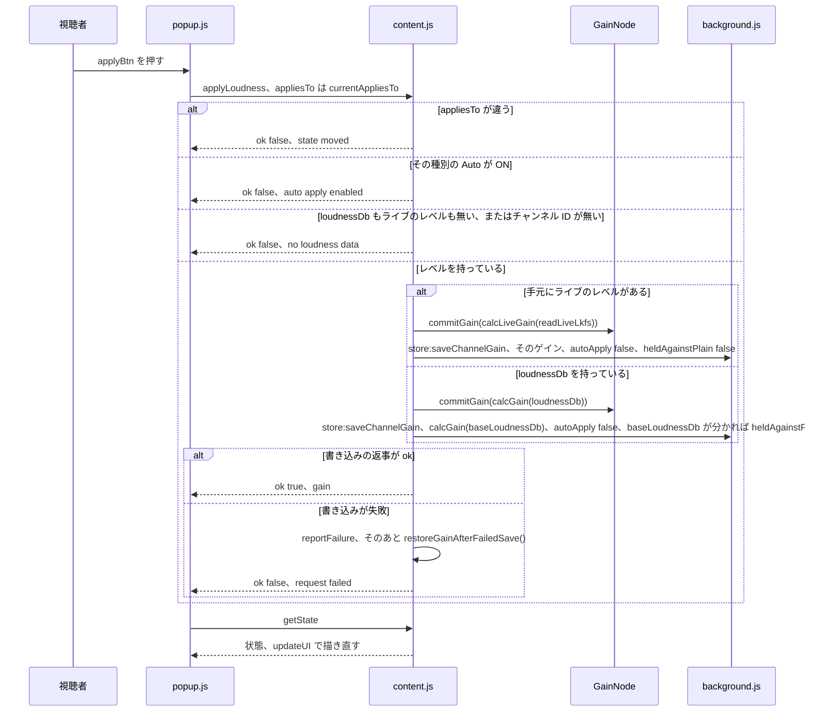

- ボタンが押せるのは、その種別の Auto が OFF で、Loudness が表示されていて、チャンネルが見つかっているとき。ボタンの文字は `applyToChannelWithValue` (「$VALUE$ をチャンネルに適用」) に提案ゲインを入れ、後ろに種別の名前をかっこ付きで足したもの。
- `autoApply` はその時点の Auto の状態で、ここまでで Auto が ON なら断っているので OFF になる。その種別のチャンネル個別のフラグが `false` で書かれ、チャンネルはその種別について全チャンネル共通の既定値に従わなくなる。
- 手元のライブのレベル (`readLiveLkfs`) は `loudnessDb` より先に使う。そのゲインは鳴らしたままの値で、印を付けずに保存する。
- 返事がどうであっても、ポップアップは `getState` を聞いて描き直す。

図のもと: `popup.js` の `updateApplyBtn`、`applyBtn` の `click` の受け取り側。`content.js` の `handleMessage` (`applyLoudness`)、`calcGainFromLiveLevel`、`calcGainFromLoudness`、`calcStoredGainFromLoudness`、`saveLiveChannelGain`、`saveManualChannelGain`、`restoreGainAfterFailedSave`。

## ポップアップ: 「LUFS 自動適用」トグル

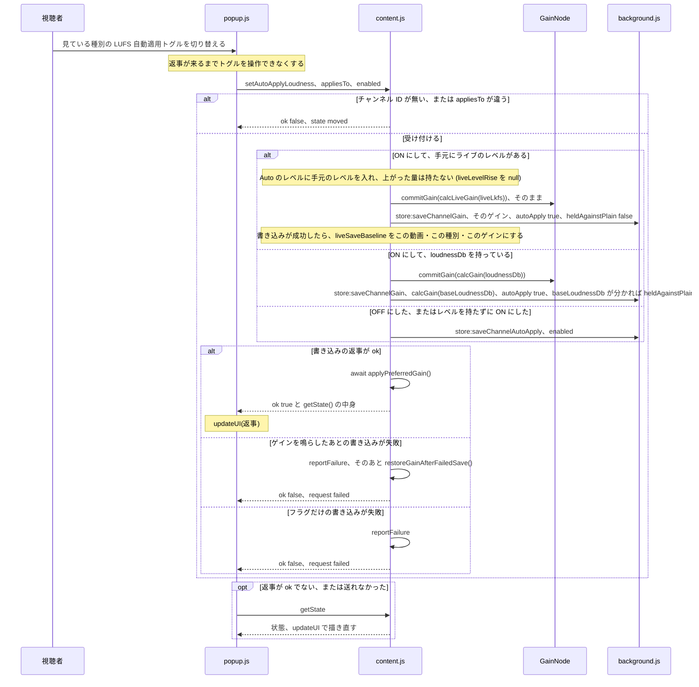

- ポップアップは見ている種別のトグルだけを表示し、その種別について、チャンネル ID があるときだけ送る。
- レベルが分かっているときに ON にすると、Auto が鳴らすゲインをすぐに適用し、フラグと一緒に 1 回の書き込みで保存する。OFF にしたとき、またはレベルが無いまま ON にしたときは、フラグだけを書き、保存ゲインはそのまま残す。
- この処理は `currentAutoApplyLoudnessVideo` / `currentAutoApplyLoudnessLive` を自分では変えない。書き込みのあとの `applyPreferredGain()` と `chrome.storage.onChanged` の受け取り側が、保存内容から決め直す。書き込みについての変更の知らせが、その `applyPreferredGain()` が読んでいる間に届くと、`storageRevision` が動いているので、その適用は何もせずに戻る。そのときまでに受け取り側が新しい中身から Auto を決め直し、計算したゲインを設定している (「他のタブ: `content.js` の `chrome.storage.onChanged`」を参照)。
- ライブの書き込みのあと、`liveSaveBaseline` があるので、同じ動画・同じ種別での次の `evaluateLiveSave` はこのゲインと比べ、同じゲインを二度保存しない。ゲインはそのまま鳴らす。続く `applyPreferredGain()` はレベルを `liveGainToPlay` に通して鳴らし、`liveRaiseFrom` を入れるので、そのあとの追従はそこから制限がかかる。
- `getState` も失敗したときは、ポップアップは最後に描いた状態からトグルを元に戻す。

図のもと: `popup.js` の `handleAutoApplyChange`、`resyncFromContent`。`content.js` の `handleMessage` (`setAutoApplyLoudness`)、`saveLiveChannelGain`、`saveChannelGain`、`saveChannelAutoApply`、`applyPreferredGain`、`restoreGainAfterFailedSave`。

## ポップアップを開いたとき: `forceDetect`

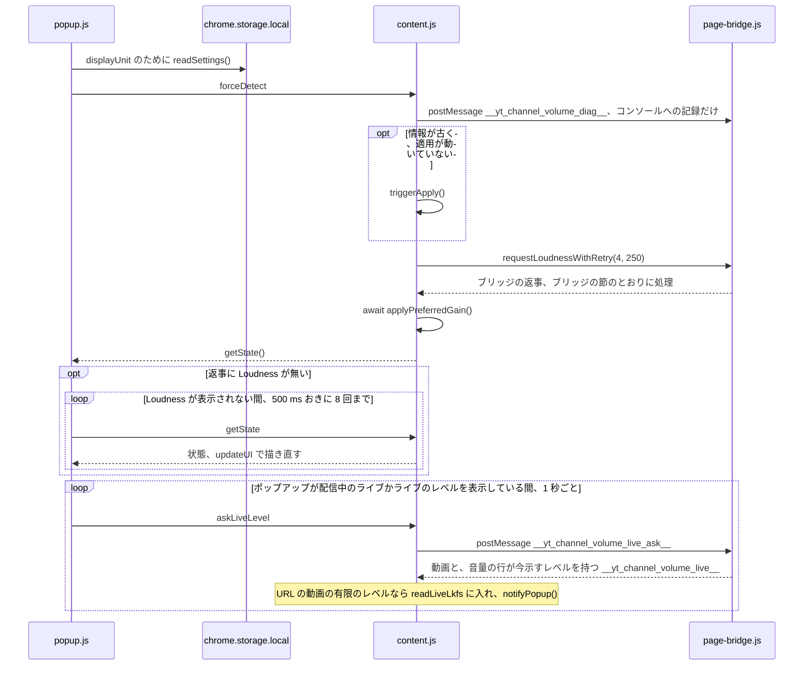

- 情報が古いとは、チャンネル ID が無いか、URL の動画 ID が `_lastVideoId` と違うこと。`triggerApply()` は「SPA 内の移動と、その他の適用のきっかけ」で説明する。
- `requestLoudnessWithRetry(4, 250)` は問い合わせを送り、次のブリッジのメッセージが来たら終わる。来ないまま 250 ms たつと、レベルを持っていれば終わり、持っていなければもう一度聞く。最大 4 回。
- ポップアップ自身の読み込み (`getState`、`retryGetState`、`askLiveLevel`) は何も書き込まない。ポップアップのために読んだライブのレベルは手元のレベルにだけなる: Auto のレベルと、Auto が鳴らして保存するものは、ブリッジの完全な返事を待つ。この流れで起きる保存は、`triggerApply()`、ブリッジの返事の処理、`applyPreferredGain()` によるもの。
- 失敗すると `reportFailure('forceDetect failed')` のあとで `{ ok: false, reason: 'request failed' }` を返す。

図のもと: `popup.js` の `init`、`retryGetState`、`askLiveLevelLater`。`page-bridge.js` の `__yt_channel_volume_live_ask__` の受け取り側。`content.js` の `handleMessage` (`forceDetect`、`askLiveLevel`)、`__yt_channel_volume_live__` の受け取り側、`sendDetectedState`、`requestLoudnessWithRetry`、`triggerApply`、`applyPreferredGain`、`getState`。

## `page-bridge.js` から届く音量レベル

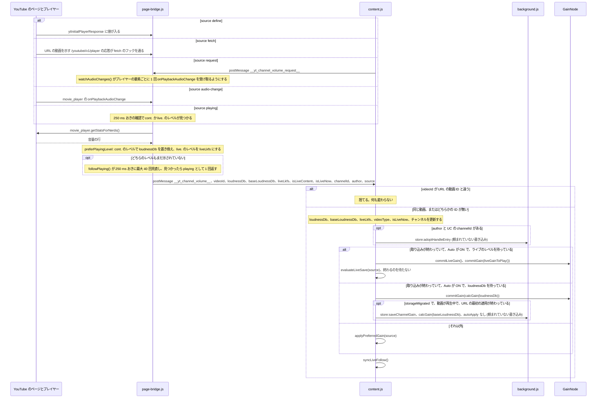

ブリッジが送る条件:

- `define`: 再生ページ (`/watch`、`/live/` の下のパス、または正規リンクが配信を示すチャンネルのライブ URL) で、応答の `videoDetails.videoId` が URL の動画であるか、どちらかが無いとき (`isCurrentVideo`)。
- `fetch`: 再生ページで、応答が `videoDetails.videoId` を持ち、それが URL の動画のとき (URL が動画を示さないときは、どの動画でもよい)。そこに動画 ID が無い応答 (`/youtubei/v1/player/ad_break` のものなど) は送らない。
- `request`: `content.js` が聞いたときはいつでも。返事は、読み込み時に取っておいた応答が URL の動画のものならそれから取る。それでレベルもチャンネル ID も得られないときは、ページが持つ応答の 1 つ目 (`ytd-watch-flexy`、その次に `movie_player.getPlayerResponse()`) から取る。`isLiveNow` は、URL の動画を示すもののうち一番新しいものから取る。どれも URL の動画を示さないときは、返事は `isLiveContent: null` を運ぶ。`content.js` はこれを受け取らないので、タブは持っている種別のままになる。
- `audio-change`: 再生ページで、プレイヤーが `onPlaybackAudioChange` を出すたび。
- `playing`: 音量の行に `cont.` か `live.` のレベルを初めて見つけたとき。

`content.js` はメッセージを次のように受け取る:

- 別の動画のメッセージは、何かを変える前に捨てる (`isBridgeMessageForCurrentVideo`)。
- 各項目は、ブリッジが送る型のときだけ受け取る: `loudnessDb` と `liveLkfs` は有限の数、`baseLoudnessDb` は数、`isLiveContent` は真偽値、`author` は文字列、`channelId` は UC 形式。
- 新しい動画 ID なら、`loudnessDb` と `baseLoudnessDb` をメッセージから入れる (無ければ `null`)。同じ動画なら、メッセージに有限の `loudnessDb` があるときだけ置き換える。`liveLkfs` はメッセージのたびに置き換えるので、それが無いメッセージはライブのレベルを消す。手元のレベル (`readLiveLkfs`) にも同じ値を入れる。ライブのレベルがあるメッセージは、それをその動画の `liveLevelBefore` として持ち、同じ動画で前に持っていたものより上がった量を 0.1 dB に丸めて `liveLevelRise` に入れる (ライブのレベルが無いメッセージと、別の動画のメッセージでは null)。ライブのレベルが無いメッセージは、`liveRaiseFrom` の `at` を null にする。
- チャンネルは、メッセージに有限の `loudnessDb` か真偽値の `isLiveContent` があり、UC の `channelId` があるときに受け取る。ID が変わると、`applyPreferredGain()` が保存内容から決め直すまで、両方の種別の Auto を OFF にしておく。名前は `author`、無ければページ、それも無ければ ID から取る。
- 旧形式の取り込みが終わっていない間 (`storageSettled` が false) は `applyAutomaticLoudnessGain` が false を返し、メッセージは `applyPreferredGain()` に回る。こちらは取り込みが終わるのを待つ。
- スライダーの試し聞きが続いている間 (「ポップアップ: スライダーを動かしている間 (`input`)」を参照) は、図のゲインを入れずに取っておく。
- Auto のゲインをかけるところで例外が出たときは、受け取り側がそれを `reportFailure('apply failed')` で記録する。`syncLiveFollow()` とレベルの待ち手は、そのあとでいつもどおり動く。
- 同じ動画でもう一度届いたとき (音声の版が変わった、プレイヤーがレベルを示した、ライブの追従) も、同じ手順を通る。Auto が ON で `baseLoudnessDb` が同じなら、Auto の保存は同じゲインと同じ印を運び、名前と url も同じなら service worker は何も `set` しない。Auto が OFF なら、保存ゲインに新しい版の比率を掛けて鳴らし直し、何も保存しない。

図のもと: `page-bridge.js` の `ytInitialPlayerResponse` の setter、`window.fetch` の置き換え、問い合わせの受け取り側、`watchAudioChanges`、`answerCurrentVideo`、`preferPlayingLevel`、`playingLevel`、`followPlaying`、`postResult`。`content.js` の `message` の受け取り側、`isBridgeMessageForCurrentVideo`、`applyAutomaticLoudnessGain`、`applyPreferredGain`、`syncLiveFollow`。

## ライブ配信: 追従タイマーとライブ保存の判定

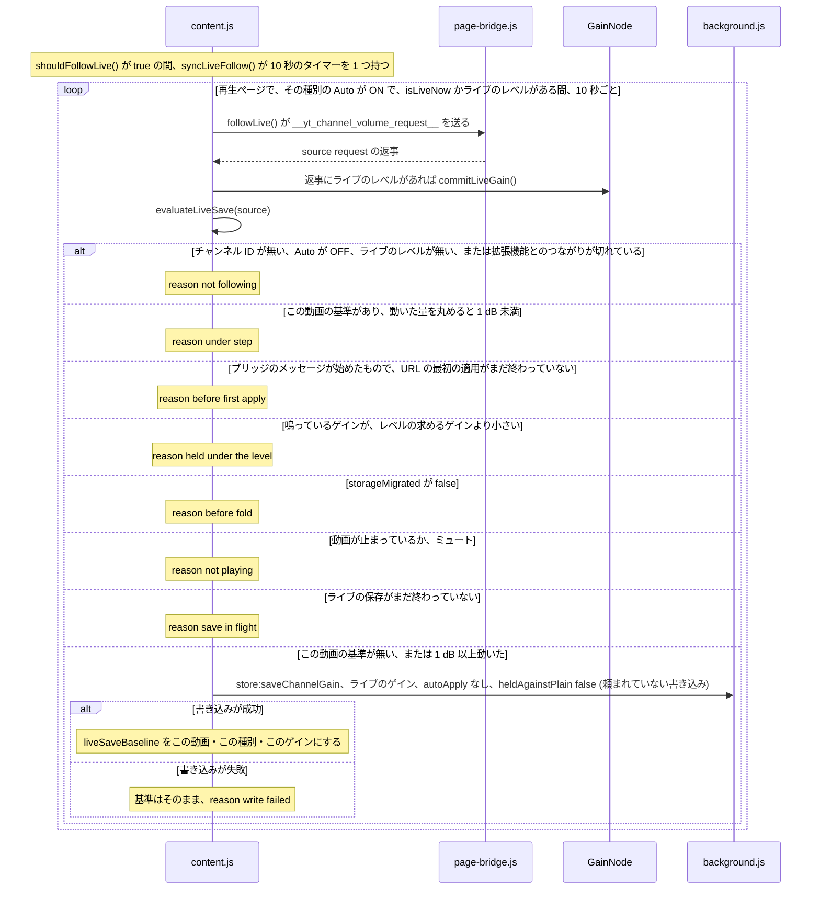

- `shouldFollowLive()` は、再生ページで、見ている種別の Auto が ON で、`isLiveNow` かライブのレベルを持っているときに true。`syncLiveFollow()` は、false ならタイマーを止め、true でタイマーが無ければ 1 つ始める。これはブリッジのメッセージのたびのあと、`applyPreferredGain` の中、`channelVolumes` の変更の受け取り側、`yt-navigate-finish` / `popstate` / `visibilitychange` のとき、`followLive` 自身の中で動く。
- 返事は他の返事と同じく、ブリッジのメッセージの受け取り側を通る。図はそのうちライブの分岐を描いている。ライブのレベルが無ければ、受け取り側の別の分岐が動く。
- `evaluateLiveSave` は、Auto が ON でライブのレベルがあるときは `applyPreferredGain` からも動く。そのため、移動のときの適用、設定の変更、Auto トグルのあとの適用も、同じ判定を通る。
- 動いた量は `gainChangeDb(gain, baseline.gain)` を 0.1 dB に丸めたもの。正の有限の数でないゲインは、限りなく大きく動いたものとして扱う。
- `liveSaveBaseline` は 1 つの動画 ID と 1 つの種別に結び付く。種別ごとに保存する枠が別なので、`evaluateLiveSave` は両方が同じときだけこれと比べる。`applyVideoVolume` は動画 ID が変わると消し、Auto トグルはライブの書き込みが成功すると設定する。
- ライブの保存は `autoApply` を送らないので Auto 自身の保存になり、チャンネルは全チャンネル共通の既定値に従い続ける。印を付けずに保存し、保存された値のまま鳴らす。
- Auto 自身の保存と同じく、`<video>` が止まっておらずミュートでもないタブだけが保存する (`isVideoPlaying()`)。音量 0 やゲイン 0 は再生中に数える。`not playing` の判定では基準をそのままにするので、再生しているタブの次の判定でもう一度試す。
- 比べて保存するのは、レベルの求めるゲイン (`calcLiveGain(liveLkfs)`) で、`liveGainToPlay` が鳴らしたゲインではない。鳴っているゲインがそれより小さい間 (始まりの上限、上昇の先取り、上げる速さの制限のどれかが抑えている間) は何も保存せず (`held under the level`)、追従は続ける。鳴っているゲインがそこに届くと、それを保存する。手動の操作は、レベルを当てている間と同じく鍵がかかったままで、ポップアップの Current は鳴っているゲインを、Suggested はレベルの求めるゲインを並べて示す。

図のもと: `content.js` の `shouldFollowLive`、`syncLiveFollow`、`followLive`、`requestLoudness`、`applyAutomaticLoudnessGain`、`commitLiveGain`、`liveGainToPlay`、`evaluateLiveSave`、`saveLiveChannelGain`。`utils.js` の `gainChangeDb`、`calcLiveGain`。

## SPA 内の移動と、その他の適用のきっかけ

YouTube は SPA (Single-Page Application。ページを読み込み直さずに、中身と URL を書き換えて画面を切り替える作り) なので、別の動画やチャンネルへ移っても新しいページは読み込まれず、`content.js` は動き続ける。

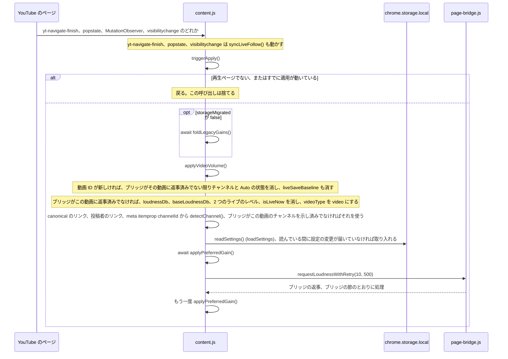

- きっかけ: `document` の `yt-navigate-finish`。`window` の `popstate`。ドキュメントを見張る `MutationObserver` は、再生ページで、ページの `<video>` 要素が前に処理したものと別になったとき、または URL の動画 ID が `_lastVideoId` と違うときに `triggerApply()` を呼ぶ。`visibilitychange` は、まだどの動画も処理していない再生ページでタブが表示されたときに `triggerApply()` を呼ぶ。最初の読み込みは次の節で説明する。
- `triggerApply()` は `_applyRunning` を鍵にする。適用が動いている間に来た呼び出しはすぐに戻り、列に並ばない。debounce は無い。拡張機能とのつながりが切れていると、見張りを止める。
- `detectChannel()` は UC の ID だけを返す。チャンネルを消したあとでページに UC の ID が無ければ、ブリッジが返事をするまでチャンネルは空のまま。チャンネル ID が無いとき、`applyPreferredGain()` は保存内容を読まない。全チャンネル共通の既定値で Auto が ON でレベルを持っていれば Auto のゲインを、それ以外は 1.0 を鳴らし、何も保存しない。
- 移動でブリッジ由来の状態を消したときは、ブリッジが `isLiveContent` を送るまで videoType は `'video'` なので、ライブ配信でも最初は動画用の保存ゲインが適用される。
- `requestLoudnessWithRetry(10, 500)` は次のブリッジのメッセージが来たら終わる。来ないまま 500 ms たつと、レベルを持っていれば終わり、持っていなければもう一度聞く。最大 10 回。ブリッジの返事はそれ自身で適用され (ブリッジの節を参照)、そのあとで `applyPreferredGain()` がもう一度動く。
- この流れでの保存は、`applyPreferredGain()` の中の Auto 自身の保存とライブの保存。`applyVideoVolume` の最初の `applyPreferredGain()` が終わると、その動画を `appliedVideoId` に入れる。それまでは、ブリッジのメッセージは URL の動画についてどちらの保存もしないので、その適用より前に届いたメッセージは、離れたページのチャンネルを持ったままでも、何も保存しない。設定の変更とポップアップを開いたときの適用は、これまでどおり保存する。
- `applyVideoVolume` の失敗は `reportFailure('apply failed')` が記録する。

図のもと: `content.js` の `yt-navigate-finish` / `popstate` / `visibilitychange` の受け取り側、`MutationObserver` の処理、`triggerApply`、`applyVideoVolume`、`detectChannel`、`loadSettings`、`requestLoudnessWithRetry`、`applyPreferredGain`。

## 起動時: 旧形式の取り込みと最初の適用

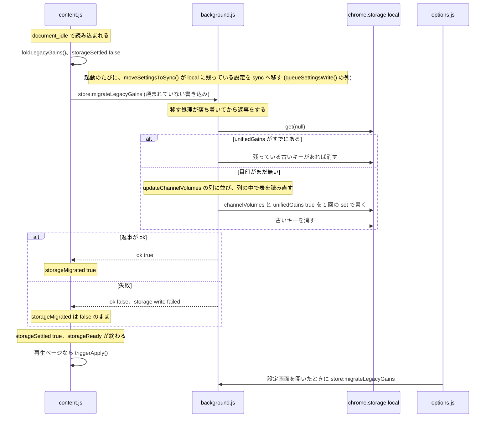

- 取り込みが `channelVolumes` に書くもの: 列に並ぶ前に読んだ表でゲインがあってフラグが無く、そのあともフラグが付いていない種別に、はっきりした `false` のフラグ (古い決まり「保存ゲインがあれば Auto は OFF」)。次に、Auto が ON と決まり、その読み込みからゲインが変わっていない種別に、古いキーで覚えていたゲインを印を付けずに入れる。`unifiedGains: true` は同じ `set` に入り、`extraKeys` があるのでこの `set` は必ず行われる。
- `clearLegacyKeys` は自分の失敗を記録するだけで、取り込みを失敗にはしない。取り込みは、全チャンネル共通の既定値を `readSettings()` で読む。
- `moveSettingsToSync` は、sync に設定が無ければ local の設定を sync に書き (あれば sync のものを残す)、そのあとで local から消す。local を消す前に sync を書くので、読む側はどちらかで見つける。
- `storageMigrated` が false の間: Auto は古い決まりで決め、Auto 自身の保存とライブの保存はしない (ゲインの適用はする)。`triggerApply()` のたびに取り込みをやり直す (`foldInFlight` で、試みは同時に 1 つだけ)。
- `storageMigrated` は、他の場所から `unifiedGains` が `chrome.storage.onChanged` で届いたときにも true になる (次の節を参照)。
- 読み込まれたときに拡張機能とのつながりが切れていれば、取り込みは頼まない。再生ページなら `triggerApply()` を呼ぶが、すぐに戻って見張りを止める。
- 設定画面は開いたときに取り込みを頼み、そのあと 2 つのキーを読む (`loadAll`)。失敗は記録され、`unifiedGains` が届くまで一覧は古い決まりで描かれる。

図のもと: `content.js` の起動部分、`foldLegacyGains`、`triggerApply`。`background.js` の起動部分。`utils.js` の `migrateLegacyAutoGains`、`clearLegacyKeys`、`resolveAutoApplySetting`、`moveSettingsToSync`、`queueSettingsWrite`、`readSettings`。`options.js` の起動の処理。

## 他のタブ: `content.js` の `chrome.storage.onChanged`

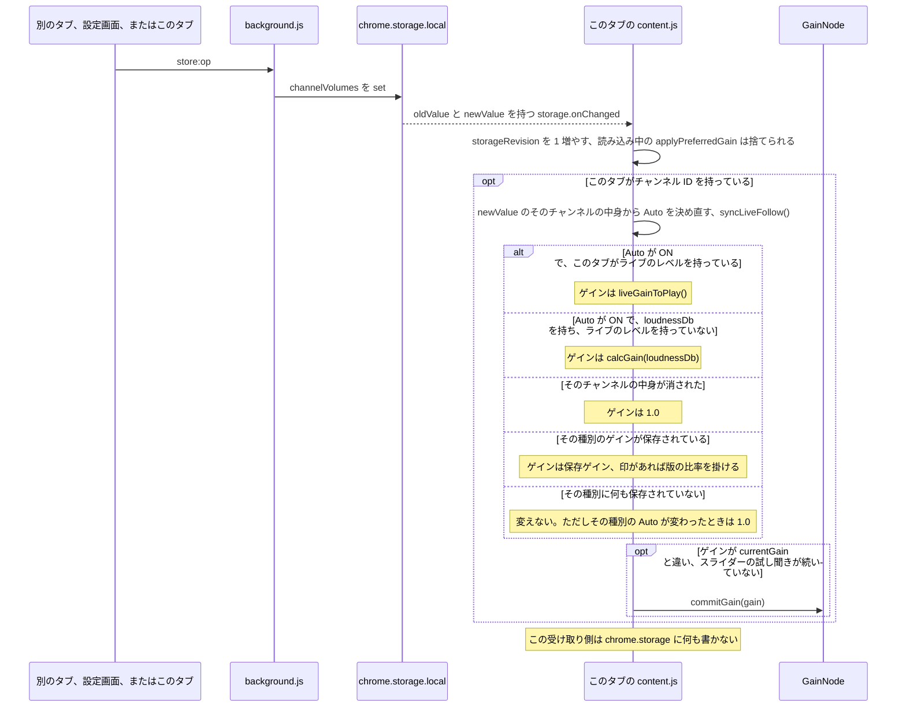

- この受け取り側は、このタブ自身の書き込みと他の場所の書き込みを区別しない。このタブが頼んだ書き込みの知らせもここに届き、計算したゲインが `currentGain` と同じなら適用ゲインは変わらない。
- Auto が ON なら、このタブが持つライブのレベルや `loudnessDb` を、他のタブが保存したゲインより先に使う。
- 同じ受け取り側は、ほかに 2 つのキーも扱う:
  - `storageMigrated` が false の間に `unifiedGains` が `true` になった: `storageMigrated` と `storageSettled` を立て、同じ知らせに `channelVolumes` の変更が無ければ `applyPreferredGain()` を動かす。
  - `autoLoudnessSettings` は `chrome.storage.sync` の知らせで届く (「設定画面: 設定の変更」を参照)。service worker が移すときに local からこのキーが消えるのは設定の変更ではなく、local の受け取り側は取り入れない。

図のもと: `content.js` の `chrome.storage.onChanged` の受け取り側、`resolveAutoApplyForType`、`setCurrentAutoApplyFromEntry`、`storedGainToPlaying`、`commitGain`。

## 設定画面: 設定の変更

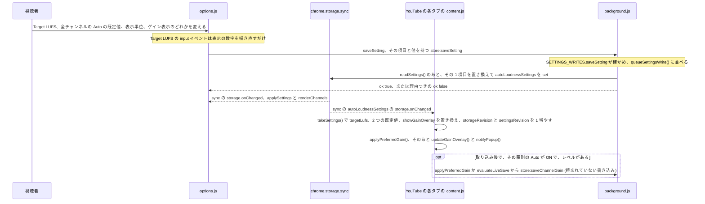

- 操作するもの: 「Target LUFS」(スライダーの `change`)、「全チャンネルの LUFS 自動適用」(Video と Live のトグル)、「表示単位」(`%` / `dB` のボタン)、「ゲイン表示」。どれも 1 項目で `saveSetting` を呼ぶ。
- `saveSetting` は、最初の読み込みが終わるまで (`settingsLoaded`) は書かずに戻り、それまでは画面の部品も操作できない状態で出てくる。その項目と値を `store:saveSetting` として `background.js` に送る。そこでは `SETTINGS_WRITES.saveSetting` が、5 つのどれでもない項目と、その項目が持てない値を断り (`write refused`)、`readSettings()` で読んだ設定を、その項目を置き換えて sync に書き戻す。この書き込みは、設定を sync へ移す処理と同じ列 `queueSettingsWrite()` に並ぶ。
- 同じプロフィールでサインインしたほかのマシンが書いた設定も、同じく `chrome.storage.sync` の知らせで届く。
- 2 つの既定値のトグルは、書き込みが終わるまで操作できなくなり、書き込みが失敗するとチェックを元に戻す。残りの 3 つも書き込みを待つ。失敗したときは、`readSettings()` で設定を読み直して、保存されている値を出す (その間に変更の知らせが来ていれば、そちらを残す)。設定の下の行には `settingsSaveFailed` (「設定を保存できませんでした。保存済みの値へ戻しました」) を出す。3 つのどれかの書き込みが成功すると、その行を消す。
- この画面の操作は、どれも `channelVolumes` を書かない。YouTube の各タブでは `applyPreferredGain()` が新しい目標値と既定値を当てはめる。その種別の Auto が ON でレベルが分かっていれば、新しい Auto のゲインを適用して保存する (Auto 自身の保存、またはライブ保存の判定)。Auto が OFF かレベルが分からなければ、保存ゲインがこれまでどおり鳴る。その適用が項目を読んでいる間に変更の知らせが届いたときは、適用は何もかけず何も保存しないまま戻り (`STORAGE_MOVED`)、受け取り側がもう 1 回だけ動かす。
- 全チャンネル共通の既定値を変えると、その種別に個別のフラグ (または古い形式のフラグ) を持たないチャンネルだけ、Auto が変わる。

図のもと: `options.js` の `targetSlider`、`defaultAutoVideoToggle`、`defaultAutoLiveToggle`、`unitToggle`、`overlayToggle` の受け取り側、`saveSetting`、`applySettings`、`chrome.storage.onChanged` の受け取り側。`utils.js` の `SETTINGS_WRITES`、`SETTING_FIELDS`、`queueSettingsWrite`、`readSettings`。`content.js` の `chrome.storage.onChanged` の受け取り側、`takeSettings`、`applyPreferredGain`、`updateGainOverlay`。

## 設定画面: 行の削除と全削除

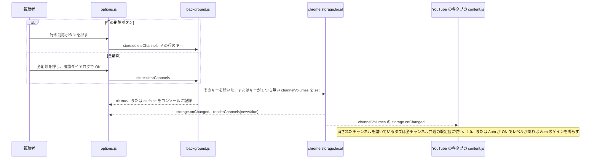

- 削除ボタンは行の「×」(マウスを重ねると「削除」と出る)。「全削除」は先に「保存済みチャンネルをすべて削除しますか？」と聞く。
- `deleteChannel` は一覧に出ているキーをそのまま受け取るので、`@handle` のキーも消せる。
- 一覧は変更の知らせからだけ描き直す。失敗すると一覧はそのままで、`[YTCV] channel not deleted` / `[YTCV] channels not cleared` を記録する。
- `content.js` の受け取り側は何も書き戻さない。そのチャンネルを開いているタブで次に適用が動くと (ブリッジの返事、移動)、Auto が ON でレベルがあれば、Auto のゲインがまた保存される。

図のもと: `options.js` の `renderChannels` (`.ch-del` の `click` の受け取り側)、`clearAllBtn` の受け取り側、`requestChannelWrite`。`utils.js` の `CHANNEL_WRITES.deleteChannel`、`CHANNEL_WRITES.clearChannels`。`content.js` の `chrome.storage.onChanged` の受け取り側。

## まとめ

| 出来事 | 適用ゲインは変わるか | `chrome.storage` に保存されるか | 場所 (関数) |
|---|---|---|---|
| ポップアップのスライダーの `input` | 変わる (試し聞き) | されない | `popup.js` の `volumeSlider` の `input` の受け取り側。`content.js` の `handleMessage` (`setGainLive`)、`commitGain` |
| ポップアップのスライダーの `change`、プリセットボタン | 変わる | される: Auto の状態をチャンネル個別のフラグにして `saveChannelGain` | `handleMessage` (`setGain`)、`saveManualChannelGain` |
| `setGain` が `state moved` で断られた、または試し聞きのあとに `auto apply controls current gain` で断られた | `applyPreferredGain` が決める値に戻る | されない | `restoreGainAfterFailedSave` |
| スライダーの試し聞きが続いている間に、ほかから来たゲイン | 操作が終わるまで変わらない | その出来事の行と同じ | `commitGainFromElsewhere` |
| `setGain` の無いまま終わった試し聞きで、取っておいたゲインがある | `applyPreferredGain` が決める値に戻る | ブリッジの返事の行と同じ | `endIdlePreview` |
| `loudnessDb` での「チャンネルに適用」 | 変わる | される: `calcGain(baseLoudnessDb)`、フラグ `false`、基準が分かれば印 | `handleMessage` (`applyLoudness`)、`saveManualChannelGain` |
| ライブのレベルでの「チャンネルに適用」 | 変わる | される: ライブのゲイン、フラグ `false`、印なし | `handleMessage` (`applyLoudness`)、`saveLiveChannelGain` |
| レベルがあるときに「LUFS 自動適用」を ON | 変わる | される: ゲインとフラグ `true` を 1 回で | `handleMessage` (`setAutoApplyLoudness`) |
| 「LUFS 自動適用」を OFF、またはレベルが無いときに ON | 書き込みのあとの `applyPreferredGain` による | される: フラグだけ | `saveChannelAutoApply` |
| 頼まれた書き込みが失敗 | `applyPreferredGain` が決める値に戻る | されない | `restoreGainAfterFailedSave` |
| ブリッジの返事、Auto が ON、ライブのレベル | 変わる | `evaluateLiveSave` が決めたとき | `applyAutomaticLoudnessGain`、`evaluateLiveSave` |
| ブリッジの返事、Auto が ON、`loudnessDb` | 変わる | 取り込み後に、動画が再生中のタブでされる (表が変わらなければ `set` しない) | `applyAutomaticLoudnessGain`、`isVideoPlaying` |
| ブリッジの返事、Auto が OFF かレベルが無い | 保存ゲイン (印があれば比率を掛ける) か 1.0 | されない | `applyPreferredGain` |
| 始まりの上限、上昇の先取り、上げる速さの制限で、レベルの求めるゲインより小さく抑えたライブのゲイン | 変わる (`liveGainToPlay` が許すゲインまで) | されない (`held under the level`) | `liveGainToPlay`、`evaluateLiveSave` |
| ポップアップのライブのレベルの読み取り (`askLiveLevel`、1 秒ごと) | 変わらない | されない | `popup.js` の `askLiveLevelLater`。`content.js` の `__yt_channel_volume_live__` の受け取り側 |
| `author` と UC の `channelId` があるブリッジの返事 | 変わらない | その名前の `@handle` の中身を引き取るときだけ | `message` の受け取り側、`CHANNEL_WRITES.adoptHandleEntry` |
| 音声の版の変更 (`audio-change`)、レベルが示された (`playing`) | ブリッジの返事の行と同じ | ブリッジの返事の行と同じ | `watchAudioChanges`、`followPlaying` |
| ライブの追従タイマー (10 秒) | ブリッジの返事の行と同じ | ブリッジの返事の行と同じ | `syncLiveFollow`、`followLive` |
| SPA 内の移動、見張り、`visibilitychange` | 変わる | 取り込み後に Auto が ON でレベルがあれば、Auto 自身の保存かライブの保存 | `triggerApply`、`applyVideoVolume`、`applyPreferredGain` |
| ポップアップを開く | `applyPreferredGain` による | SPA 内の移動と同じ | `handleMessage` (`forceDetect`) |
| 起動時、設定画面を開いたとき | 変わらない | 目印が無ければ `channelVolumes` と `unifiedGains` | `foldLegacyGains`、`migrateLegacyAutoGains` |
| service worker の起動 | 変わらない | local に残っている設定を sync へ移す | `moveSettingsToSync` |
| 取り込みが成功する前の Auto の適用 | 変わる | されない | `applyAutomaticLoudnessGain`、`applyPreferredGain`、`evaluateLiveSave` |
| `channelVolumes` の変更の知らせ | 計算したゲインが違うとき | されない | `content.js` の `chrome.storage.onChanged` の受け取り側 |
| `autoLoudnessSettings` の変更 | `applyPreferredGain` による | `options.js` に頼まれた `background.js` が sync の `autoLoudnessSettings` を。Auto が ON でレベルがあるタブでは Auto 自身の保存も | `saveSetting`、`SETTINGS_WRITES.saveSetting`、`content.js` の `chrome.storage.onChanged` の受け取り側 |
| 他の場所から届いた `unifiedGains` | `applyPreferredGain` による | Auto が ON でレベルがあれば Auto 自身の保存 | `content.js` の `chrome.storage.onChanged` の受け取り側 |
| 設定画面の行の「×」、「全削除」 | そのチャンネルのタブ: 1.0 か Auto のゲイン | される: `deleteChannel` / `clearChannels` | `renderChannels`、`clearAllBtn` の受け取り側 |

## 測って確かめたブラウザとサイトの挙動

ここに挙げる挙動は、コードだけでは決まりません。2026-10-25 に macOS の Chrome 156.0.8078.47 で、サインインしていない新しいプロファイルを使って測りました。「画面に出る Chrome」と書いたもの以外は headless (`--headless=new`、画面を出さない Chrome) です。Chrome の項目は、このリポジトリのコードと同じ形に組んだテスト用のページと拡張機能で測りました。YouTube の項目は、この拡張機能の写しにログ出力だけを足して測りました。

- **値の変わらない書き込み** (「設定画面: 設定の変更」と「他のタブ: `content.js` の `chrome.storage.onChanged`」を参照): 保存済みと同じ値を `chrome.storage.local.set` で書いても、書いた側・拡張機能のページ・content script のどこにも `onChanged` は届きませんでした (場合ごとに 10 回中 0 回。値が変わる書き込みは 10 回中 10 回届きました)。変わるキーと変わらないキーを 1 回の `set` で書くと、`changes` には変わったキーだけが入りました。
- **1 回のチャンネル書き込みの知らせと返事** (「チャンネル書き込みの共通の流れ」を参照): このリポジトリの `background.js` では、200 回中 200 回、`onChanged` が `sendMessage` の返事より先に content script に届きました。返事が遅れた時間は、中央値で 0.1 ms、最大で 0.8 ms です。
- **ポップアップのスライダーのキーボード操作** (「ポップアップ: スライダーを離したとき (`change`) とプリセットボタン」を参照): このスライダーと同じ `min="0" max="600" step="5"` の range 入力で、値が動くキーを 1 回押すと `input` と `change` が 1 回ずつ出ました (矢印キーで 5、PageUp / PageDown で 60 動きます)。端でキーを押すと、どちらも出ませんでした。キーを押し続けると、値が動いた繰り返しごとに `change` が 1 回出ました。マウスで 10 回動かすドラッグでは、`input` が 10 回、`change` が 1 回でした。`change` 1 回が、保存を伴う `setGain` 1 回になります。
- **隠れたタブでのライブ追従タイマー** (「ライブ配信: 追従タイマーとライブ保存の判定」を参照): ライブ追従タイマーと同じ形の、30000 ms の `setTimeout` をつなげたタイマーは、見えているタブと、音が出ている隠れたタブでは 30.0 秒ごとに動きました (headless でも画面に出る Chrome でも、26 回の間隔のうち 26 回が 30000〜30004 ms)。音が出ていない隠れたタブ (後ろのタブ、または画面に出る Chrome で最小化したウィンドウのタブ) では、隠れてから 216〜217 秒までは約 31 秒ごと、その後は約 60 秒ごとになりました。headless では 278 秒から、画面に出る Chrome では 42〜48 秒の間隔を 1 回はさんで 319〜324 秒からです。ライブ追従タイマー自身の間隔 `LIVE_FOLLOW_INTERVAL_MS` は 10000 ms で、10000 ms のタイマーは走らせていません。
- **最初の読み込みでの bridge の返事** (「`page-bridge.js` から届く音量レベル」と「起動時: 旧形式の取り込みと最初の適用」を参照): 普通の動画を 6 回新しく読み込むと、`content.js` が `message` の受け取りを始めたのは読み込み開始から 820〜1232 ms 後で、それより前に出た返事は届きませんでした。`define` は 6 回中 0 回、`playing` は 3 回中 0 回、`fetch` は 18 回中 12 回でした (2 回の読み込みでは、受け取り開始の 13〜107 ms 前に 3 つとも出ていて、届きませんでした)。`request` の返事は 12 回中 12 回届きました。
- **最初の読み込みでの `/youtubei/v1/player`** (「`page-bridge.js` から届く音量レベル」を参照): ページ自身のスクリプトは、自分の `url` プロパティが `/youtubei/v1/player` と読める `Request` を `window.fetch` に渡しますが、その中身は `data:application/json` の URL でした (調べた 50 個中 50 個)。bridge のフックは `args[0].url` を読むので、これを `/player` の呼び出しとして扱います。ネットワークの記録には出ません。
- **SPA 内の移動での返事** (「SPA 内の移動と、その他の適用のきっかけ」を参照): 関連動画をクリックして 182 回移動したうち、180 回は `/youtubei/v1/player` を呼びませんでした。呼んだ 2 回も別の第 3 の動画を名指ししていたので、移動先の動画への `fetch` の返事は出ませんでした。MutationObserver の URL の分岐から動く最初の適用は、182 回中 182 回、先に届いたレベルもチャンネルも持っていませんでした。`yt-navigate-finish` での適用は、先に届いたレベルを 182 回中 182 回、チャンネルを 182 回中 151 回持っていました。
- **ライブ配信** (「ライブ配信: 追従タイマーとライブ保存の判定」と「`page-bridge.js` から届く音量レベル」を参照): 配信中のライブのプレイヤー応答には、17 回の読み込みのうち 17 回で `audioConfig.loudnessDb` がありませんでした (`audioConfig` にあったのは `enablePerFormatLoudness`・`loudnessNormalizationConfig`・`loudnessTargetLkfs`)。普通の動画には 5 回中 5 回ありました。サインインして音を出している操作者の Chrome では、統計の音量の行 (`getStatsForNerds().volume`) が、配信のレベルを `live.` の形で出しました (`50%/50% (live.-17.0dB)`)。サインインせず音を消した headless の走行では、CM の後も `live.` と `cont.` のどちらも出ませんでした (8 本の配信で 837 回読んで 0 回)。普通の動画では `cont.` が 279 回中 279 回出ました。
