# Gain changes and when channel settings are saved

> 日本語版: [gain-change-and-save.ja.md](gain-change-and-save.ja.md)

This document follows the code in this repository and describes two things: every path by which the gain applied to a video's audio changes, and which of those paths write per-channel settings to `chrome.storage`. Each diagram is followed by the files and functions it is drawn from. The last section, "Measured browser and site behaviour", lists the behaviour of Chrome and YouTube that these paths depend on and the code does not decide, as measured.

## Overview

### Participants

| Participant | Where it runs | What it does here |
|---|---|---|
| `page-bridge.js` | The MAIN world of the YouTube page (the page's own JavaScript context), injected at `document_start` | Reads the player response and the player's stats-for-nerds volume line, and posts the level to `content.js` |
| `utils.js` + `content.js` | The ISOLATED world (the extension's own JavaScript context inside the page, kept apart from the page's scripts), injected at `document_idle` | Holds the tab's state, sets the gain on the GainNode, and asks `background.js` for channel writes |
| `background.js` | The service worker of the Manifest V3 (MV3) extension | Performs every write to `channelVolumes` and to the settings, and at every start moves settings still in `chrome.storage.local` to `chrome.storage.sync` |
| `popup.js` | The toolbar popup | Sends the viewer's gestures to `content.js` in the active tab |
| `options.js` | The settings page, opened in its own tab | Asks `background.js` for its settings writes, channel deletions and the legacy fold |
| `chrome.storage.local`, `chrome.storage.sync` | The browser | Hold the keys below: the settings in sync and the rest in local. Where the user has turned on Chrome sync, Chrome syncs the sync area with every Chrome the user is signed in to; where it is off, the sync area behaves like local ([`chrome.storage`](https://developer.chrome.com/docs/extensions/reference/api/storage)). `content.js` and `options.js` listen to `chrome.storage.onChanged` in both areas |
| GainNode | The Web Audio API graph in the tab: `<video>`, `MediaElementSource`, `GainNode`, destination | Plays the audio at the applied gain |

### Storage keys

| Key | Shape | Written by |
|---|---|---|
| `channelVolumes` | `{ [channelId]: { name, url, gainVideo, gainLive, gainVideoPlain, gainLivePlain, autoApplyLoudnessVideo, autoApplyLoudnessLive } }` | `background.js`, through `CHANNEL_WRITES` in `utils.js` |
| `autoLoudnessSettings` (in sync) | `{ targetLufs, displayUnit, showGainOverlay, autoApplyLoudnessVideoDefault, autoApplyLoudnessLiveDefault }` | `background.js`, through `SETTINGS_WRITES` in `utils.js`, asked by `options.js` (`saveSetting`); a copy still in local is moved to sync by `moveSettingsToSync` |
| `unifiedGains` | `true` | `background.js`, in the same `set` as the legacy fold's `channelVolumes` |
| `autoLoudnessFallbacks`, `autoLoudnessFallback:<channelId>:<type>` | Legacy Auto-learned gains | Not written. The legacy fold reads and removes them |

The fields of a `channelVolumes` entry:

- `gainVideo` / `gainLive`: the stored gain of each type (1.0 is 100%), 0 to 6. A manual gain stored against the plain rendition is clamped to that range when it is worked out (`playingGainToStored`), and the worker refuses one outside it.
- `gainVideoPlain` / `gainLivePlain`: `true` when that type's gain is held against the plain rendition (`baseLoudnessDb`). Without it the gain plays as stored.
- `autoApplyLoudnessVideo` / `autoApplyLoudnessLive`: the channel's own Auto flag for each type. A type without it follows the all-channel default.
- `name` and `url` (`https://www.youtube.com/channel/<channelId>`).
- Legacy fields: `gain` (one gain for both types) and `autoApplyLoudness` (one flag for both types) are read as both types. `setChannelGain` and `setChannelAutoApply` expand them into the per-type fields when a write touches them.
- The key is a channel id in the UC form (`UC` followed by `[A-Za-z0-9_-]`). An entry saved under an `@handle` key stays there until `adoptHandleEntry` moves it.

Every reader takes the settings through `readSettings()`: sync first, then the copy in local while the worker has not moved it, and sync once more where local comes back empty.

### Terms

- **Applied gain**: `currentGain` in `content.js` and the value on the GainNode. It changes through `commitGain` and nowhere else.
- **Stored gain**: `gainVideo` / `gainLive` in `channelVolumes`.
- **videoType**: `'live'` where the bridge says `isLiveContent` is true (a stream on air and its archive), `'video'` otherwise (videos, Shorts, premieres). `applyVideoVolume` sets it to `'video'` when it clears the bridge state for a new page, and it stays so until the bridge sends `isLiveContent`.
- **LUFS / LKFS**: Loudness Units relative to Full Scale / Loudness, K-weighted, relative to Full Scale. Both name the same loudness scale.
- **loudnessDb**: the level of the rendition being played, in dB (decibels) against YouTube's loudness target. **baseLoudnessDb**: the level of the plain rendition the response's `audioConfig` describes.
- **DRC**: Dynamic Range Compression. The player's Stable Volume setting plays a rendition of its own (an adaptive format with `isDrc`).
- **Live level** (`liveLkfs`): the `live.` level that the player's volume line names on a stream on air, an absolute level in LKFS. `content.js` holds two: Auto's level (`currentLiveLkfs`), which only the bridge's full answer sets, and which Auto plays and stores; and the level in hand (`readLiveLkfs`), which the full answer and the popup's once-a-second read set. The popup, the manual lock, "Apply to channel" and turning Auto on use the level in hand.
- **Live gain to play** (`liveGainToPlay()`): the gain Auto plays for a live level. Where the level rose `LIVE_RISE_DB` (1 dB) or more over the one the bridge named before it for the same video (`liveLevelRise`), the gain is worked out as if the level were `LIVE_RISE_AHEAD_DB` (3 dB) louder (the rise cut). The first live gain for a video in the page (`liveRaiseFrom` naming no video or another) goes no higher than `LIVE_START_CAP_DB` (3 dB) over the entry's live gain (`storedLiveGain`), where that is above 0 and the video plays as live (the start cap). After it, a gain at or below `currentGain` plays at once, and one above it plays no higher than `currentGain` raised by `LIVE_RAISE_DB` (1.5 dB) for every `LIVE_RAISE_PERIOD_MS` (30 s) since a live level last set the gain (the raise limit). `liveRaiseFrom` = `{ videoId, at }` holds that time: a bridge message naming no live level sets `at` to null, so the next live gain is not raised above the gain playing and the count starts from it, and a Target LUFS change sets it to -Infinity, so the next live gain plays as it stands. A gain over a `currentGain` of 0 plays as it stands. `liveRaiseFrom` is read and set only while the channel in hand is named for the URL's video (`channelNamedForUrlVideo()`, the check `gestureStateMoved` makes too), and the bridge naming a channel other than the one in hand drops it, so a live gain played before the channel is named starts no count, and the first live gain once a channel is named for a video goes through the start cap.
- **Target LUFS**: `targetLufs` in `autoLoudnessSettings`, -18 by default.
- **Auto**: the "Auto-apply LUFS" setting. `resolveAutoApplySetting` decides it per type: the channel's own flag, then the legacy flag, then (before the fold has landed) "a stored gain without a flag means off", then the all-channel default.
- **Auto gain**: `calcGain(loudnessDb, targetLufs)` = 10^((targetLufs - effectiveLufs) / 20), where `effectiveLufs` is -14 for a `loudnessDb` above 0 and -14 + `loudnessDb` otherwise. **Live gain**: `calcLiveGain(liveLkfs, targetLufs)` = 10^((targetLufs - liveLkfs) / 20). Both are clamped to 0 to 6, and a non-finite result is 1.0.
- **Rendition ratio**: `renditionGainRatio(loudnessDb, baseLoudnessDb ?? loudnessDb)`, 1 where `loudnessDb` is not known. A stored gain with the mark is played multiplied by it; a manual gain is stored divided by it.
- **Legacy fold**: the migration `migrateLegacyAutoGains`. `storageMigrated` says it succeeded, `storageSettled` says the attempt has finished, and `storageReady` is the promise of that attempt.
- **appliesTo**: the state a popup gesture was made against, `currentGestureState()` = channel id, videoType and the URL's video id joined with `|`. A gesture whose `appliesTo` no longer matches is refused with `state moved` (`gestureStateMoved`), and so is any gesture while the channel in hand has not been named for the URL's video: `currentChannelVideoId` is set when a bridge message names the channel for a video, and when `applyVideoVolume` takes the channel from the page.
- **Asked write**: a write a popup gesture asked for. A failure is logged by `reportFailure`, the applied gain is put back by `restoreGainAfterFailedSave()`, and the popup is answered `{ ok: false }` (a failed flag-only write of the Auto toggle is answered without the restore).
- **Unasked write**: Auto's own save, the live save, the adoption of an `@handle` entry and the legacy fold. A failure goes to `nameUnaskedWrite`: under each name, the first failure in a row is logged with `console.info`, the next one with `console.error`, later ones are not logged, and a write of that name that lands ends the row.

### Where the applied gain changes: `commitGain`

`commitGain(value)` takes `Number(value)`, turns a non-finite value into 1.0, clamps it to 0 to 6, and calls `applyGainToAudio`; then it sets `currentGain` and calls `updateGainOverlay` and `notifyPopup`. `applyGainToAudio` builds no audio chain for a gain of 1.0 while none exists; otherwise `ensureAudioChain` builds the chain for the page's `<video>` (again when the element has changed) and the value goes to `gainNode.gain.value`. When `ensureAudioChain` throws (`createMediaElementSource` refuses an element another context has already connected), `commitGain` stops there: `currentGain`, the overlay and the popup keep the gain that was playing. `notifyPopup` sends `stateChanged` when the state differs from the last state it sent.

`commitGain` is called from `applyPreferredGain` and `applyAutomaticLoudnessGain` (a live gain through `commitLiveGain`, which works it out with `liveGainToPlay`), the `chrome.storage.onChanged` listener, and the `setGainLive`, `setGain`, `applyLoudness` and `setAutoApplyLoudness` branches of `handleMessage`.

## Common path of a channel write

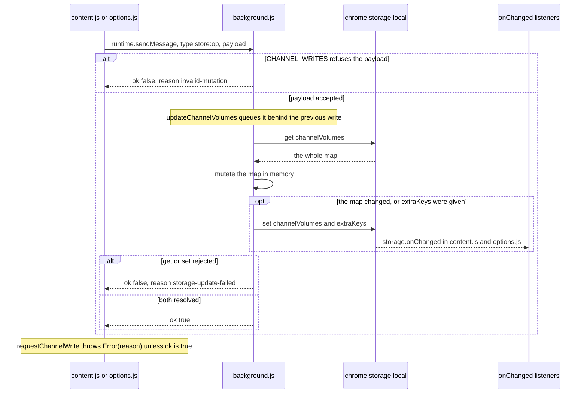

- `content.js` sends through `requestChannelWrite`, which resolves without sending when the extension context is no longer valid (`isContextValid()` is false). `saveChannelGain` and `saveChannelAutoApply` return without sending when there is no channel id, and the other senders of a channel write check for one before they send, so apart from `migrateLegacyGains` every write `content.js` sends names a channel.
- `CHANNEL_WRITES.saveChannelGain`, `saveChannelAutoApply` and `adoptHandleEntry` throw `WriteRefused` (`core/common.js`) before the map is read when the channel id is not in the UC form, `url` is present and not text, `gain` is not a finite number within 0 to 6 (`isStorableGain`), or `authorName` is not text. A `name` that is no text, is empty or is the channel id is not taken (`applyEntryName` in `core/common.js`), and a row with no name takes the id. `deleteChannel` takes any key that is non-empty text (`isRowKey` in `core/common.js`) and refuses any other.
- `updateChannelVolumes` keeps the writes of the worker on one promise chain (`channelVolumesWrite`), so one write's `get` and `set` do not interleave with another's. A failed write does not stop the chain. When the map is unchanged after `mutate` and no `extraKeys` were given, nothing is set.
- The path has no debounce and no throttle. Each request is one queued read-modify-write.

What each operation writes:

| Operation | Sent by | What it writes |
|---|---|---|
| `saveChannelGain` | `content.js` | `name` / `url` (`applyChannelIdentity`), the type's gain, the type's `gain*Plain` mark set or removed (`heldAgainstPlain`), and the type's Auto flag when `autoApply` is given |
| `saveChannelAutoApply` | `content.js` | `name` / `url` and the type's Auto flag |
| `adoptHandleEntry` | `content.js` | Where the UC key has no entry and an `@handle` key holds an entry whose `name` equals `authorName`: that entry, with the new `url`, under the UC key, and the `@handle` key removed |
| `deleteChannel` | `options.js` | The key removed |
| `clearChannels` | `options.js` | Every key removed |
| `migrateLegacyGains` | `content.js`, `options.js` | The legacy fold (see "Startup: the legacy fold and the first apply"). The worker answers it once its move of the settings to sync has settled |
| `saveSetting` | `options.js` | One field of `autoLoudnessSettings` in sync (see "Options page: settings"). It is queued with the move of the settings (`queueSettingsWrite`), not with the channel writes |

`applyChannelIdentity` replaces `name` when a name is given and differs from the channel id; otherwise it keeps the stored name, or stores the channel id where the entry has none. It replaces `url` when one is given.

Drawn from: `content.js` `requestChannelWrite`, `saveChannelGain`, `saveManualChannelGain`, `saveLiveChannelGain`, `saveChannelAutoApply`; `background.js` `chrome.runtime.onMessage` listener; `utils.js` `CHANNEL_WRITES`, `checkChannelIdentity`, `updateChannelVolumes`, `applyChannelIdentity`, `setChannelGain`, `setChannelAutoApply`.

## Applying the preferred gain: `applyPreferredGain`

Most scenarios below end in this function. It reads the channel's entry, decides the gain, and performs Auto's own save where Auto is on with a known level.

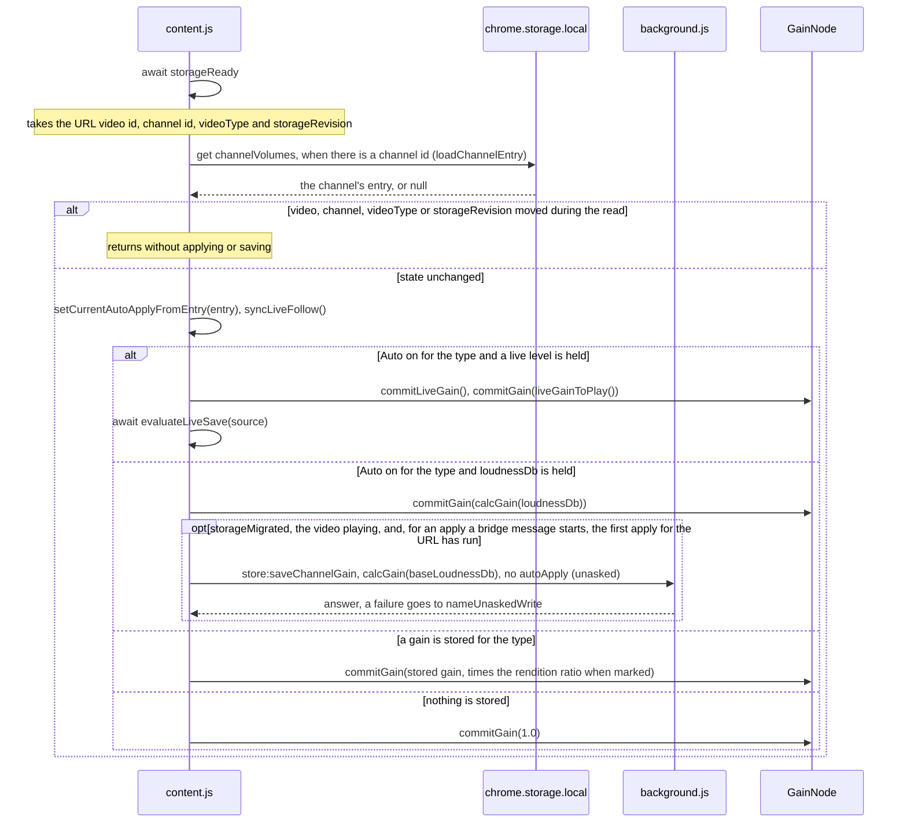

- The read is dropped when anything it was taken for has moved: another navigation, a bridge answer that changed the channel or the type, or a change notification (`storageRevision` goes up on every `channelVolumes` or `autoLoudnessSettings` change notification, and when `unifiedGains` from another context is taken in).
- Auto's own save sends no `autoApply`, so the channel keeps following the all-channel default. It sends `heldAgainstPlain: true` when `baseLoudnessDb` is known. A save whose map comes out unchanged is not set by the worker (see "Common path of a channel write").
- Nothing is saved before the legacy fold has landed (`storageMigrated` false), nor by a tab whose `<video>` is paused or muted (`isVideoPlaying()`; a volume of 0 or a gain of 0 still counts as playing). An apply a bridge message starts (`fromMessage`) saves nothing either before the first apply after a change of URL has run for the URL's video (`appliedVideoId`). The gain is still applied.
- `setCurrentAutoApplyFromEntry` also takes the entry's live gain (`storedLiveGain`), which the start cap is measured from.
- While a slider preview holds (see "Popup: slider drag (`input`)"), the gain in the diagram is held back rather than committed, and the rest runs.
- When the entry read rejects or the audio chain cannot be built, the apply stops there. Each caller that starts it without waiting for it (the bridge message, the retry after a navigation, and the `autoLoudnessSettings` and `unifiedGains` change notifications) logs the failure with `reportFailure('apply failed')`, as `triggerApply` does for the navigation's own apply.

Drawn from: `content.js` `applyPreferredGain`, `loadChannelEntry`, `setCurrentAutoApplyFromEntry`, `resolveAutoApplyForType`, `commitLiveGain`, `liveGainToPlay`, `storedGainToPlaying`, `calcStoredGainFromLoudness`, `calcGainFromLiveLevel`, `evaluateLiveSave`, `nameUnaskedWrite`; `utils.js` `getChannelGain`, `isGainHeldAgainstPlain`, `renditionGainRatio`, `calcGain`, `calcLiveGain`.

## Popup: slider drag (`input`)

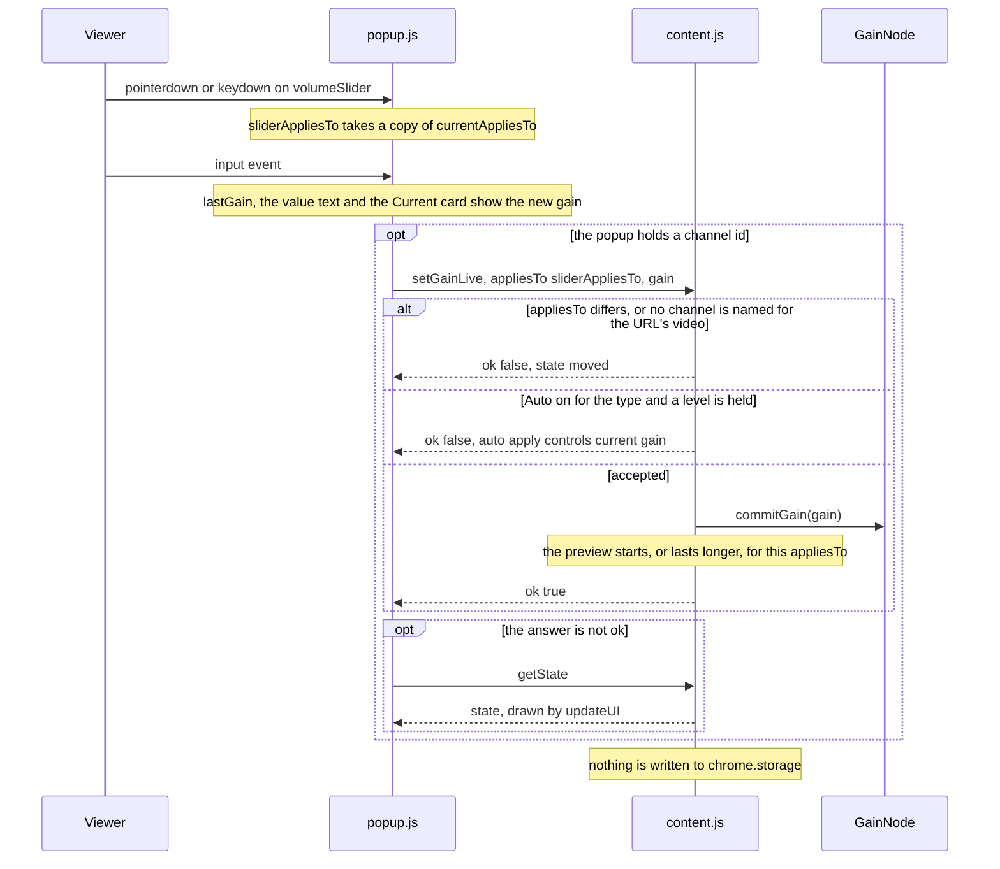

- An `input` that arrives with no `pointerdown` or `keydown` before it takes the copy of `currentAppliesTo` itself. Every `input` of one drag carries that same copy.
- "Manual Volume" (the slider and the presets) is disabled in the popup while Auto is on for the type and a Loudness is shown, and `content.js` refuses the same state.
- Each `input` event sends one `setGainLive`. There is no debounce.
- While a preview lasts and `currentGestureState()` still equals its `appliesTo`, a gain from anywhere else is held back rather than applied: `applyPreferredGain`, `applyAutomaticLoudnessGain` and the `channelVolumes` change listener commit through `commitGainFromElsewhere`, and a live gain through `commitLiveGain`, which leave the gain as it is and set it again on the element the page plays now, so a player rebuilt under the preview is connected at the preview's gain. `commitLiveGain` returns before working a live gain out, so a bridge message leaves `liveRaiseFrom` where it was; the listener works one out with `liveGainToPlay` and holds it back, so another tab's write moves `liveRaiseFrom` on from the gain the preview plays. What else they do (the state they take in, Auto's own save, the live save decision) goes on. A preview whose state has moved holds nothing back.
- While the pointer stays held on the slider after a preview the popup has not saved, the popup sends that preview again every `PREVIEW_KEEP_ALIVE_MS` (1000 ms, `keepPreviewAlive`), and each one the tab accepts starts its wait again. The sending stops when the pointer is let go of, when the preview is saved, and with the popup closed.
- The preview ends when `setGain` arrives (see the next section), or when `PREVIEW_IDLE_MS` (2000 ms) pass after the last accepted `setGainLive`. Ended that way, `applyPreferredGain()` applies what storage holds then, and the popup is notified.

Drawn from: `popup.js` `beginSliderGesture`, the `volumeSlider` `input` listener, `keepPreviewAlive`, `sendManualGain`, `refreshDisplay`; `content.js` `handleMessage` (`setGainLive`), `currentGestureState`, `isCurrentManualGainLocked`, `commitGain`, `startPreview`, `endPreview`, `endIdlePreview`, `commitGainFromElsewhere`.

## Popup: slider release (`change`) and preset buttons

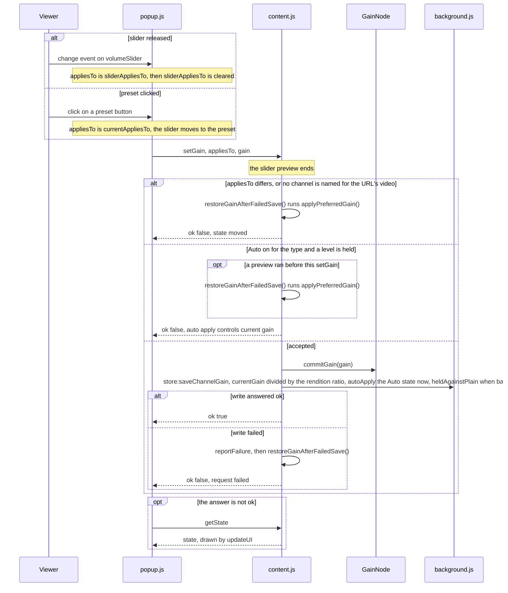

- The preset buttons are "0%", "50%", "100%", "200%", "400%" and "MAX" (`data-vol` 600). The popup sends nothing when it holds no channel id.
- A key held on the slider is one gesture, made of the keys that move the value (`createSliderKeys` in `core/common.js`: the arrow keys, PageUp / PageDown, Home / End); any other key (Tab, a modifier) leaves the gesture as it is. The `keydown` of such a key begins it (a repeat, a second such key while one is held, or the held key pressed again, does not begin another), each `input` sends `setGainLive`, the `change` that comes with each repeat sends nothing, and the `keyup` of the last such key held sends one `setGain` with the gain reached, where an `input` came during the hold. While the key is held after an unsaved preview, the popup sends that preview again every `PREVIEW_KEEP_ALIVE_MS` as it does for a held pointer (see the previous section).
- When the popup's window or the slider loses focus (`blur`) while the pointer or a key is held on the slider, the gesture ends there: a `change` that comes before that `blur` saves as a release does, a key hold sends its `setGain` at the `blur`, and after it `input` and `change` send nothing until the next `pointerdown`, or a `keydown` that is not a key repeat, on the slider; such a `change` puts the thumb back to the gain saved at the `blur` (`lastGain`).
- The stored value is the applied gain (after `commitGain` clamped it) divided by the rendition ratio, so it is held against the plain rendition. Where neither level is known, the ratio is 1 and `heldAgainstPlain` is false.
- `autoApply` is the Auto state of the type at that moment, written as the channel's own flag. Since the lock refuses Auto on with a level, a save with Auto on is one made where no level is held (the gain Auto falls back to), and it pins Auto on for the channel.
- `restoreGainAfterFailedSave()` ends a preview still running and runs `applyPreferredGain()`, so the gain goes back to whatever that function resolves from storage. The popup is answered after it.

Drawn from: `popup.js` the `volumeSlider` `change` listener, the preset `click` listeners, `sendManualGain`; `content.js` `handleMessage` (`setGain`), `fillCurrentChannelNameFromDomFallback`, `playingGainToStored`, `saveManualChannelGain`, `restoreGainAfterFailedSave`.

## Popup: "Apply to channel"

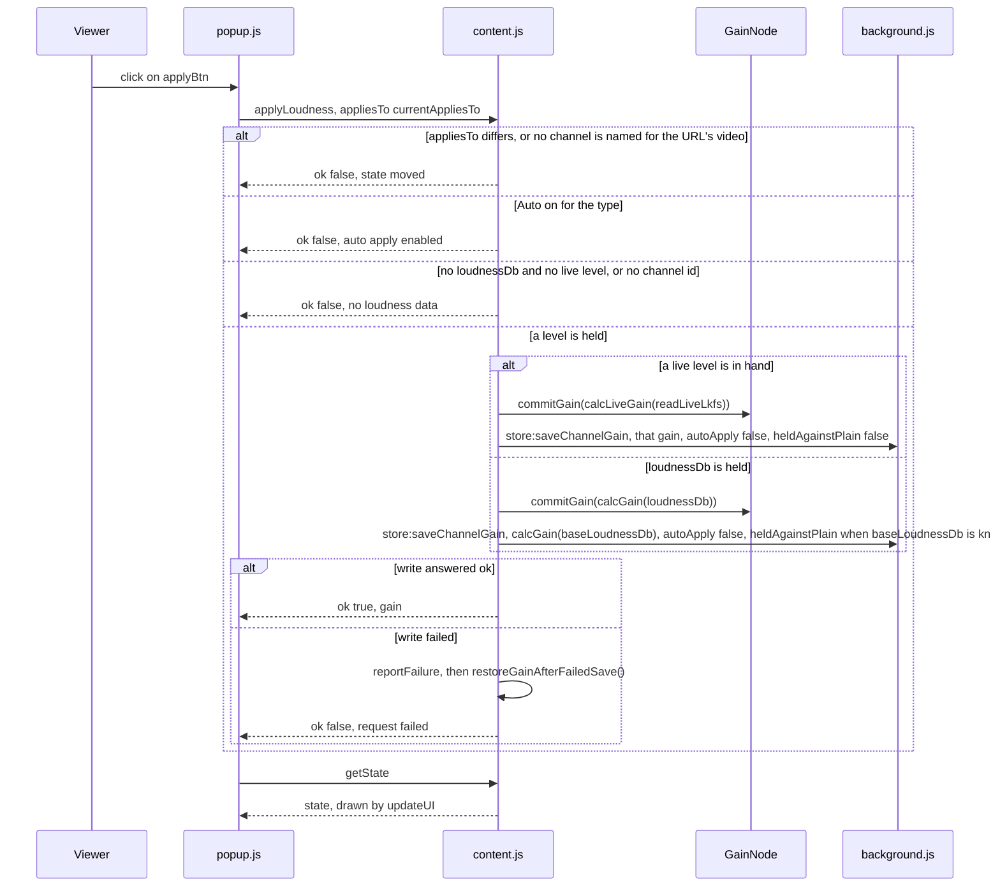

- The button is enabled where Auto is off for the type, a Loudness is shown and a channel is detected. Its label is `applyToChannelWithValue` ("Apply $VALUE$ to channel") with the suggested gain, followed by the type label in parentheses.
- `autoApply` is the Auto state at that moment, which is off because the handler has refused Auto on before this point. The channel's flag for the type is written as `false`, so the channel stops following the all-channel default for that type.
- The live level in hand (`readLiveLkfs`) goes before `loudnessDb`. Its gain is stored as played, without the mark.
- Whatever the answer, the popup asks `getState` and redraws.

Drawn from: `popup.js` `updateApplyBtn`, the `applyBtn` `click` listener; `content.js` `handleMessage` (`applyLoudness`), `calcGainFromLiveLevel`, `calcGainFromLoudness`, `calcStoredGainFromLoudness`, `saveLiveChannelGain`, `saveManualChannelGain`, `restoreGainAfterFailedSave`.

## Popup: "Auto-apply LUFS" toggle

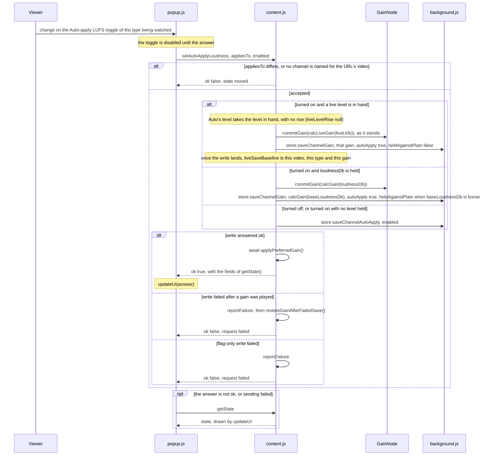

- The popup shows the toggle of the type being watched and sends only for that type and only with a channel id.
- Turned on with a level known, the gain Auto plays is applied at once and stored with the flag in one write. Turned off, or turned on with no level, only the flag is written and the stored gain is left as it is.
- The handler does not set `currentAutoApplyLoudnessVideo` / `currentAutoApplyLoudnessLive` itself. `applyPreferredGain()` after the write and the `chrome.storage.onChanged` listener resolve them from the stored entry. When the write's change notification arrives while that `applyPreferredGain()` is reading, `storageRevision` has moved and that apply returns without applying; by then the listener has resolved Auto from the new entry and set the gain it computes (see "Other tabs: `chrome.storage.onChanged` in `content.js`").
- After the live write, `liveSaveBaseline` makes the next `evaluateLiveSave` for the same video and type compare against this gain rather than store it again. The gain plays as it stands; the `applyPreferredGain()` that follows plays the level through `liveGainToPlay`, which sets `liveRaiseFrom`, so the follows after it are limited from there.
- When `getState` also fails, the popup puts the toggle back from the state it last drew.

Drawn from: `popup.js` `handleAutoApplyChange`, `resyncFromContent`; `content.js` `handleMessage` (`setAutoApplyLoudness`), `saveLiveChannelGain`, `saveChannelGain`, `saveChannelAutoApply`, `applyPreferredGain`, `restoreGainAfterFailedSave`.

## Popup open: `forceDetect`

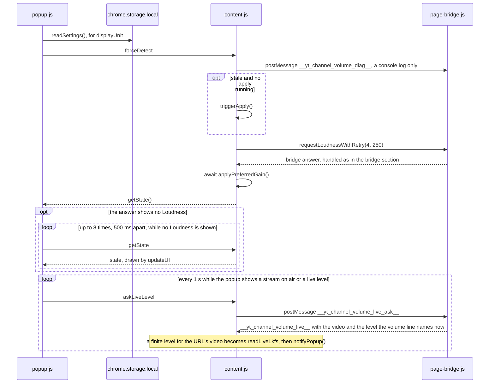

- Stale means there is no channel id, or the URL's video id differs from `_lastVideoId`. `triggerApply()` is described in "SPA navigation and the other apply triggers".
- `requestLoudnessWithRetry(4, 250)` posts a request and resolves at the next bridge message. When 250 ms pass without one, it resolves if a level is held and otherwise asks again, 4 times at most.
- The popup's own reads (`getState`, `retryGetState`, `askLiveLevel`) write nothing. A live level read for the popup becomes the level in hand only: Auto's level, and what Auto plays and stores, wait for the bridge's full answer. The saves on this path are those of `triggerApply()`, of the bridge answer's handling and of `applyPreferredGain()`.
- A failure answers `{ ok: false, reason: 'request failed' }` after `reportFailure('forceDetect failed')`.

Drawn from: `popup.js` `init`, `retryGetState`, `askLiveLevelLater`; `page-bridge.js` the `__yt_channel_volume_live_ask__` listener; `content.js` `handleMessage` (`forceDetect`, `askLiveLevel`), the `__yt_channel_volume_live__` listener, `sendDetectedState`, `requestLoudnessWithRetry`, `triggerApply`, `applyPreferredGain`, `getState`.

## Loudness from `page-bridge.js`

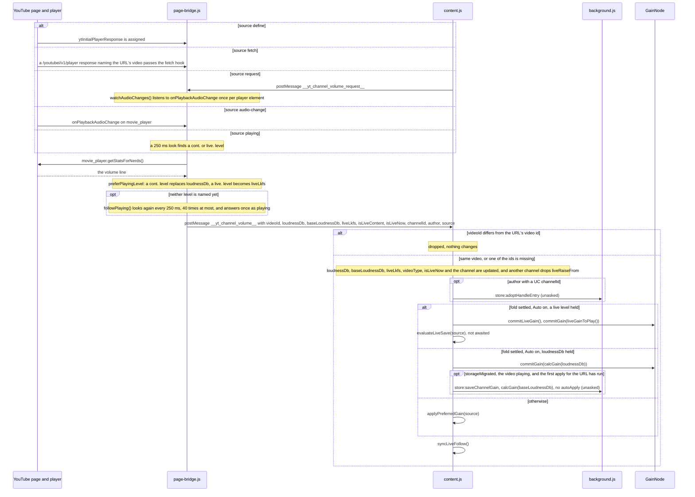

The bridge posts under these conditions:

- `define`: on a watch page (`/watch`, a path under `/live/`, or a channel's live URL whose canonical link names a stream), when the response's `videoDetails.videoId` is the URL's video or either is missing (`isCurrentVideo`).
- `fetch`: on a watch page, when the response carries a `videoDetails.videoId` and it is the URL's video (where the URL names none, whichever it is). A response with no video id there, such as the one from `/youtubei/v1/player/ad_break`, is not posted.
- `request`: whenever `content.js` asks. The answer is taken from the response kept from load when it names the URL's video; where that gives neither a level nor a channel id, from the first of the page's responses (`ytd-watch-flexy`, then `movie_player.getPlayerResponse()`). `isLiveNow` comes from the newest of those that names the URL's video. Where none of them names the URL's video, the answer carries `isLiveContent: null`, which `content.js` does not take, so the tab keeps the type it holds.
- `audio-change`: on a watch page, each time the player fires `onPlaybackAudioChange`.
- `playing`: the first look that finds a `cont.` or `live.` level in the volume line.

`content.js` takes the message as follows:

- A message for another video is dropped before anything changes (`isBridgeMessageForCurrentVideo`).
- Each field is taken only in the type the bridge sends: `loudnessDb` and `liveLkfs` as finite numbers, `baseLoudnessDb` as a number, `isLiveContent` as a boolean, `author` as text, `channelId` in the UC form.
- For a new video id, `loudnessDb` and `baseLoudnessDb` are set from the message, `null` where it carries none. For the same video they are replaced only when the message carries a finite `loudnessDb`. `liveLkfs` is replaced by every message, so a message without one takes it away; the level in hand (`readLiveLkfs`) is set to it as well. A message with a live level keeps it as `liveLevelBefore` for the video, and how far it rose over the one kept before for the same video, to 0.1 dB, as `liveLevelRise` (null for a message with no live level or for another video). A message without one sets `liveRaiseFrom`'s `at` to null.
- The channel is taken when the message carries a finite `loudnessDb` or a boolean `isLiveContent`, with a UC `channelId`. When the id changes, both Auto states are set to off until `applyPreferredGain()` resolves them from storage, `liveRaiseFrom` is dropped, and the name comes from `author`, then the page, then the id.
- `applyAutomaticLoudnessGain` returns false while the legacy fold has not finished (`storageSettled` false), and the message goes to `applyPreferredGain()`, which waits for it.
- While a slider preview holds (see "Popup: slider drag (`input`)"), the gains in the diagram are held back rather than committed.
- When applying Auto's gain throws, the listener logs it with `reportFailure('apply failed')`, and `syncLiveFollow()` and the loudness waiters run after it as they do otherwise.
- A re-arrival (rendition change, the player naming its level, the live follow) goes through the same steps. With Auto on and the same `baseLoudnessDb`, Auto's save carries the same gain and mark, and where the name and url are unchanged as well the worker sets nothing. With Auto off, the stored gain is played again with the new rendition ratio, and nothing is saved.

Drawn from: `page-bridge.js` the `ytInitialPlayerResponse` setter, the `window.fetch` wrapper, the request listener, `watchAudioChanges`, `answerCurrentVideo`, `preferPlayingLevel`, `playingLevel`, `followPlaying`, `postResult`; `content.js` the `message` listener, `isBridgeMessageForCurrentVideo`, `applyAutomaticLoudnessGain`, `applyPreferredGain`, `syncLiveFollow`.

## Live stream: follow timer and live save decision

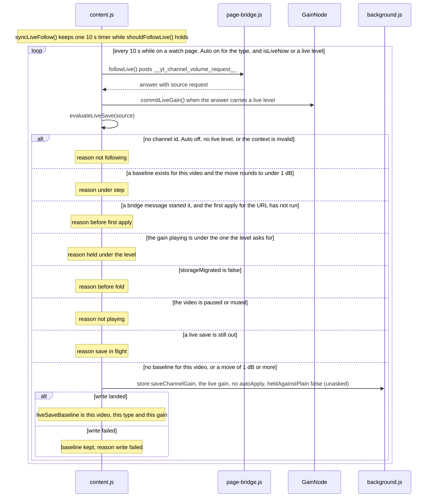

- `shouldFollowLive()` is true on a watch page with Auto on for the type being watched and either `isLiveNow` or a live level held. `syncLiveFollow()` clears the timer when it is false and starts one when none is running. It runs after every bridge message, inside `applyPreferredGain`, in the `channelVolumes` change listener, on `yt-navigate-finish`, `popstate` and `visibilitychange`, and in `followLive` itself.
- The answer goes through the bridge message handler like any other. The diagram shows its live branch; without a live level the other branches of that handler run.
- `evaluateLiveSave` also runs from `applyPreferredGain` whenever Auto is on with a live level, so a navigation apply, a settings change and the apply after the Auto toggle reach the same decision.
- The move is `gainChangeDb(gain, baseline.gain)` rounded to 0.1 dB. A gain that is not a positive finite number counts as an infinite move.
- `liveSaveBaseline` belongs to one video id and one type: `evaluateLiveSave` compares against it only when both match, since each type stores into a slot of its own. `applyVideoVolume` clears it when the video id changes, and the Auto toggle sets it when its live write lands.
- The live save sends no `autoApply`, so it is Auto's own save and leaves the channel following the all-channel default. It is stored without the mark and plays as stored.
- Like Auto's own save, it is made only by a tab whose `<video>` is neither paused nor muted (`isVideoPlaying()`); a volume of 0 or a gain of 0 still counts as playing. A decision of `not playing` leaves the baseline where it was, so the next evaluation in a tab that plays tries again.
- The gain weighed and stored is the one the level asks for (`calcLiveGain(liveLkfs)`), not the one `liveGainToPlay` lets play. While the gain playing is under it (the start cap, the rise cut or the raise limit holding it), nothing is stored (`held under the level`) and the follow goes on; once the gain playing reaches it, it is stored. The manual controls stay locked as while any level is applied, and the popup's Current shows the gain playing beside Suggested, the gain the level asks for.

Drawn from: `content.js` `shouldFollowLive`, `syncLiveFollow`, `followLive`, `requestLoudness`, `applyAutomaticLoudnessGain`, `commitLiveGain`, `liveGainToPlay`, `evaluateLiveSave`, `saveLiveChannelGain`; `utils.js` `gainChangeDb`, `calcLiveGain`.

## SPA navigation and the other apply triggers

YouTube is an SPA (Single-Page Application): moving to another video or channel changes the URL and the page content without loading a new page, so `content.js` keeps running.

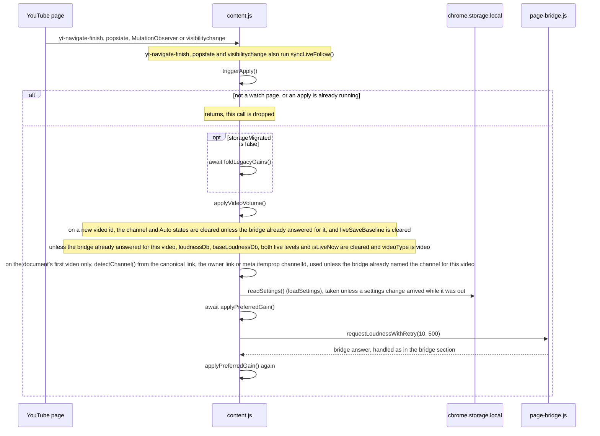

- The triggers: `yt-navigate-finish` on `document`; `popstate` on `window`; a `MutationObserver` on the document, which on a watch page calls `triggerApply()` when the page's `<video>` element is a different one from the last processed, or the URL's video id differs from `_lastVideoId`; `visibilitychange`, which calls `triggerApply()` when the tab becomes visible on a watch page before any video was processed. The first load is described in the next section. Apart from these, a `play` of the page's `<video>` runs `applyPreferredGain('play')` alone, so a tab whose video starts playing after its applies makes Auto's own save or the live save then.
- `triggerApply()` uses `_applyRunning` as a lock. A call that arrives while an apply runs returns at once and is not queued. There is no debounce. When the extension context is invalid, it disconnects the observer.
- `detectChannel()` returns a UC id only, and it is asked for the document's first video alone (`_lastVideoId` empty when the apply begins). After a navigation the page can still name the channel of the video left, so the channel stays empty until the bridge names it for the video, and so it does where the page carries no UC id. With no channel id, `applyPreferredGain()` reads no entry: it plays the Auto gain where the all-channel default is on with a level held, 1.0 otherwise, and saves nothing.
- When the navigation cleared the bridge state, videoType is `'video'` until the bridge sends `isLiveContent`, so on a live stream the gain stored for videos is applied first.
- `requestLoudnessWithRetry(10, 500)` resolves at the next bridge message. When 500 ms pass without one, it resolves if a level is held and otherwise asks again, 10 times at most. The bridge answer applies on its own (see the bridge section), and `applyPreferredGain()` runs once more after it.
- Saves on this path are Auto's own save and the live save inside `applyPreferredGain()`. Once the first `applyPreferredGain()` of `applyVideoVolume` has run, the video goes into `appliedVideoId`. Until then a bridge message makes neither save for the URL's video, so one that lands before that apply, with the channel of the page the tab left still in hand, stores nothing. A settings change and the popup's opening store as before.
- A failure in `applyVideoVolume` is logged by `reportFailure('apply failed')`.

Drawn from: `content.js` the `yt-navigate-finish`, `popstate` and `visibilitychange` listeners, the `MutationObserver` callback, `triggerApply`, `applyVideoVolume`, `detectChannel`, `loadSettings`, `requestLoudnessWithRetry`, `applyPreferredGain`.

## Startup: the legacy fold and the first apply

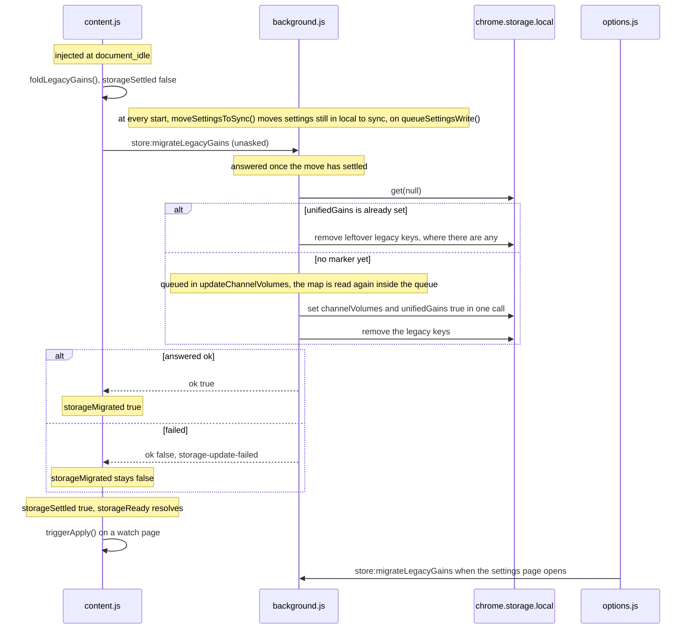

- What the fold writes into `channelVolumes`: for each type that held a gain and no Auto flag in the map as read before the queue, and has gained no flag since, an explicit `false` flag (the old rule, "a saved gain means Auto is off"); then, for each type that resolves to Auto on and whose gain did not change since that read, the gain learned under a legacy key, stored without the mark. `unifiedGains: true` goes in the same `set`, which always runs because `extraKeys` is given.
- `clearLegacyKeys` logs its own failure and does not fail the fold. The fold reads the all-channel defaults through `readSettings()`.
- `moveSettingsToSync` writes local's settings to sync where sync holds none (sync's stay otherwise), then removes them from local. Sync is written before local is cleared, so a reader finds one of the two.
- While `storageMigrated` is false: Auto is resolved under the old rule, Auto's own save and the live save are skipped while the gain is still applied, and every `triggerApply()` tries the fold again (`foldInFlight` keeps one attempt at a time).
- `storageMigrated` also becomes true when `unifiedGains` arrives through `chrome.storage.onChanged` from another context (see the next section).
- When the extension context is invalid at injection, no fold is asked for; `triggerApply()` is called on a watch page and returns at once, disconnecting the observer.
- The settings page asks for the fold when it opens and then reads both keys (`loadAll`). A failure is logged, and the list is drawn under the old rule until `unifiedGains` arrives.

Drawn from: `content.js` the startup block, `foldLegacyGains`, `triggerApply`; `background.js` the start; `utils.js` `migrateLegacyAutoGains`, `clearLegacyKeys`, `resolveAutoApplySetting`, `queueSettingsWrite`; `core/common.js` `readSettings`, `moveSettingsToSync`; `options.js` the startup chain.

## Other tabs: `chrome.storage.onChanged` in `content.js`

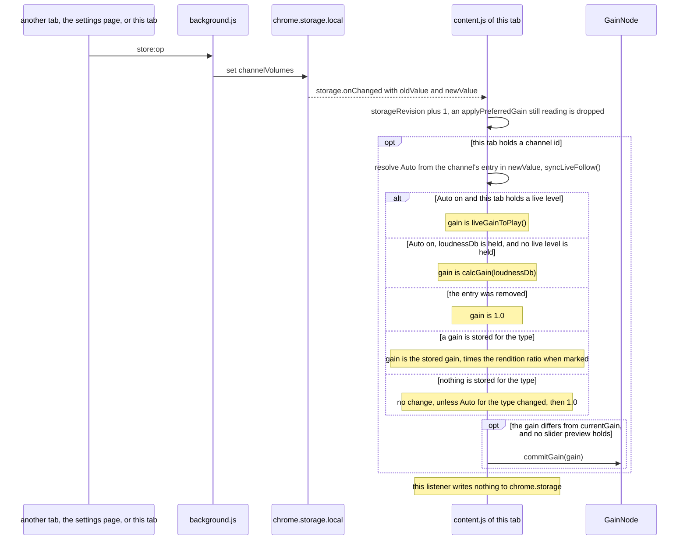

- The listener does not tell this tab's own writes from other contexts' writes. A notification for a write this tab asked for lands here too, and the applied gain does not change when the computed gain equals `currentGain`.
- With Auto on, this tab's own live level or `loudnessDb` goes before the gain another tab stored.
- The same listener handles two more keys:
  - `unifiedGains` becoming `true` while `storageMigrated` is false: sets `storageMigrated` and `storageSettled`, and runs `applyPreferredGain()` when the same notification carries no `channelVolumes` change.
  - `autoLoudnessSettings` arrives in a `chrome.storage.sync` notification (see "Options page: settings"). The key leaving local when the worker moves it is not a settings change, and the local listener does not take it.

Drawn from: `content.js` the `chrome.storage.onChanged` listener, `resolveAutoApplyForType`, `setCurrentAutoApplyFromEntry`, `storedGainToPlaying`, `commitGain`.

## Options page: settings

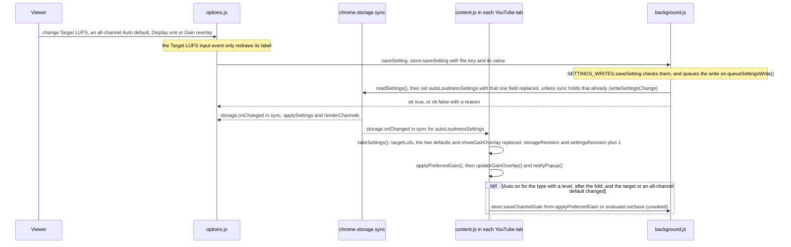

- The controls: "Target LUFS" (`change` of the slider), "Auto-apply LUFS for all channels" (Video and Live toggles), "Display unit" (`%` / `dB` buttons) and "Gain overlay". Each change calls `saveSetting` with one field. A key held on "Target LUFS" — the keys that move the value alone, as on the popup's slider — changes only its label: the `change` that comes with each repeat writes nothing, and the target is written once, at the `keyup` of the last such key held, or at a `blur` of the slider or of the page's window that comes first; a press of the pointer during the hold leaves the hold and the key's value to that `keyup`. A drag on it ends where the slider or the page's window loses focus during it: Chrome fires `change` at that blur, ahead of the blur, and that change writes. After a blur that ends a drag or a key hold, `input` and `change` belong to no gesture until the next `pointerdown`, or a `keydown` that is not a repeat: the label does not move, nothing is written, and the `change` puts the slider back to the target. A click on the unit button already active writes nothing.
- `saveSetting` returns without writing until the first read has finished (`settingsLoaded`), and the controls are disabled in the markup until then. It sends the key and its value to `background.js` as `store:saveSetting`. There `SETTINGS_WRITES.saveSetting` refuses a key that is not one of the five and a value the key cannot hold (`invalid-mutation`), and writes the settings, read through `readSettings()`, back to sync with the key replaced, on `queueSettingsWrite()`, the queue the move of the settings to sync runs on.
- Where Chrome sync is on, settings that another Chrome signed in to the same account writes arrive the same way, as a `chrome.storage.sync` notification ([`chrome.storage`](https://developer.chrome.com/docs/extensions/reference/api/storage)).
- While a key or the pointer is held on the Target LUFS slider, a settings notification (`applySettings`) sets the target the page holds and leaves the slider and its label on the value the gesture moved to, which the gesture's end writes: the notification of one press, landing while the next is held, does not take back the second press. A gesture that writes nothing at its end draws the target there instead (`drawTarget`): a key that moved nothing (at the end of the range), a drag let go of on the value it began on (Chrome fires no `change` for it, whether it moved or not), and a press that a blur ends.
- The two default toggles are disabled while their write is out, and the table follows a toggle once its write has landed. Every control waits for its write. When it fails, the page reads the settings again through `readSettings()` and shows what it holds (unless a change notification arrived meanwhile), and the line under the settings shows `settingsSaveFailed` ("Could not save the setting. The saved value was restored."). Where that read fails as well, nothing is put back, and the line shows `settingsLoadFailed` ("Could not load the saved settings. Please reload the page.") instead. A write of any of them that lands takes the line down.
- No control on this page writes `channelVolumes`. In each YouTube tab, `applyPreferredGain()` applies the new target and the new defaults: where Auto is on for the type with a known level, it applies the new Auto gain, and stores it (Auto's own save, or the live save decision) when the change moved the target or an all-channel default as this tab held them. A change of the display unit or the gain overlay applies the gain again and stores nothing (`stores: false`). Where Auto is off or no level is known, the stored gain plays as before. When a change notification lands while that apply reads the entry, the apply returns having applied and stored nothing (`STORAGE_MOVED`), and the listener runs it once more.
- A change of an all-channel default changes Auto only for channels without their own flag (or the legacy flag) for that type.

Drawn from: `options.js` the `targetSlider`, `defaultAutoVideoToggle`, `defaultAutoLiveToggle`, `unitToggle` and `overlayToggle` listeners, `saveSetting`, `applySettings`, the `chrome.storage.onChanged` listener; `utils.js` `SETTINGS_WRITES`, `SETTING_FIELDS`, `queueSettingsWrite`; `core/common.js` `readSettings`, `settingCheck`, `writeSettingsChange`; `content.js` the `chrome.storage.onChanged` listener, `takeSettings`, `applyPreferredGain`, `updateGainOverlay`.

## Options page: deleting a row and clearing all

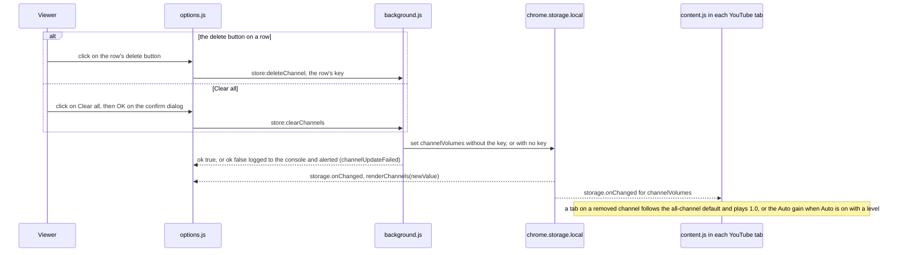

- The delete button is the "×" on a row (title "Delete"). "Clear all" asks "Delete all saved channels?" first.
- `deleteChannel` takes the key as it is listed, so an `@handle` key can be deleted too.
- The list is redrawn only from the change notification; a failure leaves it as it was, logs `[YTCV] channel not deleted` / `[YTCV] channels not cleared`, and says so in an alert (`channelUpdateFailed`).
- The `content.js` listener writes nothing back. The next apply in a tab on that channel (a bridge answer, a navigation) stores Auto's gain again when Auto is on with a level.

Drawn from: `options.js` `renderChannels` (the `.ch-del` click listener), the `clearAllBtn` listener, `requestChannelWrite`; `utils.js` `CHANNEL_WRITES.deleteChannel`, `CHANNEL_WRITES.clearChannels`; `content.js` the `chrome.storage.onChanged` listener.

## Summary

| Event | Applied gain changes? | Saved to `chrome.storage`? | Where (function) |
|---|---|---|---|
| Popup slider `input` | Yes (preview) | No | `popup.js` `volumeSlider` `input` listener; `content.js` `handleMessage` (`setGainLive`), `commitGain` |
| Popup slider `change` (`keyup` for a key), preset button | Yes | Yes: `saveChannelGain` with the Auto state as the channel's flag | `handleMessage` (`setGain`), `saveManualChannelGain` |
| `setGain` refused as `state moved`, or after a preview as `auto apply controls current gain` | Back to what `applyPreferredGain` resolves | No | `restoreGainAfterFailedSave` |
| A gain from elsewhere while a slider preview holds | No, until the gesture ends | As the row of that event | `commitGainFromElsewhere` |
| A preview that ends with no `setGain` | Back to what `applyPreferredGain` resolves | As the bridge answer rows | `endIdlePreview` |
| "Apply to channel" with `loudnessDb` | Yes | Yes: `calcGain(baseLoudnessDb)`, flag `false`, mark when the base is known | `handleMessage` (`applyLoudness`), `saveManualChannelGain` |
| "Apply to channel" with a live level | Yes | Yes: the live gain, flag `false`, no mark | `handleMessage` (`applyLoudness`), `saveLiveChannelGain` |
| "Auto-apply LUFS" turned on with a level | Yes | Yes: the gain and flag `true` in one write | `handleMessage` (`setAutoApplyLoudness`) |
| "Auto-apply LUFS" turned off, or on with no level | Through `applyPreferredGain` after the write | Yes: the flag alone | `saveChannelAutoApply` |
| An asked write failed | Back to what `applyPreferredGain` resolves | No | `restoreGainAfterFailedSave` |
| Bridge answer, Auto on, live level | Yes | When `evaluateLiveSave` decides so | `applyAutomaticLoudnessGain`, `evaluateLiveSave` |
| Bridge answer, Auto on, `loudnessDb` | Yes | Yes after the fold, in a tab whose video is playing (an unchanged map is not set) | `applyAutomaticLoudnessGain`, `isVideoPlaying` |
| Bridge answer, Auto off or no level | Stored gain (times the ratio when marked) or 1.0 | No | `applyPreferredGain` |
| Live gain held under the level's by the start cap, the rise cut or the raise limit | Yes, to the gain `liveGainToPlay` allows | No (`held under the level`) | `liveGainToPlay`, `evaluateLiveSave` |
| Popup's live-level read (`askLiveLevel`, every 1 s) | No | No | `popup.js` `askLiveLevelLater`; `content.js` the `__yt_channel_volume_live__` listener |
| Bridge answer with `author` and a UC `channelId` | No | Only when an `@handle` entry with that name is adopted | `message` listener, `CHANNEL_WRITES.adoptHandleEntry` |
| Rendition change (`audio-change`), level named (`playing`) | As the bridge answer rows | As the bridge answer rows | `watchAudioChanges`, `followPlaying` |
| Live follow timer (10 s) | As the bridge answer rows | As the bridge answer rows | `syncLiveFollow`, `followLive` |
| SPA navigation, observer, `visibilitychange` | Yes | Auto's own save or the live save, with Auto on and a level, after the fold | `triggerApply`, `applyVideoVolume`, `applyPreferredGain` |
| `play` of the page's `<video>` | Through `applyPreferredGain` | Auto's own save or the live save, with Auto on and a level, in a tab that is not muted | the `play` listener, `applyPreferredGain` |
| Popup open | Through `applyPreferredGain` | As SPA navigation | `handleMessage` (`forceDetect`) |
| Startup, settings page open | No | `channelVolumes` and `unifiedGains`, when the marker is absent | `foldLegacyGains`, `migrateLegacyAutoGains` |
| Worker start | No | Settings still in local, moved to sync | `moveSettingsToSync` |
| Auto apply before the fold has landed | Yes | No | `applyAutomaticLoudnessGain`, `applyPreferredGain`, `evaluateLiveSave` |
| `channelVolumes` change notification | When the computed gain differs | No | `content.js` `chrome.storage.onChanged` listener |
| `autoLoudnessSettings` change | Through `applyPreferredGain` | `autoLoudnessSettings` in sync by `background.js` for `options.js`, and Auto's own save in tabs with Auto on and a level, when the target or an all-channel default changed | `saveSetting`, `SETTINGS_WRITES.saveSetting`, `content.js` `chrome.storage.onChanged` listener |
| `unifiedGains` arriving from another context | Through `applyPreferredGain` | Auto's own save, with Auto on and a level | `content.js` `chrome.storage.onChanged` listener |
| Settings page "×" on a row, "Clear all" | Tabs on the channel: 1.0, or the Auto gain | Yes: `deleteChannel` / `clearChannels` | `renderChannels`, the `clearAllBtn` listener |

## Measured browser and site behaviour

The code does not decide the behaviour below. It was measured on 2026-10-25 with Chrome 156.0.8078.47 on macOS, in new profiles that were not signed in, headless (`--headless=new`) unless the item says headed. The Chrome items ran test pages and probe extensions built in the shape of this repository's code. The YouTube items ran a copy of this extension with logging added and no other change.

- **A write of unchanged values** (see "Options page: settings" and "Other tabs: `chrome.storage.onChanged` in `content.js`"): a `chrome.storage.local.set` whose values equal the stored ones fired no `onChanged` in the writing context, in an extension page or in a content script (0 of 10 per case, where a write that changed a value fired 10 of 10). A `set` of one changed key and one unchanged key listed only the changed key in `changes`.
- **The change notice and the answer of one channel write** (see "Common path of a channel write"): with this repository's `background.js`, `onChanged` reached the content script before the answer to its `sendMessage` in 200 of 200 writes. The answer came 0.1 ms later at the median and 0.8 ms later at most.
- **Keyboard on the popup slider** (see "Popup: slider release (`change`) and preset buttons"): on a range input with the slider's `min="0" max="600" step="5"`, a key press that moved the value fired one `input` and one `change` (an arrow key moves 5, PageUp / PageDown 60), and a press at either end fired neither. A held key fired one `change` for each repeat that moved the value. A mouse drag with 10 moves fired 10 `input` and 1 `change`. The popup sends one `setGainLive` for each `input`, and one `setGain` with its save at the `change` that ends a drag, or at the `keyup` that ends a press or a hold.
- **A drag on Target LUFS that loses focus** (see "Options page: settings"): headed, 2026-10-30, Chrome 156.0.8078.76, with CDP mouse input (`Input.dispatchMouseEvent`) on the settings page. A drag during which the window lost focus fired its `input`s, then `change` at the value then, then the slider's `blur` and the window's `blur`; no `input` came after the blur and no `change` at the release, whether focus stayed away or came back (3 of 3 each). It wrote once, at the value it had at the blur. A real mouse held through an application switch was not driven.
- **The live follow timer in a hidden tab** (see "Live stream: follow timer and live save decision"): a chained 30000 ms `setTimeout`, in the shape of the live follow timer, fired every 30.0 s in a visible tab and in a hidden tab playing sound (26 of 26 intervals at 30000–30004 ms, headless and headed). In a hidden tab with no sound (a background tab, or a tab in a minimized window when headed) it fired about every 31 s until 216–217 s after the tab was hidden, then about every 60 s: from 278 s headless, and from 319–324 s headed after one interval of 42–48 s. The live follow timer's own interval, `LIVE_FOLLOW_INTERVAL_MS`, is 10000 ms. A chained 10000 ms `setTimeout` (headless, 2026-10-29, Chrome 156.0.8078.48) fired every 10.0 s in a visible tab and in a hidden tab playing sound (78 of 78 intervals at 10000–10003 ms); in a hidden tab with no sound it fired about every 10 s for its first 7 ticks (10091–11039 ms, to 76 s after the tab was hidden), and about every 60 s from 133 s on (59968–60027 ms).
- **Bridge answers on a fresh load** (see "Loudness from `page-bridge.js`" and "Startup: the legacy fold and the first apply"): over 6 fresh loads of ordinary videos, `content.js` registered its `message` listener 820–1232 ms after the load started, and an answer posted before that did not reach it: `define` 0 of 6, `playing` 0 of 3, `fetch` 12 of 18 (two loads lost all three, posted 13–107 ms before the listener). The `request` answers arrived 12 of 12.
- **`/youtubei/v1/player` on a fresh load** (see "Loudness from `page-bridge.js`"): the page's own script passes `window.fetch` `Request` objects whose own `url` property reads `/youtubei/v1/player`, while the request itself is a `data:application/json` URL (50 of 50 checked). The bridge's hook reads `args[0].url` and takes them as `/player` calls. They do not appear as network requests.
- **Answers on SPA navigation** (see "SPA navigation and the other apply triggers"): over 182 navigations made by clicking a related video, 180 made no `/youtubei/v1/player` call, and the 2 that did named a third video, so no `fetch` answer was posted for the video navigated to. The first apply, from the MutationObserver URL branch, had neither an early level nor an early channel in 182 of 182. The apply on `yt-navigate-finish` had an early level in 182 of 182 and an early channel in 151 of 182.
- **Live streams** (see "Live stream: follow timer and live save decision" and "Loudness from `page-bridge.js`"): the player response of a stream on air carried no `audioConfig.loudnessDb` in 17 of 17 loads (its `audioConfig` held `enablePerFormatLoudness`, `loudnessNormalizationConfig` and `loudnessTargetLkfs`), and ordinary videos carried it in 5 of 5. In the operator's signed-in Chrome with sound, the stats-for-nerds volume line named the stream's level as `live.` (`50%/50% (live.-17.0dB)`). In the headless runs, which were signed out and muted, it named neither `live.` nor `cont.` (0 of 837 reads over 8 streams, after their ads), while an ordinary video named `cont.` in 279 of 279.
